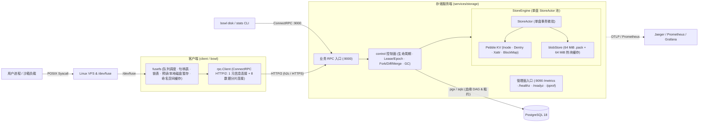

<div align="center">
  <br/>
  <a href="https://github.com/starsrc/Bowl">
    <picture>
      <source media="(prefers-color-scheme: dark)" srcset="./.github/media/logo-dark.png">
      
    </picture>
  </a>
  <br/>
  <br/>
  <h3>面向云原生沙箱与开发环境的远程 POSIX 虚拟磁盘系统</h3>
  <p>Linux FUSE 挂载 · WriterEpoch 单写者栅栏 · 盘级零拷贝 Fork / Diff / 三路 Merge</p>
  <p>
    <a href="LICENSE"><kbd>MIT License</kbd></a> &nbsp;·&nbsp;
    <a href="go.mod"><kbd>Go 1.26.5</kbd></a> &nbsp;·&nbsp;
    <a href="https://github.com/starsrc/Bowl/releases"><kbd>Pre-release（尚未发布可用版本）</kbd></a>
  </p>
  <p>
    <a href="#快速开始">快速开始</a> •
    <a href="#适用场景">适用场景</a> •
    <a href="#系统架构">系统架构</a> •
    <a href="docs/index.md">开发手册</a> •
    <a href="#交流讨论">交流群</a> •
    <a href="https://github.com/starsrc/Bowl/issues">提交 Issue</a>
  </p>
</div>

---

> [!WARNING]
> **项目尚未发布第一个可用版本（Pre-release / Early Development）**
>
> Bowl 目前处于早期活跃开发阶段，**尚未发布首个可用 Release**。在正式 `v0.1.0` 发布之前，Protobuf 契约、CLI 参数、PostgreSQL 表结构及 `.pack` / Pebble 磁盘存储格式仍可能发生不兼容演进。现阶段仅建议用于本地开发、测试评估与架构研究，**请勿用于生产环境**。

## 为什么选择 Bowl？

在 AI Agent 沙箱、CI 构建环境与多分支开发场景中，传统网络文件系统通常缺少版本分支能力，而通用对象存储又无法直接满足完整 POSIX 语义。Bowl 将**标准 Linux 文件系统挂载**与**类 Git 的盘级分支管理**结合在同一个系统中：

- **完整远程 POSIX 语义**：基于 `hanwen/go-fuse/v2` 与 `/dev/fuse` 暴露标准挂载点，支持常规随机读写、硬链接与符号链接、`rename2`（`RENAME_NOREPLACE` / `RENAME_EXCHANGE`）、`fallocate`（预分配与打洞）、`xattr`、`O_TMPFILE` 以及建议锁（`flock` / `fcntl`）。
- **零拷贝 Fork、结构化 Diff 与三路 Merge**：基于不可变提交切面与全局血缘 DAG，瞬间完成 `bowl disk fork` 写时复制派生；支持文本补丁级 `diff --patch`、冲突预检 `merge --dry-run` 与策略裁决（`fail` / `ours` / `theirs` / `--resolve`）。
- **单写者 Epoch 栅栏与软租约**：通过 PostgreSQL 18 持久化单调递增的 `writer_epoch` 与 `MountDisk` / `RenewMount` 软租约隔离陈旧写者（防止脑裂），同时支持多节点并发只读（`--mode ro`）挂载。
- **双层存储架构**：全局元数据与血缘树存于 PostgreSQL 18；单盘文件系统与块数据由服务端 `StoreActor` 独占串行微批处理，底层基于 Pebble KV 与 64 MiB Append-Only `.pack` 数据容器（256 KiB 逻辑分块网格 + 64 MiB 热块缓存）实现高吞吐写入与在线压缩回收。
- **多路分片传输与全链路可观测**：客户端采用 1 条元信息连接 + 8 条数据分片连接的 ConnectRPC HTTP/2（`h2c` / HTTPS）连接池；服务端内建 Prometheus `/metrics`、OpenTelemetry Tracing（Jaeger）与客户端 `.stats` 实时虚拟文件。

## 适用场景

- **AI Agent 沙箱工作区**：基于基线磁盘秒级 `fork` 独立工作区挂载进容器或沙箱，Agent 改坏直接丢弃分支盘，验证通过后 `diff --patch` 审查并 `merge` 回主盘。
- **多分支隔离开发与测试**：在不重复拷贝数 GB 文件的前提下，为多个并行任务或测试流水线派生各自可写的 POSIX 磁盘分支。
- **单写多读数据分发**：通过单个写入挂载生成基线或合并结果，多节点以 `--mode ro`（`epoch = 0`）只读挂载共享同一数据集。

## 系统架构



| 分层 | 载体 | 职责边界 |
| --- | --- | --- |
| **全局控制面** | PostgreSQL 18（`services/storage/db`） | 磁盘配额、`writer_epoch`、挂载租约、`disk_lineages` 与 `disk_commits` DAG |
| **单盘数据面** | `StoreActor`（Pebble KV + `.pack`） | 单盘全部 Inode、目录项、扩展属性、`256 KiB` 块映射与局部变更索引 |
| **客户端网关** | `bowl` CLI + Linux FUSE 守护进程 | VFS 请求转化、本地句柄/锁表维护、分片 RPC 调度与挂载租约心跳续期 |

## 快速开始

### 环境要求

| 工具 / 环境 | 用途与要求 | 备注 |
| --- | --- | --- |
| **Go `1.26.5`** | 编译各模块与运行测试 | 仓库强制 `GOWORK=off`（由 `Taskfile.yml` 注入） |
| **Task (`go-task`)** | 统一任务编排 | 执行构建、容器栈、测试与文档脚本 |
| **Docker & Docker Compose v2** | 启动服务端与依赖栈 | PostgreSQL 18、Goose 迁移、Storage、Jaeger |
| **Linux `/dev/fuse` + `fusermount3`** | 运行 `bowl mount` / `umount` | macOS 可编译 CLI 及运行容器化 Linux 测试，挂载需在 Linux 环境执行 |
| **Node.js + npm** | 构建开发者文档（可选） | 仅运行 `task docs:*` 时需要 |

### 1. 启动服务端并编译客户端

```bash
# 构建服务端镜像并启动 dev 环境（PostgreSQL 18 + Migration + Storage + Jaeger）
task build
task run

# 检查服务端就绪状态（业务入口 :9000，管理面 :9090，Jaeger UI :9686）
curl -fsS http://127.0.0.1:9090/readyz

# 编译 bowl 客户端二进制（Linux FUSE 挂载需使用 Linux 二进制）
CGO_ENABLED=0 GOOS=linux GOWORK=off go -C client build -o ../bin/bowl ./cmd/bowl
```

### 2. 创建、挂载、Fork、Diff 与 Merge 闭环体验

以下步骤在具备 `/dev/fuse` 的 Linux 宿主机或特权容器中执行：

```bash
# 1. 创建 1 GiB 基础虚拟磁盘
MAIN_DISK=$(./bin/bowl disk create --name app-main --size 1G -q)

# 2. 挂载主盘并写入基线文件，随后卸载以落盘提交
mkdir -p /mnt/bowl-main /mnt/bowl-feat
./bin/bowl mount "$MAIN_DISK" /mnt/bowl-main
echo "v1=baseline" > /mnt/bowl-main/config.env
sync
./bin/bowl umount /mnt/bowl-main

# 3. 零拷贝 Fork 出独立分支盘并修改
FEAT_DISK=$(./bin/bowl disk fork "$MAIN_DISK" --name app-feat -q)
./bin/bowl mount "$FEAT_DISK" /mnt/bowl-feat
echo "v2=feature-enabled" > /mnt/bowl-feat/config.env
echo "feature doc" > /mnt/bowl-feat/NOTES.md
sync
./bin/bowl umount /mnt/bowl-feat

# 4. 结构化 Diff 对比与三路 Merge 预演/提交
./bin/bowl disk diff "$FEAT_DISK" --target "$MAIN_DISK" --patch
./bin/bowl disk merge "$FEAT_DISK" --into "$MAIN_DISK" --dry-run
./bin/bowl disk merge "$FEAT_DISK" --into "$MAIN_DISK"

# 5. 验证结果并清理
./bin/bowl mount "$MAIN_DISK" /mnt/bowl-main --mode ro
cat /mnt/bowl-main/config.env
./bin/bowl umount /mnt/bowl-main
./bin/bowl disk delete "$FEAT_DISK" -y
./bin/bowl disk delete "$MAIN_DISK" -y
```

停止本地容器栈：

```bash
task down
```

## 当前边界与非目标

为了保持系统模型简洁并避免误用，以下边界已在设计与源码层面明确界定（详见 [能力全景](docs/01-overview/capabilities.md)）：

- **单写者约束**：同一磁盘同一时刻只允许一个读写挂载（后发起的读写挂载会递增 `writer_epoch` 并隔离旧写者）；多节点共享请使用 `--mode ro` 只读挂载或 `fork` 派生分支。
- **本地进程内句柄与锁**：打开句柄表、`flock` / `fcntl` 建议锁与未具名 `O_TMPFILE` 句柄状态维护在单个客户端实例本地（写暂存分片与匿名临时文件存放在 `--stage-dir` 宿主机磁盘），不跨主机同步。
- **单节点数据面**：单盘的 `StoreActor`、Pebble 实例与 `.pack` 文件驻留在单个 `storage-service` 节点上，暂不支持跨节点分片与自动副本。
- **FUSE 依赖 Linux 内核**：`bowl mount` / `umount` 需要 `/dev/fuse` 与 `fusermount3`；不支持 `RENAME_WHITEOUT`。
- **服务端鉴权待补齐**：客户端已支持通过 `--token` / `$BOWL_TOKEN` 注入 Bearer Token，但服务端尚未内置鉴权拦截器，当前需依赖内网隔离或前端反代控制访问。

## 项目结构与开发测试

仓库采用 `GOWORK=off` 多模块结构，通过 `replace` 引用根模块契约：

| 路径 | 说明 |
| --- | --- |
| `proto/` · `gen/` | Protobuf / Buf 接口定义（`storage/v1/storage.proto`）与生成代码 |
| `pkg/` | 跨模块共享的 `rpccodec` 错误映射与 `validator` 校验器 |
| `services/storage/` | 存储服务端（`control` 控制面、`store` 存储引擎、`db` Goose 迁移与 sqlc 查询） |
| `client/` | `bowl` CLI、Linux FUSE 客户端及容器化黑盒 E2E 测试 |
| `deploy/` | `dev` / `prod` Docker Compose（`prod` 额外集成 Prometheus / Loki / Alloy / Grafana） |
| `e2e/` · `benchmark/` | 跨服务 E2E 测试与 `pjdfstest` / `drive9` / `fork` / `juicefs` 基准套件 |
| `docs/` | Bowl Developer Book（VitePress 站点与 RPC 文档生成脚本） |

常用开发与测试命令（全部由 `Taskfile.yml` 管理）：

```bash
task hooks:install    # 安装 .githooks/pre-commit（按变更模块自动执行 buf lint 与 golangci-lint）
task test             # 运行根模块与 services/storage 单元测试
task test:client      # 在 Linux Docker 容器内编译并运行 client 单元测试（macOS 可用）
task test:client:e2e  # 拉起 storage-service 并在带 /dev/fuse 的容器内运行 FUSE 黑盒 E2E 测试
task test:e2e         # 运行跨服务控制面/RPC E2E 测试
task lint             # 全模块执行 buf lint 与 golangci-lint
task docs:install && task docs:dev   # 生成最新 RPC 文档并启动本地 VitePress 文档预览
```

## 文档导航

完整系统设计、契约参考与二次开发指南请阅读 [Bowl Developer Book](docs/index.md)：

- **全局认知**：[能力全景](docs/01-overview/capabilities.md) · [系统架构](docs/01-overview/architecture.md) · [快速开始](docs/01-overview/quickstart.md)
- **功能规格**：[磁盘生命周期](docs/02-features/disk-lifecycle.md) · [派生、差异与三路合并](docs/02-features/fork-diff-merge.md) · [挂载租约与写栅栏](docs/02-features/mount-and-fencing.md) · [POSIX 语义与扩展属性](docs/02-features/posix-semantics.md)
- **接口契约**：[CLI 命令参考](docs/03-interfaces/cli-reference.md) · [RPC 接口契约](docs/03-interfaces/rpc-api.md) · [可观测性与运维指标](docs/03-interfaces/observability.md)
- **内部实现**：[Storage 控制面](docs/04-internals/storage-control-plane.md) · [Storage 存储引擎](docs/04-internals/storage-store-engine.md) · [Client 与 FUSE 流水线](docs/04-internals/client-fuse-pipeline.md) · [二次开发指南](docs/04-internals/extending-bowl.md)

## 参与贡献

欢迎通过 Issue 反馈问题与建议，或通过 Pull Request 参与贡献：

1. Fork 本仓库并基于 `main` 创建特性分支。
2. 请先阅读 [开发与测试规范](AGENTS.md)，修改 `.proto` 或数据库定义后务必执行对应生成命令（禁止手改 `gen/` 与 sqlc 生成文件）。
3. 提交前确保通过 `task test`、`task test:client` 与 `task lint`。
4. 向 `main` 发起 Pull Request。

## 交流讨论

欢迎加入社区群聊讨论架构设计、使用问题与需求建议：

<table>
  <tr>
    <td align="center" width="50%">
      <strong>微信交流群（到碗里来）</strong><br/><br/>
      <br/>
      <sub>微信扫码入群（群二维码 7 天内有效）</sub>
    </td>
    <td align="center" width="50%">
      <strong>Telegram 群组</strong><br/><br/>
      <a href="https://t.me/ai_infra_bowl">
        
      </a><br/>
      <sub>扫码或点击加入：<a href="https://t.me/ai_infra_bowl">t.me/ai_infra_bowl</a></sub>
    </td>
  </tr>
</table>

## 开源协议

本项目基于 [MIT License](LICENSE) 开源。
