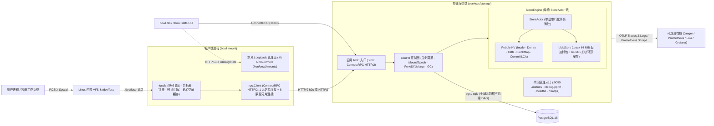

# 系统架构与仓库地图

Bowl 采用**单进程客户端 FUSE 网关 + 双层解耦存储服务端**架构：全局盘控制面与血缘 DAG 由 PostgreSQL 18 持久化，单盘内部完整 POSIX 目录树与数据块则由本地 `StoreActor`（Pebble + `.pack`）高并发自治。

## 端到端系统拓扑

### 关键路径说明

1. **客户端数据面与元信息面隔离**：`client/internal/rpc/client.go` 将所有 `Read` 与 `Write` 请求路由到 8 条独立 HTTP/2 连接构成的 `shardedRoundTripper`（FNV-1a 按 `diskID:ino` 或分片索引散列），避免大块数据读写阻塞 `Lookup`、`GetAttr`、`RenewMount` 等低延迟控制与元信息 RPC。
2. **服务端单盘 Actor 模型**：`services/storage/internal/store` 为每个活跃磁盘按需加载一个 `StoreActor`，合并并发到达的元数据修改写入同一个 Pebble `WriteBatch` 并按 `256 KiB` 逻辑分块网格写入 `.pack` 封包文件；每个只读/读写模式与 Epoch 变更都会接受 `WriterEpoch` 严格校验。
3. **双端口网络隔离**：公网业务端口 `:9000` 仅暴露 `StorageService` 37 个 ConnectRPC 过程；内网管理端口 `:9090` 暴露 `/metrics`、`/debug/pprof/*`、`/healthz` 与 `/readyz`，在 Compose 部署中默认仅绑定 `127.0.0.1`。

## 双层存储职责划分

Bowl 刻意避免将海量 POSIX 元数据（Inode、目录项、Xattr、Block 映射）放入关系型数据库，而是按访问特征与一致性域划分为**全局控制面（PostgreSQL 18）**与**单盘数据引擎（StoreActor）**两层：

| 存储层 | 载体与位置 | 持久化实体 | 核心职责 | 严禁越界行为 |
| :--- | :--- | :--- | :--- | :--- |
| **全局控制面** | PostgreSQL 18（`services/storage/db/migrations/`） | `disks`、`disk_lineages`、`disk_commits` 三张表 | 记录盘 ID/名称、逻辑分支血缘（`lineage_id`）及全局 Commit DAG（`parent_commit_id`、`root_disk_id`、`deleted_at`） | **不存储**任何文件字节、POSIX 目录项、Inode 属性、`WriterEpoch` 或写租约状态 |
| **单盘引擎元数据** | 本地磁盘 `$DATA_DIR/<disk-or-commit>/` 下的 Pebble KV | `StoreActor` 私有键值空间（参见 `store/keys.go`） | 存储单盘全部 Inode（`i:`）、目录项（`d:`）、扩展属性（`x:`）、`256 KiB` 块映射（`b:`）、`BranchStat`（`MaxBytes`、`WriterEpoch`、`WriterExpiresAt`）及局部 Diff/Merge 变更索引 | 不直接跨盘维护全局血缘树，只维护本盘/本分支数据一致性 |
| **单盘引擎数据块** | 本地磁盘 `$DATA_DIR` 下的 `.pack` 封包文件 + 内存热块缓存 | `64 MiB` 追加写 `.pack` 段 + `64 MiB` 16 分片环形缓存 | 以只追加写承载 `256 KiB` 块数据（支持读改写对齐、稀疏空洞与 `CompactPacks` 碎片回收）；`Fork` 共享只读基线 `.pack` 引用，实现零拷贝秒级派生 | 客户端无权直接访问底层 `.pack` 文件，必须经 RPC 读写 |

> [!NOTE]
> `ForkDisk` 时，控制面在 PostgreSQL 事务中更新父盘/子盘的 `disk_lineages` 与 `disk_commits` 节点，底层存储通过只读 Commit 节点共享与写时复制继承基线数据；只有被 `MergeDisk` 或 `DeleteDisk` 解除全部活跃分支引用的孤立 Commit，才会被 `ReclaimOrphan` 回收物理 `.pack` 与 Pebble 目录。

## Go 多模块工作区地图

仓库配置 `GOWORK=off`（参见 `Taskfile.yml`），通过子目录 `replace github.com/starsrc/bowl => ..` 显式管理**三个独立 Go Module**（Go 版本均为 `1.26.5`），实现服务端、客户端与共享契约的清晰解耦：

| Go Module / 包路径 | `go.mod` 路径 | 模块名 | 关键目录与职责 |
| :--- | :--- | :--- | :--- |
| **Root 模块（共享契约与 E2E）** | `go.mod` | `github.com/starsrc/bowl` | `proto/`（Protobuf 契约）、`gen/`（生成的 ConnectRPC/Validate Go 代码）、`pkg/rpccodec/`（统一错误码与详情映射）、`pkg/validator/`（参数校验辅助）、`e2e/`（跨服务与 FUSE 端到端测试） |
| **Storage 服务端模块** | `services/storage/go.mod` | `github.com/starsrc/bowl/services/storage` | `cmd/main.go`（入口）、`internal/config/`（环境变量配置）、`internal/server/`（HTTP/2 + 拦截器 + Tracing/Metrics）、`internal/control/`（PG 控制面与 GC）、`internal/store/`（`StoreActor` + Pebble + `.pack`）、`db/`（Goose 迁移与 sqlc 查询） |
| **Client 客户端模块** | `client/go.mod` | `github.com/starsrc/bowl/client` | `cmd/bowl/`（CLI 入口）、`internal/cli/`（`disk`/`mount`/`umount`/`stats` 命令与后台守护进程）、`internal/rpc/`（分片 ConnectRPC 客户端与重试/观测）、`internal/fusefs/`（`go-fuse` 实现、异步流水线、锁表、`.stats` 虚拟文件） |

> [!TIP]
> `pkg/rpccodec` 与 `pkg/validator` 属于根模块 `github.com/starsrc/bowl` 下的内部共享包，自身没有独立的 `go.mod`；修改 `proto/storage/v1/storage.proto` 后需执行 `task buf:generate` 更新 `gen/`，若新增依赖请运行 `task tidy` 同步三个模块。

## 延伸阅读

- [系统能力与边界](/01-overview/capabilities) —— 查看配额上限与明确的不支持项。
- [Storage 控制面](/04-internals/storage-control-plane) 与 [Storage 存储引擎](/04-internals/storage-store-engine) —— 深入 PostgreSQL 事务状态机与 `StoreActor` 内部实现。
- [Client FUSE 流水线](/04-internals/client-fuse-pipeline) —— 了解客户端异步预读/回写与缓存一致性设计。
