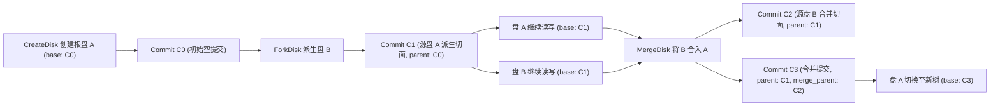

# 派生、差异与三路合并

本章说明 Bowl 基于共享血缘树（Lineage）与不可变提交有向无环图（Commit DAG）的零拷贝派生（`ForkDisk`）、最近共同祖先差异计算（`DiffDisk`）、历史提交只读穿透（`ReadCommitNode`）及两阶段三路合并（`MergeDisk`）机制。

---

## 血缘号段分配与不可变提交 DAG

所有存在派生关系的磁盘共享同一个 `lineage_id`。控制面通过 `disk_lineages` 与 `disk_commits` 两张表配合，保证同一血缘树内任何并发分支新分配的 `Ino` 与 `PackID` 永不碰撞，同时完整追踪分支演进拓扑。

### `disk_lineages` 单调号段分配器

定义于迁移脚本 `services/storage/db/migrations/20261112210000_add_disk_lineage_and_fork_dag.sql`：

- **`next_ino`（`BIGINT DEFAULT 2 CHECK (next_ino &gt;= 2)`）**：全血缘共享单调递增 Inode 分配游标。每次 `StoreActor` 本地号段耗尽时，在 PostgreSQL `LockDiskLineage` 行锁下通过 `ReserveInodeSegment` 按 `InodeSegment = 4096` 步长一次性预留闭区间 `[first, last]`。
- **`next_pack_id`（`BIGINT DEFAULT 1 CHECK (next_pack_id &gt;= 1)`）**：全血缘共享单调递增 `.pack` 文件编号分配游标。写通道封包切换时，通过 `ReservePackSegment` 按 `PackSegment = 64` 步长向控制面预留连续 PackID 号段（本地超时上限 `segmentReserveTimeout = 5s`）。

> [!NOTE]
> 当同血缘下多块子盘并发写入并最终合并回同一目标盘时，基于共享号段的预留机制确保不同分支新创建文件对应的 `Inode` 编号与 `.pack` 容器编号天然隔离、绝不重叠；即便在 `MergeDisk` 遇到特殊命名冲突需重新分配 Inode 时，也统一从血缘号段分配器申请新号。

### `disk_commits` 不可变提交有向无环图

`disk_commits` 表记录血缘树内所有被固化下来的历史静态切面（不可变只读快照目录 `&lt;storage_root&gt;/commits/&lt;commit_id&gt;`）：

| 字段 | 约束 / 语义 | 说明 |
| :--- | :--- | :--- |
| `commit_id` | UUIDv7 主键 | 提交快照唯一标识 |
| `lineage_id` | 外键关联 `disk_lineages` | 所属血缘 ID，配合 `uq_disk_commits_lineage_commit` 锁定同血缘引用 |
| `source_disk_id` | UUID | 生成该提交时的来源磁盘 ID |
| `parent_commit_id` | 同血缘复合外键（可空） | 主线父提交 ID（如 `ForkDisk` 时源盘原 `base_commit_id`，或 `MergeDisk` 时目标盘原 `base_commit_id`） |
| `merge_parent_commit_id` | 同血缘复合外键（可空） | 仅在 `MergeDisk` 成功合并时写入，指向源盘最新快照 `src_commit_id` |
| `chk_disk_commits_not_self_parent` | 表级 CHECK 约束 | 严禁 `parent_commit_id == commit_id` 或 `merge_parent_commit_id == commit_id` 形成自环 |

每块活跃磁盘在 `disks.base_commit_id` 中持有其当前基准提交指针。当发生以下操作时 DAG 向前生长：

---

## 零拷贝在线派生（`ForkDisk`）

`ForkDisk` 允许在**不卸载、不阻塞源盘在线读写**的前提下，毫秒级派生出一块可独立读写的新虚拟磁盘。核心流程由 `services/storage/internal/control/control.go` 与 `services/storage/internal/store/fork.go` 协同完成。

### 切面固化与孤儿净化

1. **源盘一致性 Checkpoint**：控制面对源盘调用 `StoreActor.Checkpoint(commitDir)`。该命令作为单协程写循环中的一次同步点执行：
   - 刷盘活跃 Pebble MemTable（`db.Flush()`）；
   - 将所有有效写入且大小 `&gt;= 1B` 的活跃 `.pack` 封口并刷盘（`sealAndSync`）；
   - 生成 Pebble 一致性检查点并硬链接已封口 `.pack` 文件至提交目录 `&lt;storage_root&gt;/commits/&lt;commit_id&gt;`。
   - **关键不变量**：`Checkpoint` **不会**递增源盘 `WriterEpoch`，源盘已挂载的读写客户端无需重新握手或断开。
2. **孤儿节点净化（Orphan Sanitization）**：若源盘切面内存在已解链但客户端仍持有打开句柄的孤儿节点（`HasOrphans == true`），直接在源盘在线删除会破坏活跃句柄。此时控制面在临时工作目录打开 `SanitizeCheckpoint`（带 `ResetEpoch: true`），清理所有 `orphan:&lt;ino&gt;` 节点、刷新 WAL 并 `db.Flush()`，重新计算净化后的真实 `effectiveUsedBytes` 作为子盘起点的干净视图与计费依据。

### 配额校验、`.pack` 共享与写时隔离

- **子盘配额规则**：若请求中 `max_bytes == 0`，默认继承源盘当前的 `max_bytes`；若显式指定 `max_bytes &gt; 0` 且小于净化后的 `effectiveUsedBytes`，立即拒绝并返回 `FailedPrecondition`（`ErrorInfo{Reason: "EINVAL"}`），并清理临时快照目录。
- **零拷贝硬链接克隆**：`CloneCheckpointDir` 将源切面克隆至子盘目录 `&lt;storage_root&gt;/disks/&lt;child_disk_id&gt;` 时：
  - 对不可变的 `.sst`、`*.blob` 与 `packs/*.pack` 文件创建操作系统硬链接（零字节数据拷贝）；
  - 对 `CURRENT`、`MANIFEST-*`、`OPTIONS-*` 等可变元数据清单执行物理拷贝；
  - 跳过 `LOCK` 与 Pebble 事件日志文件，防止进程文件锁与日志冲突。
- **写时隔离与独立 Epoch**：子盘打开前重置 `WriterEpoch = 0` 与 `WriterExpiresAt = 0`（不继承源盘写租约），并独立拥有自己的 Pebble 可写层与新 `.pack` 追加流；源盘与子盘后续各自追加的数据写入新的 `.pack` 文件并修改各自的 Pebble 键值，共享的旧 `.pack` 硬链接永远只读不可变，实现彻底的写时隔离。
- **PostgreSQL 事务推进**：`SQLStore.ForkDisk` 在 `disk_lineages` 锁保护下，将源盘新固化快照 `newCommitID` 插入 `disk_commits`（继承源盘原 `base_commit_id` 作为父提交），同步将源盘与新建子盘的 `base_commit_id` 共同指向该共享切面 `newCommitID`。

---

## 差异计算（`DiffDisk`）与提交读取（`ReadCommitNode`）

### 基于 LCA（最近共同祖先）的差异计算

`DiffDisk` 用于对比源盘（`source_disk_id`）与目标盘（`target_disk_id`）或指定基线之间的全树差异，定义于 `services/storage/internal/control/merge_diff.go` 与 `services/storage/internal/store/tree_diff.go`。

1. **非侵入式切面抓取**：通过 `snapshotDiskForInspect` 对目标盘与源盘分别抓取只读检查点快照；若盘已存在最新切面且无写入漂移可复用或新建只读临时快照，绝不影响在线挂载盘写入。
2. **LCA 判定规则**：
   - 若调用方显式提供 `base_commit_id`，控制面直接校验其属于同一血缘树并加载对应 `&lt;storage_root&gt;/commits/&lt;base_commit_id&gt;` 快照目录。
   - 若未提供 `base_commit_id`，控制面调用 `findLCA` 从 `target.BaseCommitID` 与 `source.BaseCommitID` 沿 `parent_commit_id` 和 `merge_parent_commit_id` 两条父链反向 BFS 收集全部祖先，求交集后剔除被其它公共祖先支配的节点，得到**极大公共祖先集合（MCA）**：
     - `|MCA| == 1`：唯一确定最近共同祖先（LCA）；
     - `|MCA| &gt; 1`：发生网状交叉合并（Criss-Cross Merge），存在多个不可比较的极大公共祖先；控制面拒绝猜测，直接返回 `ErrAmbiguousLCA`（`codes.FailedPrecondition` / `ErrorInfo{Reason: "EINVAL"}`），要求调用方在请求中显式传入 `base_commit_id`；
     - `|MCA| == 0`：两盘不属于同一祖先链或历史记录已不可达，返回 `FailedPrecondition`。
   - **空差异快路径**：当 `source` 与 `target` 指向同一盘、或双方自上次合并后均未修改（如 `source.BaseCommitID` 已是 `target.BaseCommitID` 祖先且源盘与基线完全一致）时，可直接判定无需遍历或精确剪枝。
3. **流式树比对与裁剪**：
   - 引擎按规范化路径字节字典序使用最小堆遍历 `Base`、`Target`、`Source` 三棵树；
   - 若直接祖先节点共享同一 `Ino` 与 `WriteSeq`（`isUnchangedVsBase`），直接 O(1) 整棵子树剪枝跳过；
   - 对常规文件数据块优先比对元数据块引用（`BlobRef`），未命中再结合稀疏零块规则进行精确字节比对；
   - 支持 `path_prefix` 目录前缀过滤、`conflicts_only` 仅看冲突条目、`page_size`（默认 `200`，最大 `1000`）及 Base64 游标 `page_token` 稳定翻页，并在每次返回中包含全量统计 `DiffSummary`。

### 历史提交节点读取（`ReadCommitNode`）

`ReadCommitNode` 允许直接按 `commit_id`（必须与请求 `disk_id` 同属一个血缘）与 `ino` 只读读取某个历史提交切面中的节点内容（`services/storage/internal/control/merge_diff.go` 与 `services/storage/internal/store/diff_merge_types.go`）：

- **节点类型限制**：
  - 常规文件（`S_IFREG`）：按 `(offset, size)` 读取数据切片与文件总尺寸（`file_size`），单次 `size` 上限为 `MaxReadNodeSliceBytes = 4 MiB`（`4 &lt;&lt; 20`），超出或 `ino == 0` / `&gt; MaxInt64` 返回 `InvalidArgument`。
  - 符号链接（`S_IFLNK`）：在响应 `symlink_target` 字段返回目标路径字节串。
  - 目录（`S_IFDIR`）：不允许作为内容节点读取，返回 `FailedPrecondition`（`store.ErrIsDir`）。
- **只读临时快照**：若目标 `commit_id` 在共享提交目录下不存在（或已被三态 GC 清理），返回 `NotFound`。

---

## 三路合并（`MergeDisk`）

`MergeDisk` 将源盘（`source_disk_id`）的演进变更以三路合并方式合入目标盘（`target_disk_id`），支持在线预览（`dry_run`）、细粒度冲突策略与崩溃可恢复的两阶段提交。

### 在线预览与正式合入门禁

| 执行模式 | 挂载门禁行为 | 状态变更 |
| :--- | :--- | :--- |
| `dry_run = true` | 不检查挂载门禁，完全基于快照在只读视图中演练合并 | 不修改目标盘、不提交新 Commit、不递增 `WriterEpoch`；若存在未决冲突，返回 `MergeConflictReport`（gRPC 状态码正常返回） |
| `dry_run = false`（`force = false`） | 控制面通过 `checkMergeMountGate` 校验：目标盘与源盘均不得持有未过期活跃写租约（`HasActiveWriterLease`），只读挂载不阻塞合并。任一盘存在活跃读写挂载则拒绝并返回 `Aborted`（`ErrorInfo{Reason: "EBUSY"}`） | 通过门禁且无未决冲突后原子替换目标盘存储实例并推进 DAG |
| `dry_run = false`（`force = true`） | 跳过 `checkMergeMountGate` 检查，直接进入两阶段提交流程 | Phase 2 预设 `WriterEpoch = ExpectedWriterEpoch + 1` 并把 `WriterExpiresAt` 归零，重新打开目标盘后立即隔离原读写挂载体，旧写者续期与写入触发自动下线 |

> [!IMPORTANT]
> 在正式合并（`dry_run = false`）时，一旦存在任何无法自动解决的冲突（裁决策略为 `MERGE_STRATEGY_FAIL`），服务端在 `services/storage/internal/server/handler_merge_diff.go` 返回 Connect/gRPC `codes.Aborted`，并在错误详情中同时附带 `ErrorInfo{Reason: "ECONFLICT"}` 与完整 `MergeConflictReport`（冲突样本上限 `MaxMergeConflictSamples = 200`）。

### 12 种冲突类型枚举与触发条件

定义于 `proto/storage/v1/storage.proto` 的 `ConflictKind` 与 `services/storage/internal/store/tree_diff.go`：

| 枚举名 | 数值 | 触发条件 |
| :--- | :--- | :--- |
| `CONFLICT_KIND_ADD_ADD` | `1` | `Base` 中无此路径，但 `Target` 与 `Source` 均新增该路径且内容/类型/属性不兼容 |
| `CONFLICT_KIND_CONTENT` | `2` | `Base`、`Target`、`Source` 均为常规文件或符号链接，且两侧相对于 `Base` 均修改了文件字节内容或链接目标（且两侧终态不一致） |
| `CONFLICT_KIND_MODIFY_DELETE` | `3` | `Target` 修改了 `Base` 中的非目录节点（内容/属性/xattr），而 `Source` 删除了该路径 |
| `CONFLICT_KIND_DELETE_MODIFY` | `4` | `Target` 删除了 `Base` 中的非目录节点，而 `Source` 修改了该路径 |
| `CONFLICT_KIND_TREE_DELETE_MODIFY` | `5` | 一侧删除了整个目录子树，另一侧在该目录及其后代路径下存在新增、删除或修改（如子树内有并发改动） |
| `CONFLICT_KIND_TYPE` | `6` | 同一路径在 `Target` 与 `Source` 的 POSIX 文件类型发生不同演进（如常规文件 vs 符号链接/FIFO 等非目录类型冲突） |
| `CONFLICT_KIND_DIR_FILE` | `7` | 一侧为目录（`S_IFDIR`），另一侧为非目录文件/符号链接导致的目录-文件结构冲突 |
| `CONFLICT_KIND_ATTR` | `8` | 文件内容兼容或未冲突，但两侧同时修改了不相交/不一致的普通元数据属性（`PermMask`、`UID`、`GID`、`Flags` 等） |
| `CONFLICT_KIND_XATTR` | `9` | 两侧对同一扩展属性（xattr）键执行了互不相同的写入或删除操作 |
| `CONFLICT_KIND_XATTR_QUOTA` | `10` | 两侧分别新增不同键名的 xattr 后虽然键名无碰撞，但合并后的单节点扩展属性键列表总字节数超过 `MaxXattrListBytes = 64 KiB` 配额上限 |
| `CONFLICT_KIND_SECURITY_ATTR` | `11` | 一侧修改了文件内容载荷，另一侧在同一文件上修改了安全敏感属性（`S_ISUID`、`S_ISGID`、`UID`、`GID` 或 `security.*` 命名空间 xattr），为防提权漏洞强制拦截为冲突 |
| `CONFLICT_KIND_HARDLINK` | `12` | `Target` 新增指向某 `Base Inode` 的硬链接或对其重命名，同时 `Source` 修改或删除了该同一 `Base Inode`，导致链接拓扑语义分叉 |

### 冲突解决策略与前缀继承

`MergeDiskRequest` 支持全局默认策略 `strategy` 与按路径覆盖表 `path_strategies`（`map&lt;string, MergeStrategy&gt;`）：

- **可用策略**：
  - `MERGE_STRATEGY_FAIL`（`1`，未指定时的默认行为）：任何冲突条目直接记录至冲突列表；只要存在冲突则终止正式合入。
  - `MERGE_STRATEGY_OURS`（`2`）：冲突发生时保留目标盘（`Target`）版本（若目标侧已删除则保持删除；若目标侧为目录冲突子树则完整保留 `Target` 子树）。
  - `MERGE_STRATEGY_THEIRS`（`3`）：冲突发生时采用源盘（`Source`）版本覆盖目标盘（若源侧已删除且为目录冲突子树则跳过该子树）。
- **前缀继承匹配规则（`resolveMergeStrategy`）**：对于任意冲突路径（规范化如 `/a/b/c.txt`），优先精确匹配 `path_strategies["/a/b/c.txt"]`；若未命中则逐级截断父目录（`/a/b` -> `/a` -> `/` / `""`）寻找最深匹配的策略；若全程未匹配，回落至全局 `strategy`（`UNSPECIFIED` 时回落为 `MERGE_STRATEGY_FAIL`）。

### 两阶段 CAS 提交与崩溃恢复机制

为兼顾在线并发性能与数据库/本地存储目录原子切换，`control.MergeDisk` 采用**两阶段 CAS + 目录交换**协议：

1. **Phase 1（无停机计算与暂存准备）**：
   - 基于快照记录合并前目标盘的 `(ExpectedWriterEpoch, ExpectedWriteSeq)`。
   - 调用 `store.MergeTrees` 在临时暂存目录 `&lt;storage_root&gt;/disks/&lt;target_disk_id&gt;.merge.&lt;merge_commit_id&gt;` 生成完整合并树：
     - 处理 `PackID` 跨盘冲突（通过 `os.SameFile` 判定同血缘共享包还是物理分歧包，若发生号段碰撞或与非同源包撞号则通过血缘号段分配器重映射新 `PackID`）；
     - 清理目标盘残余孤儿节点与死节点，重算目录 `Nlink = 2 + liveSubdirs` 与逻辑用量账本 `BranchStat`；
     - 在暂存树中将 `WriterEpoch` 预设为 `ExpectedWriterEpoch + 1` 且将 `WriterExpiresAt` 置 `0`，执行 `Flush` 与 `syncDirPath` 落盘。
   - 固化合并前源盘基准快照至 `&lt;storage_root&gt;/commits/&lt;src_commit_id&gt;`，同步写入标记文件 `.srccommit.&lt;merge_commit_id&gt;.&lt;src_commit_id&gt;` 与正式合并提交快照 `&lt;storage_root&gt;/commits/&lt;merge_commit_id&gt;`。
2. **Phase 2（短停顿 CAS 验证与原子切换）**：
   - 按 `disk_id` 字典序锁定源/目标盘对（`lockDiskPair` 防死锁），检查挂载门禁，随后关闭目标盘 `StoreActor`；
   - **CAS 校验**：核对目标盘停顿前实时 `(WriterEpoch, NextWriteSeq)` 与 Phase 1 读取基线严格一致（否则返回 `ErrConcurrentMerge` -&gt; `Aborted`/`EBUSY`）；
   - **PostgreSQL 事务提交**：`SQLStore.MergeDisk` 校验目标盘 `base_commit_id` 与合并计划起始值一致（否则返回 `ErrStaleBaseCommit` -&gt; `Aborted`/`EBUSY`），写入 `disk_commits` 新节点（`parent_commit_id = old_target_base`、`merge_parent_commit_id = src_commit_id`）并更新目标盘 `base_commit_id = merge_commit_id`；
   - **物理目录原子替换**：`os.Rename(tgtDir, oldDir)` -&gt; `os.Rename(stagingDir, tgtDir)` -&gt; `syncDirPath`，随后重新打开目标盘 `StoreActor`（`WriterEpoch` 已递增且 `WriterExpiresAt = 0`，自动隔离任何旧会话写者），清理 `oldDir` 与 `.srccommit` 标记。
3. **崩溃自动对账（`reconcilePendingMergeLocked`）**：
   - 若服务端在目录切换阶段发生宕机，下次控制面启动、打开盘或执行删除前会扫描 `*.merge.*`、`*.old.*` 与 `*.srccommit.*` 残留；
   - 判定逻辑为 `shouldRollForward = (row.BaseCommitID == cid) || (tgtMissing &amp;&amp; stagingExists &amp;&amp; oldExists)`：由于 `oldDir` 仅在 PostgreSQL 事务成功提交后创建，满足前滚条件则继续完成目录重命名激活新树；否则将 `oldDir` 恢复为 `tgtDir` 并安全清理未提交的暂存与提交目录。

---

## 相关接口与实现参考

- `ForkDisk`、`DiffDisk`、`ReadCommitNode`、`MergeDisk` 请求与响应完整字段定义：参见 [RPC 接口契约](/03-interfaces/rpc-api)。
- 命令行操作示例与参数选项：参见 [CLI 命令参考](/03-interfaces/cli-reference)。
- 挂载门禁与 `WriterEpoch` 协同机理：参见 [挂载租约与写栅栏](/02-features/mount-and-fencing)。
