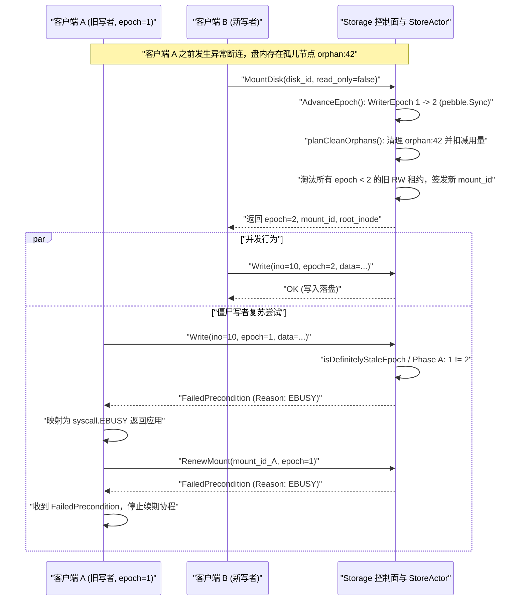

# 挂载租约与写栅栏

Bowl 采用**单盘单写多读（SWMR）**挂载模型：同一时刻同一块虚拟磁盘可以并发承载任意数量的只读挂载（`--ro`）以及**至多一个有效读写写者**。通过单调递增的 `WriterEpoch` 硬栅栏与 `MountLease` 软租约协同，系统在不引入分布式锁服务的前提下，既能瞬间隔离脑裂僵尸写者，又能为三路合并等控制面变更提供安全门禁。

---

## 读写挂载与只读挂载握手（`MountDisk`）

客户端在挂载 FUSE 前，先通过 `client/internal/cli/mount.go` 中的 `mountHandshake` 向服务端发起单次 `MountDiskRequest{disk_id, read_only}` 调用；服务端处理逻辑位于 `services/storage/internal/control/control.go` 与 `mount_lease.go`。

### 握手分支行为对比

| 维度 | 只读挂载（`read_only = true`） | 读写挂载（`read_only = false`） |
| :--- | :--- | :--- |
| 引擎状态推进 | **只读探测**根目录 `RootIno = 1`，**不推进** `WriterEpoch` | 调用 `StoreActor.AdvanceEpoch`，原子递增 `WriterEpoch` 并 `pebble.Sync` 落盘 |
| 返回 `epoch` 值 | 固定返回 `0` | 返回递增后的新 `WriterEpoch`（必为 `&gt;= 1`） |
| 孤儿节点清理 | **不触发**孤儿清理 | **同步触发** `planCleanOrphans`，彻底清除上任写者崩溃残留的 `orphan:&lt;ino&gt;` 节点并扣减逻辑用量 |
| 租约淘汰策略 | 登记只读租约，与已有 RW / RO 租约共存 | 登记新 RW 租约，并立即淘汰内存中所有 `lease.epoch &lt; epoch` 的旧 RW 租约（**保留 RO 租约**） |
| 服务端/客户端写保护 | 客户端在 `BuildMountOptions` 传入 `ro`，并在 FUSE 层 `CheckWritable()` 直接拦截返回 `EROFS` | 所有写类 RPC（`Create`、`Write`、`Unlink`、`Rename`、`SetAttr`、`Fallocate`、`SetXattr`、`RemoveXattr`、`Fsync`、`FsyncDir`、`ReclaimOrphan` 等）必须携带当前 `epoch` |
| 共用响应参数 | 均颁发 UUIDv7 `mount_id`、`lease_ttl_seconds`（默认 `30s`）、`root_inode`、`entry_timeout_seconds` 及 `attr_timeout_seconds` | 同左 |

### 客户端 FUSE 内核能力协商

`client/internal/fusefs/fs.go` 中的 `BuildMountOptions` 根据挂载结果配置内核 FUSE 参数：

- **开启 `CAP_HANDLE_KILLPRIV`**：允许存储引擎在 `Write` / `SetAttr` 批次中自行剥离 `security.capability` 与 `S_ISUID`/`S_ISGID`，消除内核每次写前探测 `GetXattr("security.capability")` 的跨机往返开销。
- **禁用 `CAP_WRITEBACK_CACHE | CAP_AUTO_INVAL_DATA`**：
  - 禁用 `CAP_WRITEBACK_CACHE` 以维持 1 MiB 写直通（或客户端 `WriteBehind` 顺序缓冲）语义，避免内核 4 KiB 脏页碎块回写与写前尺寸核对。
  - 禁用 `CAP_AUTO_INVAL_DATA`：因 SWMR 保证了同一挂载视图内无第三方并发写入，而服务端 Go 时钟与宿主机内核 `i_mtime` 存在毫秒级时钟偏差，禁止内核因 `mtime` 不等而误清整文件页缓存（文件长度变化仍由内核 `fuse_change_attributes` 自动淘汰越界页）。

---

## 单写者 `WriterEpoch` 栅栏状态机

`WriterEpoch` 是持久在单盘 Pebble `sys:stat` 中的 `uint64` 单调递增写世代计数器，由任何一次新的读写 `MountDisk` 或正式 `MergeDisk` 提交原子推高。只要新写者完成握手，任何持有旧 `Epoch` 的客户端即刻失去写权限，成为必须被隔离的“僵尸写者（Zombie Writer）”。

### 栅栏拦截链路

服务端通过三道防线对僵尸写者实施零宽容栅栏：

1. **RPC 入口守卫 `NewValidationInterceptor`**：依据 `storage.proto` 协议规则在服务端拦截器统一校验，拦截 `epoch == 0` 或超过 `MaxInt64` 的非法写请求，返回 `InvalidArgument` 与 `EINVAL`。
2. **Actor 无锁快筛（`isDefinitelyStaleEpoch`）**：位于 `services/storage/internal/store/actor.go`，通过原子变量 `atomicWriterEpoch`（且无在途 `pendingEpochAdvances`）快速判定 `epoch != currentEpoch` 并立即拦截返回 `store.ErrStaleEpoch`。
3. **写循环 Phase A 严格校验**：即使请求在世代切换并发窗口进入排队队列，单协程写循环 `validateCmd` 在 Phase A 阶段再次核对 `cmd.epoch == s.stat.WriterEpoch`，不相等绝不触碰 Pebble `Batch`。
4. **错误语义还原**：`store.ErrStaleEpoch` 经 `services/storage/internal/control/status.go` 映射为 gRPC `codes.FailedPrecondition` + `ErrorInfo{Reason: "EBUSY", Domain: "bowl.storage"}`；客户端 `rpc.MapError` 精确还原为 Linux `syscall.EBUSY`。

### 新写挂载抢占与僵尸隔离时序

---

## `MountLease` 软租约、续期与幂等卸载

`MountLease` 是存储控制面内存中的挂载会话登记表（`activeMounts`），不落盘持久化，专门用于在运行时感知活跃客户挂载状态并作为控制面危险变更（如 `MergeDisk`）的门禁依据。

### 租约数据结构与心跳续期（`RenewMount`）

- **数据结构**：每条租约记录包含 `{readOnly bool, epoch uint64, expiresAt time.Time}`，键为 `mount_id`（UUIDv7）。默认租约存活期 `DefaultMountLeaseTTL = 30s`。
- **客户端心跳策略**：`startMountLeaseRenewer` 在挂载成功后启动后台协程，按 `max(1s, lease_ttl_seconds / 3)` 间隔（默认 `10s`）周期调用 `RenewMount`（单次 RPC 超时 `mountRenewRPCTimeout = 5s`）。若服务端响应调整了 `lease_ttl_seconds`，客户端动态重设心跳定时器。
- **服务端校验规则（`control.RenewMount`）**：
  - 磁盘不存在或已销毁 -&gt; 返回 `NotFound`；
  - `read_only = true` -&gt; 要求 `epoch == 0`（否则 `InvalidArgument`）；
  - `read_only = false` -&gt; 要求 `epoch &gt; 0` 且严格等于当前 `actor.WriterEpoch()`，否则返回 `ErrStaleEpoch`（`FailedPrecondition` / `EBUSY`）。
  - 客户端一旦收到 `FailedPrecondition` 或 `NotFound`，立即打印 `mount_lease_renew_stopped` 告警并终止续期协程。
- **服务端重启后的透明重建（Rebuild）**：Storage 进程重启会清空内存 `activeMounts`；只要重连上来的客户端所持 `mount_id` 对应合法磁盘，且 RW 挂载的 `epoch` 依然等于当前盘 `actor.WriterEpoch()`（或为 RO 挂载），`RenewMount` 会自动重新写入一条有效期为 `now + TTL` 的 `mountLease`，无需客户端重新挂载。

### 租约过期行为与软状态边界

`MountLease` 的核心职责是服务控制面挂载门禁，其过期与隔离语义具有明确边界：

| 场景 | 行为与结果 | 说明 |
| :--- | :--- | :--- |
| 心跳超时租约过期（`now &gt; expiresAt`） | 控制面忽略或惰性剔除过期条目，`checkMergeMountGate` 不再视其为活跃挂载 | **不会自动递增 `WriterEpoch`** |
| 过期后旧客户端恢复网络继续发送 `Write` | 若期间无新 RW 挂载或 `MergeDisk` 发生（`WriterEpoch` 未变），写请求依然可以通过 Epoch 校验，且下次 `RenewMount` 可重建租约 | 一旦期间发生了 `MergeDisk` 或新 RW 挂载，旧客户端的 `WriterEpoch` 失效并即刻被 `EBUSY` 拦截 |
| `MergeDisk` 门禁检查（`force = false`） | 存在任何未过期目标盘租约（RW 或 RO），或存在未过期源盘 RW 租约时，拒绝合并并返回 `Aborted`（`Reason: "EBUSY"`） | 源盘只读挂载不阻塞合并 |

### `UnmountDisk` 幂等释放与客户端优雅退出

当本地 FUSE 接收到 `SIGINT` / `SIGTERM` 或外部执行 `umount` 触发退出时，客户端按严格逆序关闭各子系统：

1. **排空在途 FUSE 请求与本地脏数据（`RawFS.OnUnmount`）**：
   - 关闭本地文件锁表 `LockTable.Close()`，中断阻塞等待中的 `SetLkw`；
   - 获取 `lifecycleMu` 排他锁等待所有在途 FUSE 调用完成；
   - 排空 `WriteBehind` 异步写队列，并对所有 `dirtyInodes` 逐一发起同步 `Fsync` 落盘；
   - 清理本地句柄、缓存、临时匿名文件与预读表，排空 `ReclaimOrphan` 异步重试队列（上限 `2s` 等待）。
2. **发送 `UnmountDisk` 释放租约**：`defaultServeFUSE` 退出阻塞后，调用 `unmountMountLease`（采用独立的 `context.Background()` 与 `3s` 超时预算，防止因进程退出主上下文取消而漏发 RPC），随后清除本地挂载元信息文件。
3. **服务端幂等删除**：`control.UnmountDisk` 从 `activeMounts` 中删除 `(disk_id, mount_id)` 对应的租约；若磁盘已删除、租约早已过期或重复调用 `UnmountDisk`，均视为幂等成功直接返回 `UnmountDiskResponse{}`。

---

## 相关接口与实现参考

- 挂载、续期、卸载 RPC 定义：`proto/storage/v1/storage.proto` 与 [RPC 接口契约](/03-interfaces/rpc-api)。
- 客户端 FUSE 挂载选项与命令行参数：`client/internal/cli/mount.go` 与 [CLI 命令参考](/03-interfaces/cli-reference)。
- `MergeDisk` 门禁与 `WriterEpoch` 切换联动：[派生、差异与三路合并](/02-features/fork-diff-merge)。
