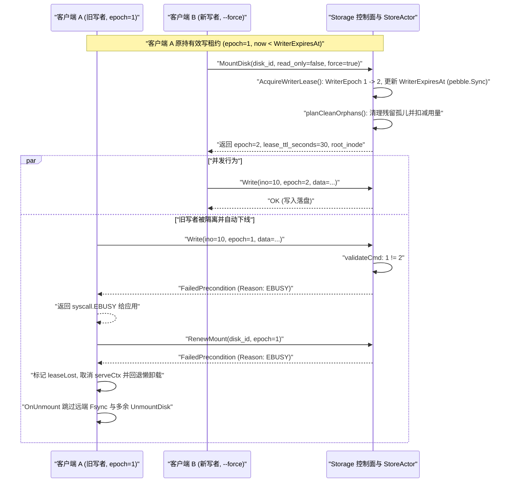

# 挂载租约与写栅栏

Bowl 采用单盘单写多读（SWMR）挂载模型。同一时刻同一块虚拟磁盘可以并发承载任意数量的只读挂载（`--ro`），并至多允许一个持有有效写租约的读写写者。服务端通过 Pebble 持久化的 `WriterEpoch`（单调递增写世代）与 `WriterExpiresAt`（UTC 纳秒级租约到期时间）协同防护，在不引入外部分布式锁的前提下完成写者互斥、显式抢占与断网/脑裂自动下线。

---

## 读写挂载与只读挂载握手（`MountDisk`）

客户端在挂载 FUSE 前，先通过 `client/internal/cli/mount.go` 中的 `mountHandshake` 向服务端发起单次 `MountDiskRequest{disk_id, read_only, force}` 调用。若 CLI 同时传入 `--ro` 与 `--force`，`executeMount` 会在派生后台守护进程前直接以退出码 `2` 拒绝；协议层同样通过 CEL 规则 `!this.read_only || !this.force` 强制拦截。

### 握手分支行为对比

| 维度 | 只读挂载（`read_only = true`） | 读写挂载（`read_only = false`） |
| :--- | :--- | :--- |
| 控制面与 Pebble 状态 | 无状态只读探测根目录 `RootIno = 1`，不写入 Pebble，不递增 `WriterEpoch` | 持盘锁调用 `StoreActor.AcquireWriterLease(ctx, ttl, force)`，原子递增 `WriterEpoch`、写入 `WriterExpiresAt = now.UTC().Add(ttl).UnixNano()` 并执行 `pebble.Sync` 落盘 |
| 活跃写者互斥与抢占 | 不受写租约阻塞，与已有 RW 或 RO 挂载并发共存 | 若盘内存在未过期写租约（`WriterEpoch > 0 && nowNano < WriterExpiresAt`）且 `force = false`，返回 `ErrDiskMounted`（`CodeAborted`，`Reason: "EBUSY"`）；传入 `--force` 或原租约已过期时零等待接管 |
| 返回 `epoch` 与租约 | 固定返回 `epoch = 0`、`lease_ttl_seconds = 0` | 返回递增后的 `epoch`（`>= 1`）与 `lease_ttl_seconds`（默认 `30s`）；客户端校验二者均大于 `0` |
| 孤儿节点清理 | 不触发孤儿清理 | 同步触发 `planCleanOrphans`，清除上任写者崩溃残留的 `orphan:<ino>` 节点并归还逻辑用量 |
| 客户端写保护与生命周期 | 内核挂载带 `ro` 标志且 `CheckWritable()` 直接返回 `EROFS`；完全跳过 `RenewMount` 与 `UnmountDisk` | 写入类 RPC 携带当前 `epoch`；后台按 `TTL/3` 续期，失租约时自动触发卸载并跳过 `UnmountDisk` |

### 客户端 FUSE 内核能力协商

`client/internal/fusefs/fs.go` 中的 `BuildMountOptions` 根据挂载结果配置内核 FUSE 参数：

- **开启 `CAP_HANDLE_KILLPRIV`**：允许存储引擎在 `Write` / `SetAttr` 批次中自行剥离 `security.capability` 与 `S_ISUID`/`S_ISGID`，消除内核每次写前探测 `GetXattr("security.capability")` 的跨机往返开销。
- **禁用 `CAP_WRITEBACK_CACHE | CAP_AUTO_INVAL_DATA`**：
  - 禁用 `CAP_WRITEBACK_CACHE` 以维持 1 MiB 写直通（或客户端 `WriteBehind` 顺序缓冲）语义，避免内核 4 KiB 脏页碎块回写与写前尺寸核对。
  - 禁用 `CAP_AUTO_INVAL_DATA`：因 SWMR 保证了同一挂载视图内无第三方并发写入，而服务端 Go 时钟与宿主机内核 `i_mtime` 存在毫秒级时钟偏差，禁止内核因 `mtime` 不等而误清整文件页缓存（文件长度变化仍由内核 `fuse_change_attributes` 自动淘汰越界页）。
- **只读直挂显式传递 `MS_RDONLY`**：`BuildMountOptions` 在 `DirectMount` 模式下除追加挂载选项 `ro` 外，同时在 `DirectMountFlags` 设置 `MS_NOSUID | MS_NODEV | MS_RDONLY`，确保内核 VFS 挂点拒绝写操作且 `/proc/self/mountinfo` VFS 选项准确呈现 `ro`。

---

## Pebble 持久化租约与 `WriterEpoch` 状态机

`WriterEpoch`（`uint64`）与 `WriterExpiresAt`（`int64`，UTC UnixNano，`0` 表示无活跃写租约）共同编码在单盘 Pebble `sys:stat` 的 49 字节定长结构 `BranchStat` 中。Storage 服务重启后无需依赖内存表重建：控制面打开 `StoreActor` 时即从 Pebble 恢复权威租约水位，直接对后续非强制 `MountDisk`、写入 RPC 与 `MergeDisk` 生效。

### 写路径世代与租约双重栅栏

服务端对所有 16 个外部写与刷盘类 RPC 实施严格检查：

1. **RPC 入口守卫（`validateWriteEpoch`）**：位于 `services/storage/internal/server/`，拒绝 `epoch <= 0` 或 `epoch > MaxInt64` 的非法写请求（返回 `InvalidArgument`）。
2. **写循环 Phase A 严格校验（`StoreActor.validateCmd`）**：位于 `services/storage/internal/store/actor.go`。当 `s.stat.WriterEpoch > 0` 时，必须同时满足 `cmd.epoch == s.stat.WriterEpoch` 且 `nowNano < s.stat.WriterExpiresAt`；任一条件不满足立即拦截并返回 `store.ErrStaleEpoch`。
3. **无锁只读快照与原子协调**：`StoreActor` 维护原子快照 `atomic.Pointer[writerLeaseSnapshot]` 与在途更新计数 `pendingLeaseUpdates`，保障并发读写或跨租约切换边界的一致性判定。
4. **错误语义还原**：`store.ErrStaleEpoch` 经 `services/storage/internal/control/status.go` 映射为 gRPC `codes.FailedPrecondition` + `ErrorInfo{Reason: "EBUSY", Domain: "bowl.storage"}`；客户端 `rpc.MapError` 精确还原为 Linux `syscall.EBUSY`。

### `--force` 抢占与旧写者自动下线时序

---

## 写租约续期、短重试与失租约自动卸载

### 续期心跳与可恢复短重试（`RenewMount`）

`RenewMountRequest{disk_id, epoch}` 仅作用于读写挂载（只读挂载从不启动续期协程）：

- **正常续期间隔**：`startMountLeaseRenewer` 启动后台协程，按 `max(1s, lease_ttl_seconds / 3)` 间隔（默认 TTL 为 `30s`，间隔为 `10s`）调用 `RenewMount`，单次 RPC 超时 `mountRenewRPCTimeout = 5s`。
- **可恢复抖动短重试**：遇到 `Unavailable`、超时等非终态错误时，不等待完整 `10s` 周期，而是按 `min(2s, normalInterval)`（即 `2s`）调度下一次续期，避免在 `30s` 租约窗口内错失重试机会。
- **服务端原子续期（`RenewWriterLease`）**：校验 `epoch > 0`、`epoch == s.stat.WriterEpoch` 且 `nowNano < s.stat.WriterExpiresAt`，成功后刷新 `WriterExpiresAt = now.UTC().Add(ttl).UnixNano()` 并执行 `pebble.Sync`，不递增 `WriterEpoch` 或 `NextWriteSeq`。
- **终态失败触发自动下线**：若 `RenewMount` 收到 `FailedPrecondition`（世代已被抢占、合并推进或租约已过期）或 `NotFound`（盘已删除），客户端打印 `mount_lease_renew_stopped` 日志，设置 `leaseLost = true`、调用 `rawFS.MarkLeaseLost()` 并取消 `serveCtx`，主动启动自愈卸载流程。

### 租约边界行为矩阵

| 场景 | 服务端行为 | 客户端行为 |
| :--- | :--- | :--- |
| 存在未过期写租约时非强制 RW 挂载 | `AcquireWriterLease` 返回 `ErrWriterLeaseActive`，映射为 `Aborted`（`Reason: "EBUSY"`） | 通过 `singleLineError` 输出单行报错并提示先卸载或使用 `--force` |
| 租约自然过期（`nowNano >= WriterExpiresAt`） | `HasActiveWriterLease` 返回 `false`；旧客户端后续写与 `RenewMount` 均被 `ErrStaleEpoch` 拦截；任意新非强制 RW 挂载与 `MergeDisk` 可直接接管 | 旧客户端续期收到 `FailedPrecondition` 后自动卸载退出 |
| 客户端断网重连但租约尚未过期 | `WriterEpoch` 与 `WriterExpiresAt` 持久在 Pebble；Storage 重启也不丢失租约态，客户端 `RenewMount` 直接成功续期 | `2s` 短重试自动恢复租约，挂载点业务零感知 |
| `MergeDisk` 门禁检查（`force = false`） | `checkMergeMountGate` 检查源盘与目标盘的 `HasActiveWriterLease`，仅活跃读写租约会触发 `EBUSY` 拦截；并发 `--ro` 挂载不阻塞合并 | `bowl disk merge` 本机 `preRPC` 同步放行 `--ro` 挂载，仅拦截本机读写挂载 |

### 信号竞争防护、懒卸载回退与优雅退出

当 `SIGINT`/`SIGTERM`、外部 `umount` 或 `serveCtx` 租约失活触发下线时，客户端按以下机制避免僵尸挂载与元数据误删：

1. **前置信号注册与防卡死循环（`serveFUSEWithServer`）**：在 `fuse.NewServer` 之后、`server.WaitMount()` 之前注册 `signal.Notify`，并在挂载整个生命周期内持续监听信号（`ctxDone` 触发后将其置为 `nil` 并保持对后续信号的响应），防止在挂载瞬间被抢占或连续收到信号时卡死。
2. **忙挂载懒卸载回退（`unmountServerWithLazyFallback`）**：优先调用 `server.Unmount()`；若因工作目录或打开句柄占用导致常规卸载失败，自动回退执行 `findUmountCommand(mountpoint, true)`（`fusermount3 -uz` / `fusermount -uz` / `umount -l`），立即将挂载点从 `/proc/self/mountinfo` 剥离。
3. **失租约快速排空（`RawFS.OnUnmount`）**：
   - 正常卸载：关闭 `LockTable`、持 `lifecycleMu` 等待在途请求结束、在总预算 `unmountFlushTimeout = 5s` 内排空 `WriteBehind` 并对存活 `dirtyInodes` 执行 `Fsync`，随后排空 `ReclaimOrphan` 重试队列。
   - 断网或失租约卸载：当 `fs.IsLeaseLost()` 为真、脏节点 `Fsync` 收到 `FailedPrecondition`/`NotFound`、或耗尽 `5s` 总超时预算时，立即跳过或中止远端 `WriteBehind` / `Fsync` / `ReclaimOrphan` 循环，避免逐节点串行干等 30 秒超时。
4. **条件释放租约与安全清理元信息（`UnmountDisk`）**：
   - 若因租约失活主动下线（`leaseLost == true`）或为只读挂载（`Epoch == 0`），客户端跳过多余的 `UnmountDisk` RPC。
   - 正常读写卸载调用 `unmountMountLease`（`UnmountDiskRequest{disk_id, epoch}`，独立 `3s` 超时），服务端 `ReleaseWriterLease` 幂等将匹配世代的 `WriterExpiresAt` 清零（保持 `WriterEpoch` 单调不回退）。
   - 删除本地 `mountMeta` 文件前严格核对 `readMountMetaPID(metaPath) == os.Getpid()`，确保旧守护进程因忙挂载延迟退出时，不会误删同路径新挂载进程刚写入的元信息文件。

---

## 相关接口与实现参考

- 挂载、续期、卸载 RPC 定义：`proto/storage/v1/storage.proto` 与 [RPC 接口契约](/03-interfaces/rpc-api)。
- 客户端守护进程与流水线细节：`client/internal/cli/mount.go`、`client/internal/fusefs/fs.go` 与 [Client 与 FUSE 流水线](/04-internals/client-fuse-pipeline)。
- 服务端租约存储与门禁实现：`services/storage/internal/store/actor.go`、`services/storage/internal/control/mount_lease.go` 与 [Storage 控制面实现](/04-internals/storage-control-plane)。
- `MergeDisk` 门禁与 `WriterEpoch` 切换联动：[派生、差异与三路合并](/02-features/fork-diff-merge)。
