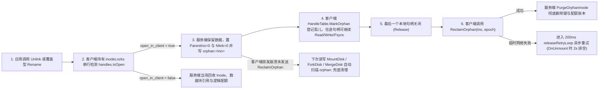

# POSIX 语义与扩展属性

本章基于 `services/storage/internal/store` 存储引擎与 `client/internal/fusefs` 客户端适配层源码，给出 Bowl 已完整实现并经代码验证的 POSIX 系统调用矩阵、边界条件、孤儿节点回收闭环以及扩展属性、`ioctl` 与文件锁语义。

---

## 目录与命名空间操作矩阵

| 操作 | 支持范围与核心契约 | 关键限制 / 错误码 | 源码依据 |
| :--- | :--- | :--- | :--- |
| `Lookup` | 按 `(parent_ino, name)` 查询子节点属性；支持 `.`（返回父目录自身）与 `..`（读取 `ParentIno`；根目录返回自身） | 名称须 `1..255` 字节且无 `/` 与 `\x00`；`ParentIno == 0` 的孤儿节点对 `Lookup` 不可见（返回 `ENOENT`） | `services/storage/internal/store/namespace.go`、`client/internal/fusefs/fs_lookup_getattr.go` |
| `Mkdir` | 创建目录，初始化 `Nlink = 2` 并递增父目录 `Nlink`；客户端本地标记空目录以加速后续负向查表 | 同名返回 `EEXIST`；父目录达 `MaxNlink = 65000` 返回 `EMLINK` | `services/storage/internal/store/namespace.go`、`client/internal/fusefs/fs_topology.go` |
| `Mknod` | 创建常规文件（`S_IFREG`）、FIFO 管道（`S_IFIFO`）、字符/块设备（`S_IFCHR`/`S_IFBLK`）及 Unix Socket（`S_IFSOCK`），支持传入 `rdev` | 若 `mode` 类型位为 `0`，按常规文件处理；禁止直接创建目录（应走 `Mkdir`） | `services/storage/internal/store/namespace.go`、`client/internal/fusefs/fs_topology.go` |
| `Create` | 原子创建常规文件并分配本地句柄；客户端 `ToProtoOpenFlags` 仅保留访问模式及 `O_CREAT`/`O_EXCL`/`O_TRUNC`/`O_APPEND`，剥离内核高位标志 | 存储端直接拒绝 `O_TMPFILE`（`0o20000000`）返回 `EOPNOTSUPP`；带 `O_CREAT \| O_EXCL` 遇已存在返回 `EEXIST` | `services/storage/internal/store/namespace.go`、`client/internal/fusefs/fs_file_handle.go` |
| `Tmpfile` (`O_TMPFILE`) | 客户端 `TmpFileManager` 在本地内存创建匿名临时文件（要求 `O_WRONLY` 或 `O_RDWR`），未具名前读写截断均在本地执行；`linkat` 具名或 `Flush`/`Fsync` 时自动通过 `Mknod + Write + SetAttr` 上云物化 | 只读挂载返回 `EROFS`；非法访问模式返回 `EINVAL` | `client/internal/fusefs/fs_tmpfile.go` |
| `Symlink` / `Readlink` | 创建符号链接（`S_IFLNK \| 0o777`），目标路径直接内联于 `Inode` 尾部，计入 `LogicalBytes`；读取返回原目标字节切片 | 目标路径不可为空且最长 `MaxSymlinkTargetBytes = 4095` 字节（超限返回 `ENAMETOOLONG`） | `services/storage/internal/store/namespace.go`、`client/internal/fusefs/fs_link.go` |
| `Link` | 为非目录存活节点创建硬链接，递增 `Nlink` | 严禁对目录创建硬链接（`EPERM`）；禁止对已解链的 `orphan` 节点（`Nlink == 0`）创建硬链接（`ENOENT`）；`Nlink &gt;= 65000` 返回 `EMLINK` | `services/storage/internal/store/namespace.go`、`client/internal/fusefs/fs_link.go` |
| `Rmdir` | 删除空目录并递减父目录 `Nlink` | `.` 返回 `EINVAL`；`..` 或非空目录返回 `ENOTEMPTY`；非目录返回 `ENOTDIR` | `services/storage/internal/store/unlink_rename.go`、`client/internal/fusefs/fs_topology.go` |
| `Unlink` | 删除非目录项；根据请求 `open_in_client` 判断立即物理清理或转入 `orphan:&lt;ino&gt;` | 对目录执行 `Unlink` 返回 `EISDIR`；带有不可变/仅追加标志受约束返回 `EPERM` | `services/storage/internal/store/unlink_rename.go`、`client/internal/fusefs/fs_topology.go` |
| `ReadDir` / `ReadDirPlus` | 按子项 `Ino` 升序流式读取（利用 Pebble `SeekPrefixGE`），支持基于游标偏移的稳定分页 | 单次 `Limit` 上限 `MaxReadDirLimit = 4096`（客户端默认按每页 `512` 项拉取） | `services/storage/internal/store/namespace.go`、`client/internal/fusefs/fs_dir.go` |

> [!NOTE]
> 当客户端使用 `--stats-file` 参数挂载时，根目录会额外暴露虚拟只读监控文件 `.stats`（占用本地保留号 `VirtualStatsIno`）。对 `.stats` 的 `Mkdir`/`Create`/`Unlink`/`Rename`/`SetAttr`/`SetXattr` 等修改操作会在客户端直接拦截返回 `EACCES` 或 `ENOTDIR`，不透传至存储服务端。

---

## `Rename` 标志位与祖先环检测

`Rename`（对应 Linux `renameat2` / FUSE `FUSE_RENAME2`）在 `services/storage/internal/store/unlink_rename.go` 与 `client/internal/fusefs/fs_rename.go` 中实现：

| 标志位 | 数值 | 支持状态 | 详细语义与校验规则 |
| :--- | :--- | :--- | :--- |
| 默认覆盖 (`0`) | `0x0` | **支持** | 若目标不存在则直接移动；若目标存在，要求类型兼容（文件不可覆盖目录 -&gt; `EISDIR`，目录不可覆盖非目录 -&gt; `ENOTDIR`，目标目录非空 -&gt; `ENOTEMPTY`）。被覆盖文件若 `Nlink == 1` 且 `TargetOpenHandle = true`，则转为孤儿节点 |
| `RENAME_NOREPLACE` | `0x1` | **支持** | 要求目标目录项绝对不存在，否则原子拒绝并返回 `EEXIST` |
| `RENAME_EXCHANGE` | `0x2` | **支持** | 要求源与目标目录项均存在，支持不同类型节点（如文件与目录互换）原子交换；跨父目录互换文件与目录时同步精确增减双方父目录 `Nlink` 并在溢出 `MaxNlink = 65000` 时拦截返回 `EMLINK` |
| `RENAME_WHITEOUT` | `0x4` | **明确不支持** | 服务端严格返回 `ErrNotSupported`（映射为 `EOPNOTSUPP`） |
| 互斥或未知标志位 | 其他组合 | **拒绝** | 若同时传入 `RENAME_NOREPLACE \| RENAME_EXCHANGE` 或携带未知位，返回 `ErrInvalid`（`EINVAL`） |

**双向祖先环检测（`isSubdirectory`）**：
- 普通 `Rename` 移动目录时，若新父目录是源目录自身或其任意后代，立即返回 `EINVAL`；
- 在 `RENAME_EXCHANGE` 模式下涉及目录互换时，引擎执行**双向祖先检查**：不仅校验 `newParent` 不是 `old` 的子目录，也校验 `oldParent` 不是 `new` 的子目录，从根本上杜绝两个目录互相交换导致脱离根目录树成为闭环孤岛。

---

## 数据读写、属性修改、空间预分配与持久化

### `Read` / `Write` / `Writev` 分片与稀疏空洞

- **协议与客户端分片**：
  - FUSE 内核单次握手上限配置为 `MaxWrite = 1 MiB`、`MaxReadAhead = 1 MiB`；
  - Storage RPC 单次传输载荷上限为 `maxReadWriteSize = 4 MiB`（`4 &lt;&lt; 20`）；若单次 FUSE 读写请求超过 `4 MiB`，客户端自动按 `4 MiB` 顺序循环分片，中途遇到 `EOF` 或后续分片失败时严格遵守 POSIX **短读 / 短写**语义（已成功读写部分返回正字节数与 `fuse.OK`，仅首片失败返回 errno）；
  - 客户端 `ReadAheadCoordinator` 对连续顺序读维持 `W_read = 4` 个 `4 MiB` 对齐预读窗口；`WriteBehindCoordinator` 支持顺序常规文件异步批量写回（遇 `O_APPEND`、`O_SYNC`/`O_DSYNC`、`AttrTimeoutSeconds &lt;= 0`、特殊权限位或携带未确认 `security.capability` 时退化为同步直通写，且通过 `inodeLocks` 保证 `O_APPEND` 的"排空 -&gt; 读大小 -&gt; 追加写"严格串行）。
  - `Write` 一旦发出在途 RPC，客户端使用 `context.WithoutCancel` 屏蔽内核 `FUSE_INTERRUPT`（如 Go `SIGURG` 信号），避免非幂等追加写重复提交。
- **底层分块与稀疏空洞**：
  - 引擎以固定 `BlobSize = 256 KiB` 网格映射文件数据键 `data:&lt;ino&gt;:&lt;blockIdx&gt;` -&gt; `16B BlobRef{PackID, Offset, Length}`，`.pack` 容器单包封口上限为 `PackMaxSize = 64 MiB`；
  - `MaxFileSize = math.MaxInt64`，偏移或长度溢出返回 `ErrFileTooLarge`（`EFBIG`）；
  - 写入后文件末端之前形成的未分配空洞不占用 `.pack` 存储空间，读取空洞块时自动以零字节填充；对已分配整块写入全零时支持零块省略/打洞回收；
  - 任何常规数据写入成功时，存储引擎同步剥离 `S_ISUID`、`S_ISGID` 权限位并删除 `security.capability` 扩展属性（与客户端 `CAP_HANDLE_KILLPRIV` 协同）。

### `SetAttr` 按位部分更新与 `Fallocate` 模式差异

- **`SetAttr`**：支持独立或组合更新 `Mode`、`UID`、`GID`、`Size`（截断或稀疏扩长）、`Atime` / `AtimeNow`、`Mtime` / `MtimeNow`、`CtimeNow` 与 `Flags`。客户端在 `FATTR_ATIME_NOW` 与 `FATTR_ATIME`（或 `MTIME_NOW` 与 `MTIME`）同时置位时强制优先发送 `*Now = true` 并置空显式时间戳，避免触发协议互斥校验。当 `UID`、`GID` 或 `Size` 发生变化时，服务端自动剥离 `S_ISUID | S_ISGID` 及 `security.capability`。
- **`Fallocate` 支持矩阵（区分客户端入口与存储引擎）**：

| 模式组合 | 存储引擎层（`store/data_partial.go`） | 客户端 FUSE 层（`fs_setattr_fallocate.go`） | 语义说明 |
| :--- | :--- | :--- | :--- |
| `0`（默认预分配） | **支持** | **支持** | 区间越过当前文件尾时扩展 `Inode.Size`（更新 `LogicalBytes` 与配额），以稀疏语义保留空间而不填充物理垃圾 |
| `FALLOC_FL_KEEP_SIZE` | **支持** | **支持** | 保持 `Inode.Size` 不变，仅校验配额与边界 |
| `FALLOC_FL_PUNCH_HOLE \| FALLOC_FL_KEEP_SIZE` | **支持** | **支持** | 对 `[offset, offset+len)` 打洞释放覆盖的 `256 KiB` 块引用并对部分重叠块局部清零，保持 `Size` 不变 |
| `FALLOC_FL_PUNCH_HOLE`（无 `KEEP_SIZE`） | `ErrInvalid`（`EINVAL`） | `EOPNOTSUPP` | POSIX 规定打洞必须同时携带 `KEEP_SIZE` |
| `FALLOC_FL_ZERO_RANGE`（含或不含 `KEEP_SIZE`） | **支持** | **拦截返回 `EOPNOTSUPP`** | 存储引擎已实现范围置零逻辑，但当前客户端 FUSE 入口显式白名单限制仅放行前三种模式 |
| `COLLAPSE_RANGE` / `INSERT_RANGE` 等其他模式 | `ErrNotSupported`（`EOPNOTSUPP`） | `EOPNOTSUPP` | 不支持改变中间块偏移或折叠范围的操作 |

### `Flush` 与 `Fsync` / `FsyncDir` 刷盘语义

- **延迟落盘策略**：`close(fd)` 触发 FUSE `Flush` 时，客户端仅排空本地 `WriteBehind` 队列并释放该进程的 POSIX 记录锁（对未具名 `O_TMPFILE` 则上传写入服务端 WAL），**不再**跨机发起物理 `Fsync` RPC，以保障高频小文件吞吐。
- **物理持久化屏障**：仅当应用显式调用 `fsync()`/`fdatasync()`（`Fsync`）、`fsync(dirfd)`（`FsyncDir`）或卸载触发 `OnUnmount` 排空所有 `dirtyInodes` 时，存储引擎将 `syncBarrier = true` 送入单协程写循环执行 WAL 同步落盘与死包清理。
- **边界约束**：`Fsync` 对目录返回 `EISDIR`；`FsyncDir` 对非目录返回 `ENOTDIR`，且对已被 `Rmdir` 但仍被本地持有句柄的已删除目录安全放行返回 `OK`。

---

## Unlink/Rename-while-open 孤儿节点闭环

为了完整支持 POSIX “打开后删除仍可继续读写，最后一个句柄关闭才彻底释放空间”的语义（如 SQLite 日志、临时工作文件与锁文件），Bowl 在客户端与服务端之间建立了跨进程闭环机制：

核心状态与兜底路径：

1. **防竞态串行化**：在 `Unlink`、`Rename`（非 `EXCHANGE` 覆盖且目标 `Nlink == 1`）与 `Release` 之间，客户端通过按 `Inode` 粒度的 `inodeLocks` 互斥锁严格串行执行，彻底避免“客户端刚关闭句柄但 `Unlink` 误判仍打开”或“已标记孤儿却漏掉关闭回调”的双边漏失。
2. **孤儿期可见性与计费**：在 `orphan:&lt;ino&gt;` 存活期间，节点 `Nlink == 0`、`ParentIno == 0`：任何新 `Lookup` 与 `Link` 均返回 `ENOENT`，但既有的文件描述符仍可通过 `Ino` 正常读写、`Fstat` 与 `Fsync`，其 `Inode.Size` 也依然计入 `used_bytes` 配额。
3. **异步重试与积压告警**：若 `ReclaimOrphan` 因网络抖动返回 `Unavailable`/`DeadlineExceeded`/`Aborted`/`ResourceExhausted`/`Internal`，节点进入客户端 `releaseQueue`，后台协程按 `DefaultReleaseRetryInterval = 200ms` 周期重试；队列深度达到 `DefaultOrphanBacklogThreshold = 16` 时限流打印 `orphan_reclaim_backlogged` 告警。
4. **崩溃兜底清扫**：若客户端未及发送 `ReclaimOrphan` 即断电崩溃，服务端会在**下一次读写 `MountDisk`**（`AcquireWriterLease` 触发 `planCleanOrphans`）、**`ForkDisk`**（`SanitizeCheckpoint` 净化）或 **`MergeDisk`**（阶段一整理目标树）时统一清除全部残留 `orphan:&lt;ino&gt;` 记录并归还逻辑容量配额。

---

## 扩展属性 `xattr`、`ioctl` 与文件锁

### 扩展属性 `xattr`（`xattr_setattr.go` / `fs_xattr.go`）

- **长度与配额硬上限**：
  - 属性名 `1..255` 字节，不能包含 `\x00`（为空或含 NUL 返回 `EINVAL`；超 `255` 字节返回 `ERANGE`）；
  - 单属性值上限 `MaxXattrValueBytes = 64 KiB`（`65536` 字节，超限返回 `ERANGE`）；
  - 单节点所有属性键列表总长度（按 `sum(len(name) + 1)` 计入每键尾部的 `\x00` 分隔符）上限 `MaxXattrListBytes = 64 KiB`（超限返回 `ENOSPC`）。
- **命名空间与文件类型约束**：
  - `user.*` 前缀的扩展属性**仅允许**挂载在常规文件（`S_IFREG`）、目录（`S_IFDIR`）与套接字（`S_IFSOCK`）上；
  - 对符号链接、FIFO、设备节点等其他类型设置或删除 `user.*` 属性返回 `EPERM`，读取返回 `ENODATA`；
  - `ListXattr` 返回按字节字典序排列的所有原始属性键名（不按类型过滤），客户端根据内核调用约定在 `len(dest) == 0` 时返回所需字节总长度，缓冲区不足返回 `ERANGE`。
- **存在性标志与能力负缓存**：
  - 支持 `XATTR_CREATE (0x1)`（属性已存在则失败返回 `EEXIST`）与 `XATTR_REPLACE (0x2)`（属性不存在则失败返回 `ENODATA`）；同时置位或未知标志返回 `EINVAL`；
  - 客户端 `capabilityCache` 为每个未显式设置过 `security.capability` 的节点维持本地“已知不存在”负缓存，避免内核在每次 `Write` 前额外发起 `GetXattr("security.capability")` RPC。

### `ioctl` 标志位映射（`fs_ioctl.go`）

| 命令号 | 映射服务端字段 | 支持标志位 | 拒绝 / 边界行为 |
| :--- | :--- | :--- | :--- |
| `FS_IOC_GETFLAGS` (`0x80086601`) / `FS_IOC32_GETFLAGS` (`0x80046601`) | `InodeAttribute.flags` | 读取 `FS_IMMUTABLE_FL` (`0x00000010`)、`FS_APPEND_FL` (`0x00000020`) | 缓冲区 `&lt; 4` 字节返回 `EINVAL`；先对当前节点执行 `WriteBehind.BarrierInode` 保证顺序一致 |
| `FS_IOC_SETFLAGS` (`0x40086602`) / `FS_IOC32_SETFLAGS` (`0x40046602`) | `SetAttrRequest.flags` | 设置/清除 `ProtoFlagImmutable` (`0x1`)、`ProtoFlagAppend` (`0x2`) | 只读挂载返回 `EROFS`；包含除这两个标志外的其余位返回 `EOPNOTSUPP` |
| `FS_IOC_FSGETXATTR` (`0x801c581f`) / `FS_IOC_FSSETXATTR` (`0x401c5820`) | `InodeAttribute.flags` | 双向桥接 `FS_XFLAG_IMMUTABLE` (`0x00000008`)、`FS_XFLAG_APPEND` (`0x00000010`) | 缓冲区 `&lt; 28` 字节返回 `EINVAL`；出现未知 `fsxattr` 标志返回 `EOPNOTSUPP` |
| 其余所有命令（如 `TCGETS` 终端探测） | — | — | **在加锁与写屏障前直接短路返回 `ENOTTY`**（严禁返回 `ENOSYS`，以免内核永久禁用整个挂载点的所有 `ioctl` 能力） |

### 文件锁（`fs_lock.go` / `lock_table.go`）

客户端在本地挂载点进程内维护 `LockTable`（每个 Inode 隔离维护 `posix` 与 `flock` 两套独立锁集合），全面支持 `GetLk`、`SetLk`（非阻塞冲突返回 `EAGAIN`）与 `SetLkw`（阻塞等待）：

- **POSIX 字节范围记录锁（`fcntl` / `lockf`）**：
  - 按 `LockOwner` 区分持有者；校验区间 `end &gt;= start`；对请求 `F_RDLCK` 检查句柄不得为 `O_WRONLY`，对请求 `F_WRLCK` 检查句柄不得为 `O_RDONLY`（否则返回 `EBADF`）；
  - 同一持有者在重叠/相邻区域加锁或部分 `F_UNLCK` 时，执行自动区间分裂（Split）与同类型合并（Coalesce）；
  - `SetLkw` 在追加等待者前通过构建局部等待图执行**实时死锁检测（`deadlocked`）**，一旦成环立即拒绝后到请求并返回 `EDEADLK`；
  - 每次 `Flush`（即任何进程 `close(fd)`）时按 `LockOwner` 自动释放该持有者的所有 POSIX 锁；
  - `GetLk` 不允许传入 `F_UNLCK`（返回 `EINVAL`）。
- **BSD `flock` 全文件锁（`FUSE_LK_FLOCK`）**：
  - `NormalizeLockRange` 将整个文件锁区间统一归一化为 `[0, ^uint64(0)]`；
  - 按打开句柄 `Fh`（`fh != 0` 优先，回退 `Owner`）标识持有者，仅在句柄彻底关闭触发 `Release` 时释放；支持同一句柄持锁期间平滑升级或降级锁类型（先原子卸除旧锁再挂新锁）。
- **中断与卸载取消**：`SetLkw` 阻塞期间若收到内核 `cancel`（`FUSE_INTERRUPT`）、调用上下文取消或挂载退出调用 `LockTable.Close()`，立即将等待者移除唤醒并返回 `EINTR`。由于 Bowl 为单写者架构且客户端内进程共享同一挂载点，本地锁表在单机多进程并发下完全具备 POSIX 锁语义，但不跨多个独立只读挂载点同步。

---

## 相关接口与实现参考

- 全部存储引擎错误码与 POSIX `errno` 映射表：`services/storage/internal/control/status.go` 与 `client/internal/rpc/errors.go`。
- 存储 RPC 接口详细字段约束：[RPC 接口契约](/03-interfaces/rpc-api)。
- 写缓存、预读流水线与客户端内部状态机：[Client 与 FUSE 流水线](/04-internals/client-fuse-pipeline)。
