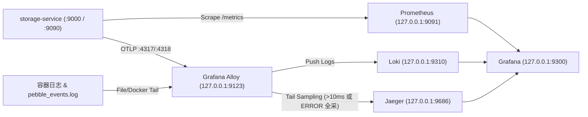

# 可观测性手册

Bowl 在服务端与客户端构建了同构的可观测性体系，涵盖**双端口网络隔离**、**零高基数标签 Prometheus 指标**、**优先级感知 OpenTelemetry 链路追踪**、**客户端回环统计接口**与**分级结构化日志**。

## 服务端双端口架构

`services/storage/cmd/main.go` 与 `services/storage/internal/server/server.go` 同时监听两个完全隔离的 HTTP 端口：

| 端口 | 环境变量（默认值） | Compose 绑定策略 | 暴露路径与用途 |
| :--- | :--- | :--- | :--- |
| **公网 RPC 端口** | `SERVER_PORT`（`9000`） | `0.0.0.0:9000` | 仅挂载 `StorageService` ConnectRPC HTTP/2（`h2c` 或 TLS）业务接口 |
| **内网管理端口** | `INTERNAL_SERVER_PORT`（`9090`） | `127.0.0.1:9090` | `/metrics`（Prometheus 抓取）、`/debug/pprof/*`（运行时剖析，支持 `PPROF_MUTEX_FRACTION` 与 `PPROF_BLOCK_RATE`）、`/healthz`（存活探针，恒返回 `200`）、`/readyz`（就绪探针，实时 Ping PostgreSQL 连接池） |

## 服务端关键 Prometheus 指标

所有指标统一以 `bowl_storage_` 为前缀，**刻意不在核心数据/控制指标中暴露高基数的 `disk_id` 标签**，避免海量短生命周期沙箱盘撑爆 TSDB 基数。

### 1. HTTP 与 RPC 传输层（`server/metrics.go`）

| 指标名 | 类型 | 标签 | 说明 |
| :--- | :--- | :--- | :--- |
| `bowl_storage_http_request_duration_seconds` | Histogram | `procedure`, `status_class` | 服务端请求处理耗时，采用 `18` 个亚毫秒起步分桶（`25µs .. 10s`） |
| `bowl_storage_http_request_bytes_total` | Counter | `procedure`, `status_class` | 请求载荷累计字节数 |
| `bowl_storage_http_response_bytes_total` | Counter | `procedure`, `status_class` | 响应载荷累计字节数 |

此外，`otelconnect` 导出的标准 `rpc.server.call.duration` / `rpc.server.duration` 指标在 `server/metrics.go` 中同样被覆写为 `SubMillisecondBuckets`（`25µs .. 10s`）。

### 2. 控制面与全局存储引擎汇总（`control/metrics.go`）

`storageEngineCollector` 采用 **Pull 模式** 在每次 `/metrics` 抓取时动态聚合全部已加载 `StoreActor`、Pebble 实例、Commit 目录与宿主机磁盘空间：

| 指标名 | 类型 | 关键标签 | 说明 |
| :--- | :--- | :--- | :--- |
| `bowl_storage_disks_loaded` | Gauge | `mode`（`rw`/`ro`） | 当前常驻内存的 `StoreActor` 数量 |
| `bowl_storage_logical_bytes` / `bowl_storage_inodes` | Gauge | — | 已加载磁盘汇总逻辑字节数与 Inode 总数 |
| `bowl_storage_pack_physical_bytes` / `referenced_bytes` / `live_bytes` | Gauge | — | `.pack` 物理文件总占用、活跃引用字节与有效载荷字节（用于衡量空间放大与碎片率） |
| `bowl_storage_pack_low_watermark_files` / `pending_dead_files` / `open_fds` | Gauge | — | 待压缩低水位 `.pack` 数、待删除死封包数与打开文件句柄数 |
| `bowl_storage_hot_cache_bytes` / `hot_cache_blocks` | Gauge | — | `64 MiB` 16 分片热块环形缓存当前占用与块数 |
| `bowl_storage_data_dir_physical_bytes` / `commits_active` / `commits_physical_bytes` | Gauge | — | `DATA_DIR` 物理总占用、活跃 Commit 目录数及其物理占用 |
| `bowl_storage_volume_total_bytes` / `volume_available_bytes` | Gauge | — | 宿主机数据卷总容量与可用容量 |
| `bowl_storage_pebble_*` | Gauge | — | 汇总 Pebble WAL、L0 子层/文件数、ReadAmp、CompactionDebt、Flush、Filter 与 TableIter 活跃计数 |
| `bowl_storage_pebble_block_cache_*` | Gauge | — | 所有盘共享的 `64 MiB` Pebble BlockCache 命中/未命中与字节数 |
| `bowl_storage_pebble_stall_active` | Gauge | — | 当前正在经历写停顿（Write Stall）的磁盘数量 |
| `bowl_storage_control_actor_loads_total` / `actor_evictions_total` | Counter | — | 按需加载与淘汰 `StoreActor` 次数 |
| `bowl_storage_control_forks_total` / `commits_reclaimed_total` / `cleanup_errors_total` | Counter | — | Fork 执行次数、孤立 Commit 回收计数与清理失败次数 |
| `bowl_storage_control_open_actor_duration_seconds` / `fork_stage_duration_seconds` / `segment_reserve_duration_seconds` | Histogram | — | 控制面打开 Actor、Fork 分阶段与 Segment 预留耗时 |

### 3. 单盘 StoreActor 与 Data/KV 热路径（`store/metrics.go`）

| 指标名 | 类型 | 关键标签 | 说明 |
| :--- | :--- | :--- | :--- |
| `bowl_storage_actor_queue_wait_seconds` | Histogram | — | 请求进入 `StoreActor` 微批队列前的排队等待时间 |
| `bowl_storage_actor_tick_batch_size` | Histogram | — | 单次微批合并处理的写操作数量 |
| `bowl_storage_actor_tick_phase_duration_seconds` | Histogram | `phase` | 微批各阶段（校验、Pebble 写入、回调通知）耗时 |
| `bowl_storage_inode_lock_wait_seconds` | Histogram | — | 单 Inode 互斥锁竞争等待耗时 |
| `bowl_storage_blob_rmw_read_duration_seconds` / `pwrite_duration_seconds` / `pread_duration_seconds` | Histogram | — | `256 KiB` 块读改写（RMW）、`.pack` 写/读 syscall 耗时 |
| `bowl_storage_blob_mu_wait_seconds` / `sync_duration_seconds` | Histogram | `target`, `trigger` | `.pack` 互斥锁等待与 `fdatasync`/`fsync` 刷盘耗时 |
| `bowl_storage_blob_write_blocks_total` / `write_bytes_total` | Counter | `mode` | 块写入次数与字节数（区分整块覆盖与局部 RMW） |
| `bowl_storage_blob_read_source_total` | Counter | `source` | 块读取命中来源分布（热块环形缓存、`.pack` 物理读取或全零稀疏洞） |
| `bowl_storage_read_op_duration_seconds` / `kv_read_duration_seconds` | Histogram | `op` | 读数据操作与 Pebble 元数据只读操作延迟 |
| `bowl_storage_hot_cache_evictions_total` | Counter | — | 热块缓存驱逐次数 |
| `bowl_storage_epoch_fenced_total` | Counter | — | 因 `writer_epoch` 过期被栅栏拦截的请求数 |
| `bowl_storage_pebble_stall_events_total` / `pebble_disk_slow_total` | Counter | — | Pebble L0 写停顿事件与超过 `500ms` 的慢盘告警次数 |
| `bowl_storage_bg_sync_errors_total` / `pack_remove_errors_total` | Counter | — | 后台异步刷盘与死 `.pack` 清理错误计数 |

## 客户端可观测性与 `.stats` 虚拟文件

### 1. 回环 HTTP 管理端口与 `bowl stats`

`bowl mount` 默认监听本地回环 TCP 地址 `127.0.0.1:0`（可通过 `--admin-addr` 指定端口或传入 `"off"` 关闭），并将地址写入 `/run/bowl/mounts/<sha256_16B>.json`（无权限回退 `$TMPDIR/bowl-mounts/`）。暴露端点如下：

| 端点 | 用途 |
| :--- | :--- |
| `GET /metrics` | Prometheus 格式客户端指标 |
| `GET /debug/pprof/*` | 客户端进程 Go 运行时剖析 |
| `GET /healthz` / `GET /readyz` | 进程存活与 FUSE 就绪探针 |
| `GET /debug/stats?format=<text\|json\|stats>` | `bowl stats` 命令的数据源，输出人类可读表格（`text`）、JSON（`json`，其中暂存模块字段为 `"stage"`）或两列原始文本（`stats`） |

### 2. 客户端核心指标（`rpc/observability.go` & `fusefs/metrics.go`）

| 模块 | 关键指标名 | 说明 |
| :--- | :--- | :--- |
| **RPC 客户端** | `bowl_client_rpc_retries_total`、`bowl_client_rpc_retry_exhausted_total`、`bowl_client_stale_epoch_total`、`bowl_client_rpc_logical_duration_seconds` | 瞬态重试计数、重试耗尽计数、Epoch 过期计数与端到端逻辑 RPC 耗时；同时发出 `X-Request-Id` 与 `otelconnect` `rpc.client.*` 亚毫秒指标 |
| **FUSE 操作层** | `bowl_client_fuse_*` | 覆盖全部 `41` 个 FUSE 操作的调用次数、错误数与延迟（`26` 个对数微秒桶：`1µs .. 33.55s`） |
| **客户端缓存与队列** | `bowl_client_nscache_*`、`bowl_client_capcache_*`、`bowl_client_readahead_*`、`bowl_client_stage_*`、`bowl_client_tmpfile_*` | 命名空间负/正缓存、Capability 缓存、顺序预读窗口、本地磁盘写暂存与后台上传、宿主机磁盘 `O_TMPFILE` 状态统计 |
| **句柄、锁与连接** | `bowl_client_open_handles`、`bowl_client_locks_*`、`bowl_client_inodelock_*`、`bowl_client_queue_*`、`bowl_client_fuse_connection_*` | 当前打开句柄数、本地 POSIX/flock 锁表、客户端 Inode 锁等待与异步请求队列深度 |

#### 写暂存（`bowl_client_stage_*`）与 `O_TMPFILE`（`bowl_client_tmpfile_*`）指标明细

| 指标名 | 类型 | 说明 |
| :--- | :--- | :--- |
| `bowl_client_stage_writes_total` | Counter | 路由至本地磁盘暂存与同步直通写的请求次数统计 |
| `bowl_client_stage_bytes_total` | Counter | 路由至本地磁盘暂存与同步直通写的载荷字节数统计 |
| `bowl_client_stage_upload_rpcs_total` | Counter | 后台上传工作协程发起 `Write` RPC 的累计次数统计（按结果区分） |
| `bowl_client_stage_inflight` | Gauge | 当前正在向服务端传输的后台暂存分片 `Write` RPC 并发数 |
| `bowl_client_stage_pending_chunks` | Gauge | `StageCoordinator` 中尚未完成上传的活跃与待传分片数量 |
| `bowl_client_stage_used_bytes` | Gauge | 当前占用的 `--stage-size` 本地暂存配额字节数（含常规分片与已具名转正的 `O_TMPFILE`） |
| `bowl_client_stage_capacity_bytes` | Gauge | 当前挂载实例配置的 `--stage-size` 暂存配额上限字节数 |
| `bowl_client_stage_backpressure_wait_duration_seconds` | Histogram | 前台 `Write` 因触发 `--stage-size` 上限阻塞等待配额释放的耗时分布 |
| `bowl_client_stage_barrier_wait_duration_seconds` | Histogram | FUSE 屏障操作等待对应 Inode 或全盘暂存分片排空的耗时分布 |
| `bowl_client_tmpfile_active_files` | Gauge | 当前由 `TmpFileManager` 管理的未具名 `O_TMPFILE` 活跃文件数 |
| `bowl_client_tmpfile_resident_bytes` | Gauge | 当前未具名 `O_TMPFILE` 在宿主机 `--stage-dir` 磁盘上的实际字节占用 |
| `bowl_client_tmpfile_promotes_total` | Counter | 通过 `linkat`（`Link`）具名转正并移交 `StageCoordinator` 上传的 `O_TMPFILE` 累计次数 |

### 3. 挂载根目录虚拟 `.stats` 文件

在 `bowl mount` 时传入 `--stats-file`，客户端会在挂载根目录暴露只读虚拟文件 `.stats`（及其兼容别名 `.jfs.stats`），源码位于 `client/internal/fusefs/stats_file.go`：

- **文件属性**：固定虚拟 Inode `(1<<63)-1`，权限 `0o444`，仅允许只读打开（`O_RDONLY`）；
- **内容格式**：按两列空白分隔（`<metric_name> <value>`）渲染当前运行态全量指标，兼容 `juicefs bench` 等外部基准测试工具的自动采集协议；
- **读取方式**：`cat <mountpoint>/.stats` 与 `bowl stats <mountpoint> --raw` 返回完全一致的实时快照。

## OpenTelemetry 分布式追踪

### 环境变量配置（`server/tracing.go` & `config.go`）

| 环境变量 | 默认值 | 说明 |
| :--- | :--- | :--- |
| `OTEL_ENABLED` | `true`（`.env.example`） | 总开关 |
| `OTEL_SERVICE_NAME` | `bowl-storage`（服务端） | 上报服务名；客户端挂载固定上报对应客户端服务名，短生命周期 CLI 使用 `bowl-cli` |
| `OTEL_TRACES_EXPORTER` | `otlp` | 导出器类型，支持 `otlp` 或 `none` |
| `OTEL_EXPORTER_OTLP_ENDPOINT` / `OTEL_EXPORTER_OTLP_TRACES_ENDPOINT` | — | OTLP 接收端（若缺少协议前缀，代码自动补全 `http://`） |
| `OTEL_EXPORTER_OTLP_INSECURE` | `true`（dev/prod） | 是否禁用 OTLP gRPC/HTTP TLS 校验 |
| `OTEL_TRACES_SAMPLER_ARG` | 服务端：dev `1.0` / prod `0.10`；客户端 `mount`：`0.001` | 默认概率采样率 |
| `OTEL_TRUST_REMOTE` | `false` | 控制是否完全信任短生命周期外部请求带来的未采样 `traceparent` |

### 优先级采样与 CLI 链路串联机制

Bowl 采用自定义的**优先级采样器（Priority Sampler）**，兼顾日常低开销与关键控制路径 100% 可追踪：

1. **服务端（`server/tracing.go`）**：
   - 对所有控制面与栅栏写入 RPC（`CreateDisk`、`ForkDisk`、`UpdateDisk`、`DeleteDisk`、`MountDisk`、`UnmountDisk`、`MergeDisk`、`ReclaimOrphan`）强制 **100% 采样**；
   - 携带已采样 Span Link 的请求强制跟随采样；
   - 针对来自短生命周期 CLI 进程的未采样远端 `traceparent`，按服务端局部策略重新评估采样决策（避免 CLI 低采样率导致服务端关键路径盲区）。
2. **客户端 `mount`（`client/internal/cli/admin.go` & `client/internal/fusefs/stage.go`）**：
   - 默认采样率仅 `0.001`，但对关键落盘与卸载链路（`fuse.Fsync`、`fuse.FsyncDir`、`fuse.OnUnmount`）及携带已采样 `SpanLink` 的 Span 强制 **100% 采样**。
   - `StageCoordinator` 在异步暂存与上传路径中发出 3 类追踪 Span：`stage.UploadChunk`（携带指向各前序写入者/转正者 Span 的 `SpanLinks`）、`stage.BackpressureWait`（配额背压阻塞）与 `stage.BarrierWait`（写屏障排空）。
3. **客户端 `bowl disk`（`client/internal/cli/disk_obs.go`）**：
   - 每次 CLI 执行自动创建 `cli.disk.<subcommand>` 根 Span（服务名 `bowl-cli`），并在命令退出前预留最多 `2s` 刷新导出缓冲区，便于在 Jaeger 中从 CLI 命令直接下钻到服务端 PostgreSQL 与 `StoreActor` Span。

## 日志体系与生产监控栈

### 结构化日志与慢操作阈值

| 组件 | 日志输出与格式 | 分级与慢请求告警阈值 |
| :--- | :--- | :--- |
| **存储服务端** | 标准输出 JSON/Text 日志；单盘 Pebble 额外写入 `$DATA_DIR/<disk>/pebble_events.log` | 控制面写请求以 `INFO` 记录；高频数据/元数据正常请求及 `Lookup`/`GetXattr` 的 `NotFound` 降为 `DEBUG`；**数据面耗时 `> 50ms`**、**控制面耗时 `> 200ms`** 或 **Pebble 写慢盘 `> 500ms`** 输出慢操作告警 |
| **客户端 `mount`** | 后台模式默认写 `/var/log/bowl/mount-<disk-id>.log`（无权限回退 `$XDG_STATE_HOME/bowl/logs/` 或 `~/.local/state/bowl/logs/`），支持 `--log-file`、`--log-level`、`--log-format` | 客户端单次 RPC 耗时超过 **`1s`** 输出慢调用告警日志；`--stage-dir` 位于 `tmpfs` 时启动输出 `stage_dir_on_tmpfs` 告警；后台上传遇终端业务错误输出 `stage_upload_failed` 错误日志 |

### 生产环境全链路可观测性栈（`deploy/prod/`）

使用 `ENV=prod task run` 启动生产编排后，系统额外拉起以下组件协同工作：

- **Grafana Alloy** 在生产模式中承担 OTLP 网关与日志收集器职责：对 Trace 执行尾部采样（保留所有 `ERROR` 及耗时超过 `10ms` 的慢 Span），同时采集容器日志与单盘 `pebble_events.log` 推送至 **Loki**，最终与 **Prometheus**、**Jaeger** 统一接入 **Grafana**（`127.0.0.1:9300`）呈现。

## 延伸阅读

- [CLI 参考手册](/03-interfaces/cli-reference) —— 查看 `bowl stats` 与 `bowl mount --admin-addr` / `--stats-file` 的命令行用法。
- [快速开始](/01-overview/quickstart) —— 查询本地开发环境端口映射并验证 `/readyz`。
