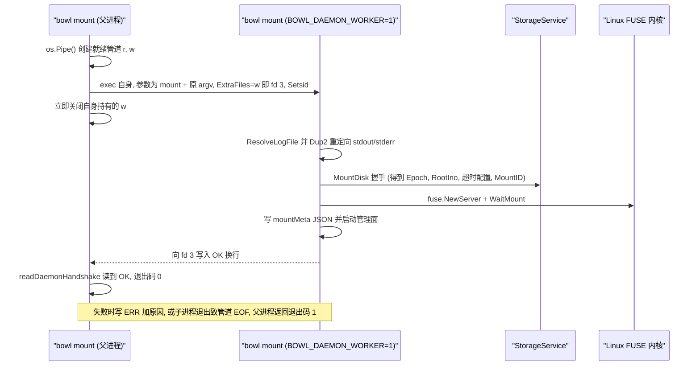
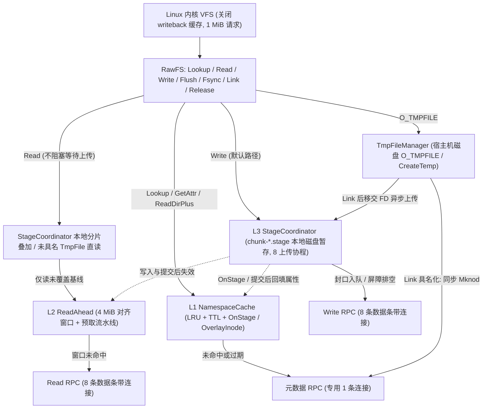

# 客户端 FUSE 流水线

`client` 是独立的 Go 模块，二进制入口为 `client/cmd/bowl`，核心包为 `client/internal/cli`（命令与守护进程）、`client/internal/fusefs`（FUSE 文件系统）、`client/internal/rpc`（ConnectRPC 客户端）。本章从进程生命周期讲到每一次 `read` / `write` 的字节路径。服务端对端见 [Store 引擎](/04-internals/storage-store-engine)。

::: warning 与常见印象不同的两点
- 管理端**不是 Unix Socket**，而是挂载进程内的本地 TCP HTTP 服务（默认 `127.0.0.1:0`，随机端口），地址通过元数据 JSON 文件发现。见 §1.3。
- `fs_capability.go` **不做 FUSE 能力协商**，它是 `security.capability` 扩展属性的负缓存。FUSE 能力协商在 `BuildMountOptions`（`client/internal/fusefs/fs.go`）。见 §2.1。
:::

## 1. 守护进程

### 1.1 fork 与就绪握手

`bowl mount` 默认以后台守护模式运行。`executeMount`（`client/internal/cli/mount.go`）完成 `--mode <staged|ro>`、`--stage-size`（最低 `4 MiB`）、`--stage-dir`（禁止位于 `<mountpoint>` 内）等参数校验后，按 `BOWL_DAEMON_WORKER` 环境变量与 `-f` 标志选择三种模式之一：

| 条件 | 模式 | 入口 |
| --- | --- | --- |
| 环境变量 `BOWL_DAEMON_WORKER=1` | 守护子进程 | `runDaemonWorker`（`cli/daemon.go:78`） |
| 未指定 `-f` / `--foreground` | 父进程：派生子进程并等待握手 | `spawnDaemon`（变量，指向 `spawnDaemonProcess`，`cli/daemon.go:38`） |
| 指定 `-f` | 前台阻塞，日志写标准错误 | `runMount(..., stderr, nil)` |

要点：

- 父进程**必须立即关闭自己的管道写端**（`daemon.go:71`），否则子进程退出时读端收不到 EOF，父进程会永久阻塞。
- 子进程用 `Setsid: true` 脱离控制终端，`Stdin` 指向 `/dev/null`，并通过 `unix.Dup2` 把标准输出与标准错误重定向到日志文件。
- 日志文件由 `ResolveLogFile`（`cli/log.go:49`）解析：`--log-file` 优先；否则 `/var/log/bowl/mount-` 加 `disk-id` 加 `.log`；无权限回退到 `$XDG_STATE_HOME/bowl/logs/` 或 `~/.local/state/bowl/logs/`。
- 握手协议只有两种行：`OK` 与 `ERR:` 加错误文本（`readDaemonHandshake`，`daemon.go:19`）。

### 1.2 `runMount` 装配顺序

`runMount`（`client/internal/cli/mount.go`）是前台与守护子进程共用的主流程：

1. `setupObservability`：日志、追踪与指标运行时。
2. **初始化暂存目录会话（仅 `--mode staged`）**：在连接服务端之前调用 `fusefs.OpenStageDirSession(baseCfg.StageDir)` 创建并加锁实例目录 `inst-<pid>-<hex>/`，基于 `flock` 清理已退出进程残留目录，并通过 `stageDirIsTmpfs`（`CheckTmpfs` / `statfs`）检查是否位于 `tmpfs` 上（命中时输出 `stage_dir_on_tmpfs` 告警），同时注册退出时的 `stageSession.Close()`。前置校验可确保非法或不可写 `--stage-dir` 快速失败而不推进服务端 `WriterEpoch`。`--mode=ro` 下跳过此步骤，不创建暂存目录，也不启动后台上传工作协程。
3. `rpc.NewClientFromConfig`：构造 ConnectRPC 客户端（见 §4）。
4. `mountHandshake`：单次 `MountDisk` RPC，10 秒超时。返回权威 `Epoch`、`RootIno`、`entry` 与 `attr` 超时；读写挂载必须拿到非 0 的 `Epoch`。
5. `fusefs.NewRawFS(client, *cfg)` 并注册指标收集器，同时注册延迟清理 `rawFS.OnUnmount()`（若单测等场景未传入 `StageSession` 且非只读模式，自动创建临时暂存会话并在 `OnUnmount` 清理，`StageSize` 默认 `DefaultStageSize = 512 MiB`）。
6. `startAdminServer`：启动管理面。
7. `startMountLeaseRenewer`：后台协程按 `TTL/3`（最小 1 秒）调用 `RenewMount`；收到 `FailedPrecondition` 或 `NotFound` 即停止续期。
8. `serveFUSE`（默认 `defaultServeFUSE`）：`fuse.NewServer` → `Serve` → `WaitMount` → `BindMountpoint` → `ready()`，之后阻塞到卸载。

### 1.3 管理端与发现元数据

- 管理面 `startAdminServer`（`cli/admin.go:318`）在 `--admin-addr` 上监听 **TCP**，默认 `127.0.0.1:0`，传 `off` 关闭。提供 `/metrics`、`/debug/pprof/*`、`/healthz`、`/readyz`、`/debug/stats`。
- 挂载就绪后，`ready` 回调把 `mountMeta`（`mountpoint`、`pid`、`disk_id`、`admin_addr`、`started_at`）原子写入（临时文件加 `rename`）元数据目录 `/run/bowl/mounts`，无权限回退 `$TMPDIR/bowl-mounts`；文件名为规范化挂载点 SHA-256 前 16 字节的十六进制加 `.json`（`cli/mountmeta.go`）。
- `bowl stats` 通过这些 JSON 找到 `admin_addr`，请求 `/debug/stats`；`bowl disk delete`、`bowl disk merge` 通过 `/proc/self/mountinfo`（`cli/mountinfo.go` 的 `FindDiskMountpoint`）识别本机挂载。

### 1.4 退出与清理

卸载由 `bowl umount`（调用 `fusermount3` / `fusermount` / `umount`）或 `SIGINT` / `SIGTERM` 触发，守护进程内的顺序如下：

1. 内核通知卸载，`server.Serve()` 返回；`RawFS.OnUnmount`（`client/internal/fusefs/fs.go`）执行：关闭锁表 → 取 `lifecycleMu` 写锁（等待在途请求排空）→ 排空 `StageCoordinator` 全部待传与在途分片（含已具名转正的 `O_TMPFILE` 上传）→ 对所有脏 inode 逐个 `Fsync` RPC → 清空句柄、`NamespaceCache`、`capabilityCache`、`TmpFileManager`、`ReadAheadCoordinator` → 关闭并移除 `StageDirSession`（`inst-<pid>-<hex>/`）→ 排空 `ReclaimOrphan` 重试队列。
2. `runMount` 停止续期协程，调用 `UnmountDisk` RPC 释放服务端租约（独立超时，不受信号上下文取消影响）。
3. 删除元数据 JSON 文件，关闭管理面与可观测性运行时。
4. `executeUmount`（`cli/umount.go:75`）在非 `--force` 时用 `waitMountMetaDrained` 轮询元数据文件消失或进程退出，保证"命令返回即数据已刷盘、租约已释放"。

## 2. FUSE 层基础：挂载选项、能力缓存与 Inode 锁

### 2.1 FUSE 能力协商：`BuildMountOptions`

`BuildMountOptions`（`client/internal/fusefs/fs.go`）决定与内核协商的能力与参数：

| 项 | 取值 | 含义 |
| --- | --- | --- |
| `MaxWrite` / `MaxReadAhead` | `1 MiB` / `1 MiB` | 单次写请求与内核预读上限 |
| `MaxBackground` / `CongestionThreshold` | `64` / `48` | 后台异步请求并发与拥塞阈值 |
| `ExtraCapabilities` | `CAP_HANDLE_KILLPRIV` | 由文件系统自己在写批次里清除 `security.capability`，内核不再写前探测 |
| `DisabledCapabilities` | `CAP_WRITEBACK_CACHE`、`CAP_AUTO_INVAL_DATA` | 关闭内核写回缓存，保持 1 MiB 写请求粒度并由 `StageCoordinator` 在本地磁盘合并；关闭自动失效，避免服务端与内核 mtime 不等造成整文件页缓存被清空 |
| `Options` | `default_permissions`，`--mode ro` 时加 `ro` | 权限检查交内核 |
| `EnableLocks` | `true` | 启用 POSIX 与 flock 锁协议（`fs_lock.go`、`lock_table.go`） |

`security.capability` 负缓存（`fusefs/fs_capability.go`）：`capabilityCache` 记录每个内核 inode"是否已知不带该属性"。普通文件几乎不会设置它，命中 `knownAbsent` 就免去写前 `GetXattr` RPC；`Create`、写成功、`SetAttr` 后调用 `markAbsent`，显式 `SetXattr` 后 `markPresent`，inode 被回收时 `forget`，会话失效时 `reset`。写路径用 `!fs.caps.knownAbsent(...)` 决定是否先做同步探测。

### 2.2 Per-Inode 细粒度锁：`inode_lock.go`

`inodeLocks` 是按 inode 分片的引用计数互斥锁表：

- 数据结构：`map[uint64]*inodeLockEntry`，条目含 `sync.Mutex` 与 `refs`；`lock(ino)` 返回释放函数，`refs` 归零时删除条目，内存随活跃 inode 数增减，不随文件总数增长。
- 先 `TryLock` 快路径（指标 `incInodeLockFast`），失败才阻塞并记录争用耗时。
- 只用于"同一节点必须串行"的少数场景，**不是**全局锁：

| 场景 | 位置 | 要保护的不变量 |
| --- | --- | --- |
| `O_APPEND` 写 | `fs_rw.go` | "排空暂存分片 → 读当前大小 → 提交同步 Write"原子，否则并发追加读到同一旧大小互相覆盖 |
| `Release` 孤儿标记 | `fs_file_handle.go` | 最后一个句柄关闭与并发 `Unlink` 互不错过，避免孤儿 inode 泄漏 |
| `Rename` 覆盖目标 | `fs_rename.go` | 被覆盖节点的孤儿标记串行 |
| 拓扑变更（`Unlink` 等） | `fs_topology.go` | 子节点解链与最后句柄关闭定序 |

对比：服务端 `StoreActor` 也有按 `ino & 0xfff` 的 4096 条带锁，用于同一 inode 的局部写定序，见 [Store 引擎 §3.2](/04-internals/storage-store-engine)。

## 3. 三级缓存与本地磁盘暂存流水线

进程内缓存与 I/O 调度分三级，由内核页缓存之下的三个协调器组成：

| 级别 | 组件 | 载体与缓存对象 | 容量与参数 |
| --- | --- | --- | --- |
| L1 | `NamespaceCache`（`namespace_cache.go`） | 内存 LRU：inode 属性、目录项、完整目录流、符号链接目标 | 默认 `65536` 条（`DefaultNamespaceCacheCapacity`），TTL 由服务端下发，支持 `OnStage` 本地写属性叠加 |
| L2 | `ReadAheadCoordinator`（`read_ahead.go`） | 内存窗口：4 MiB 对齐的文件数据窗口 | 单句柄最多 `4` 个预取窗口（`ReadAheadMaxPrefetch`），全客户端并发预读 RPC 上限 `32`（`ReadAheadMaxGlobalInflight`，即 128 MiB） |
| L3 | `StageCoordinator`（`stage.go`）与 `TmpFileManager`（`tmpfile_manager.go`） | 本地磁盘：`chunk-*.stage` 写暂存分片（上限 4 MiB）与宿主机 `O_TMPFILE` 匿名文件 | 默认暂存总配额 `--stage-size = 512 MiB`（最小 `4 MiB`），8 个后台上传工作协程复用 `[4 MiB]byte` 缓冲池；未具名 `O_TMPFILE` 不占上传配额 |

### 3.1 L1 命名空间缓存与本地写叠加

- **键**：`cacheKey{kind, ino, name}`，`kind` 区分 inode、目录项、目录流。条目有绝对到期时间（`expiresAtNano`）与权重；目录流按所含目录项数计费，防止单个大目录绕过容量上限。
- **二级索引**：`byParent`（父 inode → 子名集合）、`dirsByChild`、`inodeDirs`，使失效与回填从 O(N) 扫描降为定向查找。
- **`completeDirs`**：记录"目录内容已被完整掌握"的父节点（目录流已加载，或刚由 `Mkdir` 创建为空目录）。命中时未找到的名字可直接返回 `ENOENT`，不发 `Lookup` RPC。任何目录项被淘汰或目录发生未知变更，必须同步撤销标记。
- **代数校验**：`version()` 返回会话代数，`snapshot()` 返回会话代数与目录变更代数。在途 RPC 回填前用 `...At(epoch, ...)` 形式的方法（如 `putInodeAt`、`refreshInodeAt`）校验代数；代数已变则放弃回填，防止旧响应污染新状态。`Open` 在取到缓存后若发现代数变化返回 `ESTALE`（`fs_file_handle.go`）。
- **本地暂存属性叠加（Read-Your-Own-Writes）**：`GetAttr`、`Lookup` 与 `ReadDirPlus` 在不阻塞等待后台上传的前提下，通过 `NamespaceCache` 的 `OnStage` 钩子及缓存未命中 / `AttrTimeout == 0` 路径上的 `OverlayInode`，直接向应用展示 `StageCoordinator` 中的最新 `logicalSize` 与 `mtime`/`ctime`。
- 变更类操作用 `invalidateDirListingTouchParentAt` 等函数同时失效目录流并就地更新父目录属性。

### 3.2 L2 预读与本地叠加读：`read_ahead.go`

`RawFS.Read`（`fs_rw.go`）**不再**等待后台写队列排空（不执行 `BarrierInode`），而是直接保证 Read-Your-Own-Writes 语义：

1. **未具名 `O_TMPFILE` 直读**：`tmpMgr.Read` 直接从宿主机 `*os.File` 读取，不发 RPC。
2. **本地暂存分片叠加读**：当 `StageCoordinator` 中存在该 `ino` 的待传分片（或已具名转正但仍在上传中的 `O_TMPFILE` 句柄）时：
   - 若文件在当前会话内新建或截断，或所请求的字节区间在 `logicalSize` 内已被本地暂存分片完全覆盖，直接从本地分片文件读取并返回（**零服务端 `Read` RPC**）。
   - 对于已有历史数据的文件，先向服务端读取未被本地覆盖的基线区间（绕过可能陈旧的 `readAhead` 缓冲），在 `logicalSize` 范围内对空洞填零，再按 `seq` 时间顺序叠加本地暂存分片数据。
3. **无待传分片时走 `ReadAheadCoordinator.Read`**：
   - **4 MiB 对齐窗口**：窗口为 `[offset 对齐到 4 MiB, +4 MiB)`，`MaxRPCChunkSize = 4 MiB`。同一窗口的并发请求通过 `windowSlot` **单飞**，只发一次 `Read` RPC。
   - **首读直通**：句柄的第 1 个请求不放大；非连续随机读按请求尺寸直通，不放大成 4 MiB。
   - **顺序判定**：`offset == lastReadEnd`，或内核并发 readahead 流量（用单调高水位 `streamEnd` 判定）；请求不小于 `readAheadMinWant = 128 KiB`。
   - **预取流水线**：确认顺序流后（`seqCount` 达到 3 或窗口消费超过 1 MiB）由 `ensurePrefetchPipelineLocked` 并发维持最多 4 个后续窗口；全局并发由 `tryAcquirePrefetchSlot` 限制在 32。
   - **乱序容错**：`prevWin` 保留刚滑出的上一窗口，内核并发 readahead 的晚到请求直接命中，不误判为随机跳读而清空流水线。
   - **缓冲生命周期**：窗口数据是 `rpc.ReadPayload` 的 `sharedReadBuf` 引用计数包装，活跃窗口、上一窗口、等待者与前台拷贝都释放后才归还 4 MiB 池缓冲。

任何写入同一 inode 的操作都会调用 `readAhead.InvalidateInode`；`Release` 时 `RemoveHandle`；卸载时 `Clear`。

### 3.3 L3 有界本地磁盘暂存：`stage.go`

`StageCoordinator`（`client/internal/fusefs/stage.go` 及平台相关 `*_linux.go` / `*_other.go`）取代了旧版纯内存 `WriteBehindCoordinator`。

#### 暂存目录会话与启动清理（`OpenStageDirSession`）

- 默认 `--stage-dir` 为 `/var/tmp/bowl-stage`（`DefaultStageDir`；首次自动创建默认目录时设置权限 `0o777 | os.ModeSticky`，自定义路径使用 `0o755`）。
- 每个可写挂载实例创建 `<stageDir>/inst-<pid>-<hex>/`，并在 `.lock` 文件上持有非阻塞排他 `flock`（`LOCK_EX | LOCK_NB`）。
- 启动扫描清理：遍历 `<stageDir>` 下既有的 `inst-*` 目录，若对其 `.lock` 调用 `LOCK_EX | LOCK_NB` 成功（或缺少 `.lock` 且对应 PID 已退出），则调用 `os.RemoveAll` 清理失效进程遗留数据，并清除根目录散落的旧文件；对持锁存活进程（`flock` 返回 `EWOULDBLOCK`）的目录予以保留。
- `CheckTmpfs` 在 Linux 上通过 `unix.Statfs` 比对 `unix.TMPFS_MAGIC`（`0x01021994`），若暂存目录位于 `tmpfs` 上则输出 `stage_dir_on_tmpfs` 告警（非 Linux 平台返回 `false, nil`）。

#### 写路径分流（`RawFS.writeData`）

| 条件 | 路径 |
| --- | --- |
| 本地未具名 `O_TMPFILE` | `tmpMgr.Write` 直接写入宿主机 `*os.File`，不占用 `--stage-size` 配额，不发 RPC |
| `O_APPEND` | 持 `inodeLocks`，先对 `StageCoordinator` 执行屏障排空并读取最新文件大小，再同步直通 `Write` RPC |
| `O_SYNC` / `O_DSYNC`、`specialInode`（`Immutable` / `Append` / SUID / SGID，在 `Create` 与 `Open` 路径记录属性，确保 `AttrTimeout == 0` 下普通文件仍进入暂存）、`!caps.knownAbsent(nodeID)` 首次探测、0 字节写、单次长度 `> MaxRPCChunkSize`（`4 MiB`） | 先排空本 inode 暂存上传，再同步直通 `Write` RPC（超过 `4 MiB` 按 `4 MiB` 循环分片） |
| 其余常规 `Create` 与 `Open` 写入 | 直接进入 `StageCoordinator` 暂存（无需先经历 2 MiB 同步探针阈值） |

直通 Write 使用 `context.WithoutCancel(opCtx)` 屏蔽 `FUSE_INTERRUPT`，避免非幂等写 RPC 在服务端提交后被客户端中断引发重试重复写入。

#### 标准分片文件与 8 协程后台上传

- **标准分片文件（非 `O_TMPFILE`、不打洞）**：常规文件写暂存使用标准文件 `<instanceDir>/chunk-<seq>.stage`（权限 `0o600`）。每次 `Write` 打开或创建分片文件并合并顺序/相邻/窗口内写入（上限 `StageChunkSize = 4 MiB`），**并在 `Write` 返回前立即关闭 `*os.File`**，保证空闲期间零分片文件描述符常驻。
- **分片封口（Seal）触发条件**：以下任一情况将当前活跃分片送入 FIFO 后台上传队列：
  1. 分片长度达到 `4 MiB`；
  2. 出现非相邻偏移跳跃；
  3. 调用 `Flush`（`close(fd)`）；
  4. 任意上传屏障触发；
  5. 触发 `--stage-size` 背压且队列与在途均无已封口分片正在排空（防止多个未关闭文件相互等待引发死锁）。
- **8 个后台上传工作协程**：匹配客户端 `rpc.HTTP2DataConnectionShards = 8`，从有界 `[4 MiB]byte` 缓冲池（`sync.Pool` / 通道）借用内存读取分片并发起 `Write` RPC，保持 Go 堆内存平稳。
- **同 Inode 写定序不变量**：仅当多个分片均为按 `256 KiB`（与服务端 `BlobSize` 一致）对齐的 `4 MiB` 整块、覆盖互不相交的 `256 KiB` 物理块区间且不与该 inode 更早的待传分片重叠时，才允许同 inode 并发在途 `Write` RPC；其余未对齐或存在重叠的分片严格按 `seq` 顺序串行提交。
- **提交后即时清理**：分片 `Write` RPC 成功后，协调器立即删除对应磁盘文件 `os.Remove(chunkPath)`（与并发本地 `Read` 加锁协同，确保正在读的读者完成读取后再移除），扣减 `usedStageBytes`，调用 `fs.markDirty(ino)`，刷新 `NamespaceCache` 与 `capabilityCache`，并唤醒背压等待者。
- **`--stage-size` 背压**：当 `usedStageBytes + deltaBytes > stageSize`（默认 `512 MiB`，最小 `4 MiB`）时，必要时先封口活跃部分分片，随后阻塞前台 `Write`（记录 `stage.BackpressureWait` Span）直到后台工作协程释放配额；若 FUSE `cancel` 在字节暂存前触发，返回 `EINTR`。
- **后台错误分类与 `errseq` 粘性语义**：
  - 瞬态网络或超时错误（未携带业务 `ErrorInfo` 的 `Unavailable`、`DeadlineExceeded`、底层传输错误）：保留磁盘分片，按有界指数退避（`100ms` .. `2s`）重试。
  - `NotFound`（`ENOENT`）：丢弃分片并释放配额。
  - 终端服务端错误（`ENOSPC` / `ResourceExhausted`、`EBUSY` / `FailedPrecondition`、`EPERM`、`EACCES`、`EINVAL`、`EFBIG`、`EROFS` 等）：删除磁盘分片，立即释放 `--stage-size` 配额，输出结构化 `ERROR` 日志 `stage_upload_failed`，失效缓存，并按 `errseq` 语义将粘性错误记录到相关句柄，供后续 `Flush`、`Fsync` 或 `Write` 返回。

### 3.4 非阻塞 `Flush`、上传屏障与本地丢弃

| FUSE 操作 | 动作 | 持久化与阻塞特性 |
| --- | --- | --- |
| `Flush`（`close(fd)`） | 释放 POSIX 记录锁；未具名 `O_TMPFILE` 直接返回 `OK`（零 RPC）；常规文件封口当前活跃分片投入后台队列并消费该句柄尚未观测的 `errseq` 错误 | **非阻塞立即返回**，不等待网络上传，不发 `Fsync` RPC |
| `Fsync` | 未具名 `O_TMPFILE` 调用宿主机 `f.Sync()`；常规文件（含已具名转正的 `O_TMPFILE`）阻塞等待该 inode 全部暂存分片上传完成（`FlushInodeForHandle`），再发起 `Fsync` RPC（`Datasync` 取自 `FsyncFlags`）并 `clearDirty` | 阻塞直到服务端 WAL 同步与脏 `.pack` `fdatasync` |
| `Release` | 若为孤儿且最后一个句柄关闭（`orphan && !stillOpen`），在 `handles.ReleaseContext` 触发 `ReclaimOrphan` 前先执行 `DiscardInode` 丢弃未传分片（仅等待已发出网络的在途 `Write` RPC）；常规关闭仅封口并 `ForgetHandle` | 常规关闭不等待网络上传 |
| `Rename` / 常规文件 `Link` | 在发送 `client.Rename` / `client.Link` RPC 前执行 `BarrierInode`，阻塞等待 `sourceServerIno`（`Rename` 同时等待 `targetServerIno`）全部暂存分片（含转正 `O_TMPFILE` 上传）完成 | 阻塞排空目标节点写暂存 |
| 变更类 `SetAttr`（含 `Size == 0` 截断）/ `Fallocate` / `SetXAttr` / `RemoveXAttr` / `GetXAttr` / `ListXAttr` / 受支持的 `Ioctl` | 变更类 `SetAttr`（含 `Size == 0`）与 `Fallocate` 调用 `ResetInodeStream` 排空并重置本节点流状态（非变更类 `SetAttr` 仅通过 `OverlayAttr` 叠加本地属性而不触发屏障）；`xattr` 操作与受支持的 `Ioctl` 先调用 `BarrierInode`（`Ioctl` 不支持的命令仍在屏障前短路返回 `ENOTTY`） | 阻塞排空本节点写暂存 |
| `StatFs` | 调用 `client.StatFS` 前执行全量屏障 `BarrierAll` | 阻塞排空全盘写暂存 |
| `Unlink`（`nlink == 1 && !open`）/ `Open(O_TRUNC)` | 调用 `DiscardInode` 在本地删除未上传的 `chunk-*.stage` 文件并释放配额 | 零网络上传浪费 |
| `OnUnmount` | 排空全部 inode 的排队与在途暂存上传，对所有 `dirtyInodes` 逐一发起 `Fsync` RPC，然后清理并关闭 `StageDirSession` | 卸载时确认全盘物理落盘 |

### 3.5 宿主机磁盘 `O_TMPFILE`：`tmpfile_manager.go`

旧版内存稀疏页（`pages`）与 `Flush` 阶段 `Sync`（`.bowl-tmp-*`）已移除，改为宿主机磁盘匿名文件方案：

- **匿名文件载体**：每个未具名 `Tmpfile`（本地 inode 置最高位 `1 << 63`，`tmpLocalInoBit`）在 `--stage-dir` 实例目录内打开一个宿主机 `*os.File`。Linux 上优先调用 `unix.Open(dir, unix.O_TMPFILE|unix.O_RDWR|unix.O_CLOEXEC, 0o600)`；宿主机文件系统不支持 `O_TMPFILE` 时（以及非 Linux 平台），回退为 `os.CreateTemp` 后立即 `os.Remove` 并保持 `*os.File` 打开。
- **未具名阶段（`!named`）**：`Write`、`Read`、`SetAttr`（`Truncate`）、`Fallocate`（`unix.Fallocate`，`PUNCH_HOLE` 返回 `EOPNOTSUPP` 时回退写零）与 `Fsync`（`f.Sync()`）直接在宿主机 `*os.File` 上执行，**不占用也不等待 `--stage-size` 上传槽位**（防止超大临时文件自死锁）。`Flush` 直接返回 `fuse.OK`（零 RPC）；未调用 `linkat` 即关闭（`Release` + `Forget`）时直接关闭 `*os.File`，零服务端 RPC。
- **具名转正（`linkat` → `RawFS.Link`）**：
  1. 同步向服务端发起 `Mknod` 创建目录项并分配 `serverIno`；
  2. 建立 `localIno <-> serverIno` 双向别名映射，填充 `NamespaceCache` 与 `EntryOut`（`Size`、`Mtime`、`Atime`、`Nlink = 1`）；
  3. 将 `*os.File`（连同 `Size`、`Atime`、`Mtime`）移交 `StageCoordinator`：有效数据字节计入 `usedStageBytes` 配额，上传完成前继续由该 `*os.File` 服务本地 `Read` / `GetAttr`；
  4. 后台 8 个工作协程扫描非空洞区间（Linux 使用 `SEEK_DATA`/`SEEK_HOLE`，不支持时回退零页扫描），按 `<= 4 MiB` 分片异步上传并逐片释放配额；
  5. 数据片上传完毕后提交最终 `SetAttr(Size, Atime, Mtime)`，标记 `serverIno` 脏并关闭 `*os.File`。

### 3.6 客户端暂存指标与 OTel 链路（`metrics.go`）

`Metrics` 将旧 `WriteBehindStats` 替换为 `StageStats`（`/debug/stats?format=json` 中字段名为 `"stage"`），完整指标定义见 [可观测性手册](/03-interfaces/observability)：

- **Stage Prometheus 指标**：`bowl_client_stage_writes_total`、`bowl_client_stage_bytes_total`、`bowl_client_stage_upload_rpcs_total`、`bowl_client_stage_inflight`、`bowl_client_stage_pending_chunks`、`bowl_client_stage_used_bytes`、`bowl_client_stage_capacity_bytes`、`bowl_client_stage_backpressure_wait_duration_seconds`、`bowl_client_stage_barrier_wait_duration_seconds`。
- **TmpFile Prometheus 指标**：`bowl_client_tmpfile_active_files`、`bowl_client_tmpfile_resident_bytes`（未具名 `O_TMPFILE` 在宿主机磁盘的占用字节数）、`bowl_client_tmpfile_promotes_total`。
- **OTel 链路 Span**：`stage.UploadChunk`（通过 `SpanLinks` 关联前序写入/转正 Span）、`stage.BackpressureWait` 与 `stage.BarrierWait`。

## 4. 多路复用分片 HTTP/2 RPC 客户端

### 4.1 分片传输

`newShardedRoundTripper`（`rpc/client.go:201`）把物理连接隔离为两类：

| 流量 | 连接数 | 接收窗口 |
| --- | --- | --- |
| `Read` / `Write` 大块数据 | `8` 条（`HTTP2DataConnectionShards`），原子计数轮询 | 每连接 `64 MiB` |
| 其余元数据与屏障 RPC（`Lookup`、`GetAttr`、`Create`、`Fsync`、`ReadDirPlus` 等） | `1` 条专用连接 | `32 MiB` |

单流窗口均为 `8 MiB`，帧上限 `1 MiB`，与服务端对称（见 [控制面 §2.3](/04-internals/storage-control-plane)）。隔离的目的：元数据请求不被 4 MiB DATA 帧队头阻塞，数据流量不受单连接读写循环串行化限制。`isBulkDataProcedure` 按 URL 路径判定。

`NewClientFromConfig` 的拦截器顺序（外 → 内）：重试与逻辑耗时 → 请求可观测性 → `otelconnect` → 错误原因标注 → 可选 Bearer 鉴权 → `Accept-Encoding: identity`（关闭响应压缩）。编解码器使用与服务端同源的 `rpccodec.ProtoBinaryCodec`；读响应的 4 MiB 缓冲经 `TakeReadPayload` 接管，`<= 256 KiB` 的小读直接克隆，不占大缓冲槽（`SmallReadPayloadCutoff`）。

### 4.2 `h2_coalesce.go`：合并 HEADERS 与 DATA

明文 HTTP/2（h2c，`http://` endpoint）下，Go 标准库对一次 Unary 请求会分两次 `Flush` 写出 HEADERS 帧与 DATA 帧。在 Linux `tcp_autocorking` 加虚拟网卡加服务端 Delayed ACK 的组合下，小 DATA 被挂起等待前序包释放，产生约 10 ms 的伪延迟。`h2CoalesceConn` 包装底层连接：

- 识别"单个完整 HEADERS 帧、`END_HEADERS=1`、`END_STREAM=0`、不超过 1024 B"，暂存在 `pendingBuf`，不立即写出。
- 紧随其后的 DATA 写入到来时，二者合并为一次 `Write`（不超过 8192 B 用栈内 `scratchBuf`，更大的 4 MiB 载荷用 `net.Buffers` 走 `writev`）。
- 兜底定时器 `150µs`（`h2CoalesceFlushDelay`）：若 DATA 迟迟未到（例如流控窗口耗尽），超时后单独冲刷 HEADERS。

TLS（`https://`）路径不包装，直接用标准传输。两种路径都开启 `TCP_NODELAY`。

### 4.3 `retry.go`：有界指数退避

默认参数：总预算 `30s`、初始间隔 `100ms`、倍数 `2.0`、单次上限 `1s`，每次等待带 `[0.5, 1.0]` 抖动。`shouldRetry`（`retry.go:167`）按顺序判定：

1. 携带业务 `ErrorInfo.Reason` 的错误：**绝不重试**（服务端已明确拒绝）。
2. `InvalidArgument`、`NotFound`、`AlreadyExists`、`PermissionDenied`、`FailedPrecondition`、`ResourceExhausted`、`Aborted`、`Unimplemented`：绝不重试。
3. 建连阶段失败（`ECONNREFUSED`、`dial` 错误）：请求未送达，幂等与非幂等都重试。
4. 在 17 个只读与幂等 RPC 白名单（`idempotentProcedures`，`retry.go:80-98`，含 `Read`、`Fsync`、`Lookup`、`GetAttr`、`ReadDirPlus`、`RenewMount`、`UnmountDisk` 等）内：`Unavailable` 或底层传输错误可重试。
5. 其余（`Write`、`Create`、`Rename` 等非幂等 RPC 在连接建立后的中断）：**严禁重试**，避免重复提交。

预算耗尽时错误被包装为 `DeadlineExceeded`（有业务 `ErrorInfo` 的除外），最终映射为 `EIO`，并记录 `rpc_retry_exhausted_eio` 日志。

## 5. Connect 错误到 `syscall.Errno`

`rpc.MapError`（`rpc/errors.go:81`）是唯一的映射入口；`RawFS.ToStatus(err, cancel)` 调用 `MapErrorWithCancel`，若内核 `cancel` 通道已关闭则优先返回 `EINTR`。

判定顺序：

1. `nil` → 0；`ErrKernelInterrupted` 或 `context.Canceled` → `EINTR`。
2. 错误携带 `ErrorInfo.Reason`：按 **25 类** 原因字符串一一映射为同名 errno：`EINVAL`、`ENAMETOOLONG`、`ERANGE`、`E2BIG`、`ENOENT`、`ENODATA`、`EEXIST`、`EPERM`、`EACCES`、`ENOTDIR`、`EISDIR`、`ENOTEMPTY`、`EBADF`、`ENOSPC`、`EAGAIN`、`EDEADLK`、`EINTR`、`EOPNOTSUPP`、`EMLINK`、`EFBIG`、`ESPIPE`、`EXDEV`、`EIO`、`EROFS`、`EBUSY`。
3. 无匹配 `Reason` 时按 Connect 状态码兜底：

| Connect code | errno |
| --- | --- |
| `NotFound` | `ENOENT` |
| `AlreadyExists` | `EEXIST` |
| `PermissionDenied` | `EACCES` |
| `InvalidArgument` | `EINVAL` |
| `FailedPrecondition` | `EBUSY` |
| `Unimplemented` | `EOPNOTSUPP` |
| `ResourceExhausted` | `ENOSPC` |
| `Canceled` | 传输层错误为 `EIO`，否则 `EINTR` |
| 其余 | `EIO` |

注意 `ECONFLICT`（合并冲突原因）不在 25 类里：合并由 `bowl disk merge` 走控制面 RPC 而不经 FUSE 路径，FUSE 侧即使遇到也落入 `Aborted → EIO` 兜底。

### 内核 `cancel` 联动

`ContextWithCancelChan`（`rpc/errors.go:27`）把 FUSE 的 `cancel` 通道转成 `context`。收到中断后给在途 RPC `15ms` 宽限（`inFlightCancelGracePeriod`），因为 Go 运行时约每 10 ms 的 `SIGURG` 抢占会触发内核下发 `FUSE_INTERRUPT`，立即取消会把可在数毫秒完成的快速 RPC 误杀成伪 `EINTR`。

## 6. 排错入口

| 现象 | 先看 |
| --- | --- |
| 挂载卡住不返回 | 日志文件（`--log-file` 或 `/var/log/bowl/mount-` 加 `disk-id`）；父进程在等 `OK` / `ERR:` |
| `bowl stats` 找不到挂载 | 元数据目录 `/run/bowl/mounts` 或 `$TMPDIR/bowl-mounts` 中的 JSON 是否存在、`pid` 是否存活 |
| 读吞吐不稳 | 管理面 `/debug/stats` 的预读命中与窗口指标；确认是否被判为随机读（首读直通、非顺序不预读） |
| 写后立刻读到旧数据 | 不应发生：`Read` 直接叠加读取本地未上传暂存分片与服务端基线数据，无需等待后台上传 |
| 写返回 `EBUSY` | 世代栅栏：同一磁盘已有更新的写挂载，见 [挂载与世代栅栏](/02-features/mount-and-fencing) |
| 关闭文件后掉电丢数据 | `Flush` 仅封口分片入队即返回，不阻塞等待上传也不发 `Fsync`，需应用显式 `fsync` |
| 日志出现 `stage_dir_on_tmpfs` | `--stage-dir` 位于内存文件系统 `tmpfs`，建议改到真实磁盘路径避免占用内存 |
| 日志出现 `stage_upload_failed` | 后台分片上传触发终端服务端错误（如 `ENOSPC` / `EBUSY`），应用可在后续 `Flush` / `Fsync` / `Write` 收到粘性 `errseq` 错误 |
