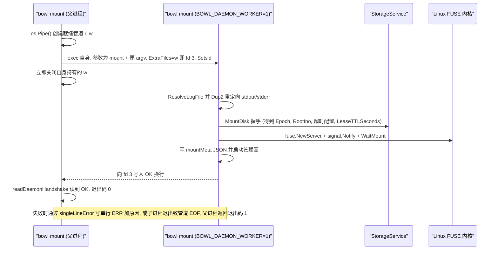
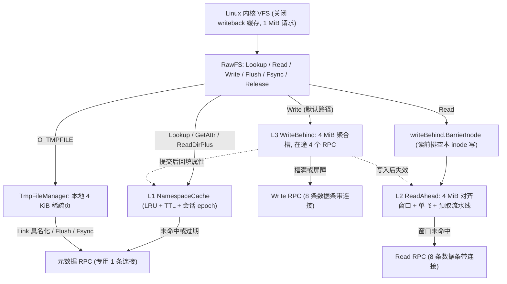

# 客户端 FUSE 流水线

`client` 是独立的 Go 模块，二进制入口为 `client/cmd/bowl`，核心包为 `client/internal/cli`（命令与守护进程）、`client/internal/fusefs`（FUSE 文件系统）、`client/internal/rpc`（ConnectRPC 客户端）。本章从进程生命周期讲到每一次 `read` / `write` 的字节路径。服务端对端见 [Store 引擎](/04-internals/storage-store-engine)。

::: warning 与常见印象不同的两点
- 管理端**不是 Unix Socket**，而是挂载进程内的本地 TCP HTTP 服务（默认 `127.0.0.1:0`，随机端口），地址通过元数据 JSON 文件发现。见 §1.3。
- `fs_capability.go` **不做 FUSE 能力协商**，它是 `security.capability` 扩展属性的负缓存。FUSE 能力协商在 `BuildMountOptions`（`fs.go:858`）。见 §2.1。
:::

## 1. 守护进程

### 1.1 fork 与就绪握手

`bowl mount` 默认以后台守护模式运行。`executeMount`（`cli/mount.go:578`）先解析参数并在 `spawnDaemon` 之前校验 `--ro` 与 `--force` 互斥（冲突时以退出码 `2` 立即失败），随后按 `BOWL_DAEMON_WORKER` 环境变量与 `-f` 标志选择三种模式之一：

| 条件 | 模式 | 入口 |
| --- | --- | --- |
| 环境变量 `BOWL_DAEMON_WORKER=1` | 守护子进程 | `runDaemonWorker`（`cli/daemon.go:88`） |
| 未指定 `-f` / `--foreground` | 父进程：派生子进程并等待握手 | `spawnDaemon`（变量，指向 `spawnDaemonProcess`，`cli/daemon.go:38`） |
| 指定 `-f` | 前台阻塞，日志写标准错误 | `runMount(..., stderr, nil)` |

要点：

- 父进程**必须立即关闭自己的管道写端**（`daemon.go:71`），否则子进程退出时读端收不到 EOF，父进程会永久阻塞。
- 子进程用 `Setsid: true` 脱离控制终端，`Stdin` 指向 `/dev/null`，并通过 `unix.Dup2` 把标准输出与标准错误重定向到日志文件。
- 日志文件由 `ResolveLogFile`（`cli/log.go`）解析：`--log-file` 优先；否则 `/var/log/bowl/mount-` 加 `disk-id` 加 `.log`；无权限回退到 `$XDG_STATE_HOME/bowl/logs/` 或 `~/.local/state/bowl/logs/`。
- 握手协议只有两种行：`OK` 与单行 `ERR:` 加错误文本（`singleLineError` + `readDaemonHandshake`，`daemon.go:19,76`），避免 `MountDisk` 多行报错在管道首行读取时被截断。

### 1.2 `runMount` 装配顺序

`runMount`（`cli/mount.go:390`）是前台与守护子进程共用的主流程：

1. `setupObservability`：日志、追踪与指标运行时。
2. `rpc.NewClientFromConfig`：构造 ConnectRPC 客户端（见 §4）。
3. `mountHandshake`：单次 `MountDisk` RPC（带 `Force` 参数，10 秒超时）。只读挂载返回 `Epoch = 0` 与 `LeaseTTLSeconds = 0`；读写挂载校验 `Epoch > 0` 与 `LeaseTTLSeconds > 0`（遇未过期活跃写者则返回单行 `EBUSY` 提示）。
4. `fusefs.NewRawFS(client, *cfg)` 并注册指标收集器。
5. `startAdminServer`：启动管理面。
6. `startMountLeaseRenewer`：只读挂载直接跳过；读写挂载按 `max(1s, TTL/3)` 调用 `RenewMount(disk_id, epoch)`，可恢复错误按 `min(2s, normalInterval)` 短间隔重试，收到 `FailedPrecondition` 或 `NotFound` 则设置 `leaseLost`、`rawFS.MarkLeaseLost()` 并取消 `serveCtx` 触发自动下线。
7. `serveFUSE`（默认 `defaultServeFUSE` 与 `serveFUSEWithServer`，`mount.go:296-386`）：创建 `fuse.NewServer` 后在 `WaitMount()` 前即注册 `signal.Notify`，通过持续监听循环（`ctxDone` 触发置 `nil` 后继续监听后续信号）等待退出，`BindMountpoint` 并调用 `ready()`。

### 1.3 管理端与发现元数据

- 管理面 `startAdminServer` 在 `--admin-addr` 上监听 **TCP**，默认 `127.0.0.1:0`，传 `off` 关闭。提供 `/metrics`、`/debug/pprof/*`、`/healthz`、`/readyz`、`/debug/stats`。
- 挂载就绪后，`ready` 回调把 `mountMeta`（`mountpoint`、`pid`、`disk_id`、`admin_addr`、`started_at`）原子写入（临时文件加 `rename`）元数据目录 `/run/bowl/mounts`，无权限回退 `$TMPDIR/bowl-mounts`；文件名为规范化挂载点 SHA-256 前 16 字节的十六进制加 `.json`（`cli/mountmeta.go`）。
- `bowl stats` 通过这些 JSON 找到 `admin_addr`，请求 `/debug/stats`；`bowl disk delete`、`bowl disk merge` 通过 `/proc/self/mountinfo`（`cli/mountinfo.go` 的 `FindDiskMountpoint`）识别本机挂载（`bowl disk merge` 仅拦截本机读写挂载，放行只读挂载）。

### 1.4 退出与清理

卸载由 `bowl umount`（调用 `fusermount3` / `fusermount` / `umount`）、`SIGINT` / `SIGTERM` 或失租约取消 `serveCtx` 触发，守护进程内的顺序如下：

1. `unmountServerWithLazyFallback` 优先执行 `server.Unmount()`，若因目录或句柄忙失败则自动回退 `findUmountCommand(mountpoint, true)`（`fusermount3 -uz` / `fusermount -uz` / `umount -l`）懒卸载。`server.Serve()` 返回后，`RawFS.OnUnmount`（`fs.go:494`）关闭锁表、持 `lifecycleMu` 等待在途请求结束、在总预算 `unmountFlushTimeout = 5s` 内排空 `writeBehind` 并逐个 `Fsync` 脏 inode、清理缓存与临时文件，最后排空 `ReclaimOrphan` 队列。若已标记 `leaseLost`、遇到 `FailedPrecondition`/`NotFound` 或超时预算耗尽，立即跳过/早停远端刷盘与孤儿回收，保证自动下线瞬时完成。
2. `runMount` 停止续期协程；若非失租约退出且为读写挂载，调用 `UnmountDisk(disk_id, epoch)` RPC 释放服务端写租约（独立 `3s` 超时）；若已失租约或为只读挂载，跳过 `UnmountDisk`。
3. 移除元数据 JSON 文件前校验 `readMountMetaPID(metaPath) == os.Getpid()`（防止懒卸载后原挂载点被重用时误删新进程元数据），随后关闭管理面与可观测性运行时。
4. `executeUmount` 在非 `--force` 时用 `waitMountMetaDrained` 轮询元数据文件消失或进程退出，保证"命令返回即数据已刷盘、租约已释放"。

## 2. FUSE 层基础：挂载选项、能力缓存与 Inode 锁

### 2.1 FUSE 能力协商：`BuildMountOptions`

`BuildMountOptions`（`fusefs/fs.go:858`）决定与内核协商的能力与参数：

| 项 | 取值 | 含义 |
| --- | --- | --- |
| `MaxWrite` / `MaxReadAhead` | `1 MiB` / `1 MiB` | 单次写请求与内核预读上限 |
| `MaxBackground` / `CongestionThreshold` | `64` / `48` | 后台异步请求并发与拥塞阈值 |
| `ExtraCapabilities` | `CAP_HANDLE_KILLPRIV` | 由文件系统自己在写批次里清除 `security.capability`，内核不再写前探测 |
| `DisabledCapabilities` | `CAP_WRITEBACK_CACHE`、`CAP_AUTO_INVAL_DATA` | 关闭内核写回缓存，保持 1 MiB 直通写；关闭自动失效，避免服务端与内核 mtime 不等造成整文件页缓存被清空 |
| `Options` | `default_permissions`，只读时加 `ro` | 权限检查交内核 |
| `DirectMount` / `DirectMountFlags` | `true` / `MS_NOSUID \| MS_NODEV`（只读追加 `MS_RDONLY`） | 直连内核 `mount(2)` 时将 VFS 挂点标记为只读 |
| `EnableLocks` | `true` | 启用 POSIX 与 flock 锁协议（`fs_lock.go`、`lock_table.go`） |

`security.capability` 负缓存（`fusefs/fs_capability.go`）：`capabilityCache` 记录每个内核 inode"是否已知不带该属性"。普通文件几乎不会设置它，命中 `knownAbsent` 就免去写前 `GetXattr` RPC；`Create`、写成功、`SetAttr` 后调用 `markAbsent`，显式 `SetXattr` 后 `markPresent`，inode 被回收时 `forget`，会话失效时 `reset`。写路径用它决定是否允许走异步聚合（`fs_rw.go:188` 的 `!fs.caps.knownAbsent(...)` 分支）。

### 2.2 Per-Inode 细粒度锁：`inode_lock.go`

`inodeLocks` 是按 inode 分片的引用计数互斥锁表：

- 数据结构：`map[uint64]*inodeLockEntry`，条目含 `sync.Mutex` 与 `refs`；`lock(ino)` 返回释放函数，`refs` 归零时删除条目，内存随活跃 inode 数增减，不随文件总数增长。
- 先 `TryLock` 快路径（指标 `incInodeLockFast`），失败才阻塞并记录争用耗时。
- 只用于"同一节点必须串行"的少数场景，**不是**全局锁：

| 场景 | 位置 | 要保护的不变量 |
| --- | --- | --- |
| `O_APPEND` 写 | `fs_rw.go:175` | "排空异步写 → 读当前大小 → 提交 Write"原子，否则并发追加读到同一旧大小互相覆盖 |
| `Release` 孤儿标记 | `fs_file_handle.go:341` | 最后一个句柄关闭与并发 `Unlink` 互不错过，避免孤儿 inode 泄漏 |
| `Rename` 覆盖目标 | `fs_rename.go:99` | 被覆盖节点的孤儿标记串行 |
| 拓扑变更（`Unlink` 等） | `fs_topology.go:240` | 子节点解链与最后句柄关闭定序 |

对比：服务端 `StoreActor` 也有按 `ino & 0xfff` 的 4096 条带锁，用于同一 inode 的局部写定序，见 [Store 引擎 §3.2](/04-internals/storage-store-engine)。

## 3. 三级缓存与 I/O 流水线

进程内缓存分三级，由内核页缓存之下的三个协调器组成：

| 级别 | 组件 | 缓存对象 | 容量与参数 |
| --- | --- | --- | --- |
| L1 | `NamespaceCache`（`namespace_cache.go`） | inode 属性、目录项、完整目录流、符号链接目标 | 默认 `65536` 条（`DefaultNamespaceCacheCapacity`），LRU，TTL 由服务端下发 |
| L2 | `ReadAheadCoordinator`（`read_ahead.go`） | 4 MiB 对齐的文件数据窗口 | 单句柄最多 `4` 个预取窗口（`ReadAheadMaxPrefetch`），全客户端并发预读 RPC 上限 `32`（`ReadAheadMaxGlobalInflight`，即 128 MiB） |
| L3 | `WriteBehindCoordinator`（`write_behind.go`）与 `TmpFileManager`（`tmpfile_manager.go`） | 顺序写的 4 MiB 聚合槽；`O_TMPFILE` 匿名文件的 4 KiB 稀疏页 | 单文件在途写 RPC 上限 `4`（`WriteBehindMaxInFlight`，峰值 16 MiB），常驻 `8 x 4 MiB` 缓冲 |

### 3.1 L1 命名空间缓存

- **键**：`cacheKey{kind, ino, name}`，`kind` 区分 inode、目录项、目录流。条目有绝对到期时间（`expiresAtNano`）与权重；目录流按所含目录项数计费，防止单个大目录绕过容量上限。
- **二级索引**：`byParent`（父 inode → 子名集合）、`dirsByChild`、`inodeDirs`，使失效与回填从 O(N) 扫描降为定向查找。
- **`completeDirs`**：记录"目录内容已被完整掌握"的父节点（目录流已加载，或刚由 `Mkdir` 创建为空目录）。命中时未找到的名字可直接返回 `ENOENT`，不发 `Lookup` RPC。任何目录项被淘汰或目录发生未知变更，必须同步撤销标记。
- **代数校验**：`version()` 返回会话代数，`snapshot()` 返回会话代数与目录变更代数。在途 RPC 回填前用 `...At(epoch, ...)` 形式的方法（如 `putInodeAt`、`refreshInodeAt`）校验代数；代数已变则放弃回填，防止旧响应污染新状态。`Open` 在取到缓存后若发现代数变化返回 `ESTALE`（`fs_file_handle.go:157`）。
- 变更类操作用 `invalidateDirListingTouchParentAt` 等函数同时失效目录流并就地更新父目录属性。

### 3.2 L2 预读：`read_ahead.go`

`RawFS.Read`（`fs_rw.go:24`）先做本地匿名文件旁路与 `writeBehind.BarrierInode`（保证读到自己刚写的数据），再进入 `ReadAheadCoordinator.Read`。核心规则：

1. **4 MiB 对齐窗口**：窗口为 `[offset 对齐到 4 MiB, +4 MiB)`，`MaxRPCChunkSize = 4 MiB`。同一窗口的并发请求通过 `windowSlot` **单飞**，只发一次 `Read` RPC。
2. **首读直通**：句柄的第 1 个请求不放大；非连续随机读按请求尺寸直通，不放大成 4 MiB。
3. **顺序判定**：`offset == lastReadEnd`，或内核并发 readahead 流量（用单调高水位 `streamEnd` 判定，因为内核并发请求到达顺序与偏移顺序无关）；请求不小于 `readAheadMinWant = 128 KiB`。
4. **预取流水线**：确认顺序流后（`seqCount` 达到 3 或窗口消费超过 1 MiB）由 `ensurePrefetchPipelineLocked` 并发维持最多 4 个后续窗口；全局并发由 `tryAcquirePrefetchSlot` 限制在 32。
5. **乱序容错**：`prevWin` 保留刚滑出的上一窗口，内核并发 readahead 的晚到请求直接命中，不误判为随机跳读而清空流水线。
6. **缓冲生命周期**：窗口数据是 `rpc.ReadPayload` 的 `sharedReadBuf` 引用计数包装，活跃窗口、上一窗口、等待者与前台拷贝都释放后才归还 4 MiB 池缓冲。

任何写入同一 inode 的操作都会 `readAhead.InvalidateInode`；`Release` 时 `RemoveHandle`；卸载时 `Clear`。

### 3.3 L3 异步写回：`write_behind.go`

`RawFS.writeData`（`fs_rw.go:123`）按下列顺序选路径：

| 条件 | 路径 |
| --- | --- |
| 本地匿名文件 | `tmpMgr.Write`，写本地稀疏页，不发 RPC |
| `O_APPEND` | 持 `inodeLocks`，`FlushAndResetInodeForHandle` 排空后读当前大小，再同步直通 Write |
| `O_SYNC` / `O_DSYNC`、属性超时为 0、`Immutable` / `Append` / SUID / SGID 特殊 inode、`security.capability` 未知、零长度、超过 4 MiB | 先 `FlushAndResetInodeForHandle`，再同步直通（超过 4 MiB 按 4 MiB 分片循环） |
| 其余（默认） | `writeBehind.WriteForHandle`：并入 4 MiB 聚合槽，异步提交 |

直通 Write 使用 `context.WithoutCancel(opCtx)`：写是非幂等变更，一旦 RPC 已发出就忽略 `FUSE_INTERRUPT`，避免服务端已提交而客户端返回 `EINTR` 触发调用方重试造成重复追加。

聚合与并发规则（`write_behind.go:19-41`）：

- 聚合槽 `WriteBehindChunkSize = 4 MiB`，单文件最多 `4` 个在途 Write RPC；槽满且在途已满时进入背压等待（`write_behind.BackpressureWait`）。
- **对齐不变量**：只有聚合起始偏移按 `WriteBehindBlockAlign = 256 KiB` 对齐，且分片为 4 MiB 整倍数时才允许并发在途。这与服务端 `BlobSize = 256 KiB` 一致，保证任意两个在途 Write 覆盖的 256 KiB 物理块区间互不相交。
- **同步探针**：大块流式写在首段同步写入（探针）验证世代栅栏、`Immutable` / `Append`、KILLPRIV 与配额后，才激活异步流水线（`WriteBehindActivateBytes = 2 MiB`）；`Create` 成功的新文件经 `SeedCreatedInode` 预热，可直接聚合。
- **错误语义**：按 Linux `errseq_t` 语义，每个句柄在 `RegisterHandle` 时采样全局错误水位，`Flush` / `Fsync` 只消费该句柄尚未观测的错误，一个句柄不会"偷走"另一个句柄的写错误。

### 3.4 刷盘屏障：Flush / Fsync / Release

| FUSE 操作 | 源码 | 动作 | 持久化级别 |
| --- | --- | --- | --- |
| `Flush`（`close(fd)`） | `fs_file_handle.go:211` | 释放 POSIX 记录锁；匿名文件先上云；只读句柄 `BarrierInode`；可写句柄 `FlushInodeForHandle`（刷尾部分片，等全部在途 Write 完成，消费该句柄错误） | 写入已进服务端队列，**不发 Fsync RPC** |
| `Fsync` | `fs_file_handle.go:261` | 匿名文件同步 → `FlushInodeForHandle` → `Fsync` RPC（`Datasync` 取自 `FsyncFlags`）→ `clearDirty` | 服务端完成 WAL 同步与脏 `.pack` `fdatasync`（见 [Store 引擎 §1.5](/04-internals/storage-store-engine)） |
| `Release` | `fs_file_handle.go:313` | `BarrierInode` → 持 `inodeLocks` → 释放 flock、`readAhead.RemoveHandle`、`writeBehind.ForgetHandle`；孤儿最后句柄触发回收；最后一个句柄时 `writeBehind.RemoveInode` | 无 |
| `OnUnmount` | `fs.go:494` | `leaseLost`/失租约/超时预算（`5s`）耗尽时跳过或早停远端刷盘，否则排空 `writeBehind` 并对存活 `dirtyInodes` 逐个 `Fsync` | 卸载时尽量确认落盘，失租约不阻塞退出 |

`markDirty` 在每次成功写入后登记 inode，`Fsync` 成功后 `clearDirty`；因此 `Flush` 不付 Fsync 代价，但卸载一定补刷。需要"关闭即持久"的应用必须显式 `fsync`。

### 3.5 本地匿名文件：`tmpfile_manager.go`

`O_TMPFILE` 创建的匿名文件先存在客户端：本地 inode 号置最高位（`1 << 63`，`tmpLocalInoBit`），数据放 4 KiB 稀疏页（`tmpSparsePageSize`）。`Link` 具名化时通过 `TmpMaterializer` 创建服务端 inode，按最大 1 MiB（`tmpUploadChunkSize`）分片上传，再回收本地条目。内核 `nlookup` 与打开句柄双双归零才回收，`HasPendingSync` 让常规文件的 `Flush` 跳过无谓处理。

## 4. 多路复用分片 HTTP/2 RPC 客户端

### 4.1 分片传输

`newShardedRoundTripper`（`rpc/client.go:201`）把物理连接隔离为两类：

| 流量 | 连接数 | 接收窗口 |
| --- | --- | --- |
| `Read` / `Write` 大块数据 | `8` 条（`HTTP2DataConnectionShards`），原子计数轮询 | 每连接 `64 MiB` |
| 其余元数据与屏障 RPC（`Lookup`、`GetAttr`、`Create`、`Fsync`、`ReadDirPlus` 等） | `1` 条专用连接 | `32 MiB` |

单流窗口均为 `8 MiB`，帧上限 `1 MiB`，与服务端对称（见 [控制面 §2.3](/04-internals/storage-control-plane)）。隔离的目的：元数据请求不被 4 MiB DATA 帧队头阻塞，数据流量不受单连接读写循环串行化限制。`isBulkDataProcedure` 按 URL 路径判定。

`NewClientFromConfig` 的拦截器顺序（外 → 内）：重试与逻辑耗时 → 请求可观测性 → `otelconnect` → 错误原因标注 → 可选 Bearer 鉴权 → `Accept-Encoding: identity`（关闭响应压缩）。编解码器使用与服务端同源的 `rpccodec.ProtoBinaryCodec`；读响应的 4 MiB 缓冲经 `TakeReadPayload` 接管，`<= 256 KiB` 的小读直接克隆，不占大缓冲槽（`SmallReadPayloadCutoff`）。

### 4.2 `h2_coalesce.go`：合并 HEADERS 与 DATA

明文 HTTP/2（h2c，`http://` endpoint）下，Go 标准库对一次 Unary 请求会分两次 `Flush` 写出 HEADERS 帧与 DATA 帧。在 Linux `tcp_autocorking` 加虚拟网卡加服务端 Delayed ACK 的组合下，小 DATA 被挂起等待前序包释放，产生约 10 ms 的伪延迟。`h2CoalesceConn` 包装底层连接：

- 识别"单个完整 HEADERS 帧、`END_HEADERS=1`、`END_STREAM=0`、不超过 1024 B"，暂存在 `pendingBuf`，不立即写出。
- 紧随其后的 DATA 写入到来时，二者合并为一次 `Write`（不超过 8192 B 用栈内 `scratchBuf`，更大的 4 MiB 载荷用 `net.Buffers` 走 `writev`）。
- 兜底定时器 `150µs`（`h2CoalesceFlushDelay`）：若 DATA 迟迟未到（例如流控窗口耗尽），超时后单独冲刷 HEADERS。

TLS（`https://`）路径不包装，直接用标准传输。两种路径都开启 `TCP_NODELAY`。

### 4.3 `retry.go`：有界指数退避

默认参数：总预算 `30s`、初始间隔 `100ms`、倍数 `2.0`、单次上限 `1s`，每次等待带 `[0.5, 1.0]` 抖动。`shouldRetry`（`retry.go:167`）按顺序判定：

1. 携带业务 `ErrorInfo.Reason` 的错误：**绝不重试**（服务端已明确拒绝）。
2. `InvalidArgument`、`NotFound`、`AlreadyExists`、`PermissionDenied`、`FailedPrecondition`、`ResourceExhausted`、`Aborted`、`Unimplemented`：绝不重试。
3. 建连阶段失败（`ECONNREFUSED`、`dial` 错误）：请求未送达，幂等与非幂等都重试。
4. 在 17 个只读与幂等 RPC 白名单（`idempotentProcedures`，`retry.go:80-98`，含 `Read`、`Fsync`、`Lookup`、`GetAttr`、`ReadDirPlus`、`RenewMount`、`UnmountDisk` 等）内：`Unavailable` 或底层传输错误可重试。
5. 其余（`Write`、`Create`、`Rename` 等非幂等 RPC 在连接建立后的中断）：**严禁重试**，避免重复提交。

预算耗尽时错误被包装为 `DeadlineExceeded`（有业务 `ErrorInfo` 的除外），最终映射为 `EIO`，并记录 `rpc_retry_exhausted_eio` 日志。

## 5. Connect 错误到 `syscall.Errno`

`rpc.MapError`（`rpc/errors.go:81`）是唯一的映射入口；`RawFS.ToStatus(err, cancel)` 调用 `MapErrorWithCancel`，若内核 `cancel` 通道已关闭则优先返回 `EINTR`。

判定顺序：

1. `nil` → 0；`ErrKernelInterrupted` 或 `context.Canceled` → `EINTR`。
2. 错误携带 `ErrorInfo.Reason`：按 **25 类** 原因字符串一一映射为同名 errno：`EINVAL`、`ENAMETOOLONG`、`ERANGE`、`E2BIG`、`ENOENT`、`ENODATA`、`EEXIST`、`EPERM`、`EACCES`、`ENOTDIR`、`EISDIR`、`ENOTEMPTY`、`EBADF`、`ENOSPC`、`EAGAIN`、`EDEADLK`、`EINTR`、`EOPNOTSUPP`、`EMLINK`、`EFBIG`、`ESPIPE`、`EXDEV`、`EIO`、`EROFS`、`EBUSY`。
3. 无匹配 `Reason` 时按 Connect 状态码兜底：

| Connect code | errno |
| --- | --- |
| `NotFound` | `ENOENT` |
| `AlreadyExists` | `EEXIST` |
| `PermissionDenied` | `EACCES` |
| `InvalidArgument` | `EINVAL` |
| `FailedPrecondition` | `EBUSY` |
| `Unimplemented` | `EOPNOTSUPP` |
| `ResourceExhausted` | `ENOSPC` |
| `Canceled` | 传输层错误为 `EIO`，否则 `EINTR` |
| 其余 | `EIO` |

注意 `ECONFLICT`（合并冲突原因）不在 25 类里：合并由 `bowl disk merge` 走控制面 RPC 而不经 FUSE 路径，FUSE 侧即使遇到也落入 `Aborted → EIO` 兜底。

### 内核 `cancel` 联动

`ContextWithCancelChan`（`rpc/errors.go:27`）把 FUSE 的 `cancel` 通道转成 `context`。收到中断后给在途 RPC `15ms` 宽限（`inFlightCancelGracePeriod`），因为 Go 运行时约每 10 ms 的 `SIGURG` 抢占会触发内核下发 `FUSE_INTERRUPT`，立即取消会把可在数毫秒完成的快速 RPC 误杀成伪 `EINTR`。

## 6. 排错入口

| 现象 | 先看 |
| --- | --- |
| 挂载卡住不返回 | 日志文件（`--log-file` 或 `/var/log/bowl/mount-` 加 `disk-id`）；父进程在等 `OK` / `ERR:` |
| `bowl stats` 找不到挂载 | 元数据目录 `/run/bowl/mounts` 或 `$TMPDIR/bowl-mounts` 中的 JSON 是否存在、`pid` 是否存活 |
| 读吞吐不稳 | 管理面 `/debug/stats` 的预读命中与窗口指标；确认是否被判为随机读（首读直通、非顺序不预读） |
| 写后立刻读到旧数据 | 不应发生：`Read` 前有 `BarrierInode` 排空同 inode 的聚合写 |
| 写返回 `EBUSY` | 世代栅栏：同一磁盘已有更新的写挂载，见 [挂载与世代栅栏](/02-features/mount-and-fencing) |
| 关闭文件后掉电丢数据 | `Flush` 不发 `Fsync`，需应用显式 `fsync` |
