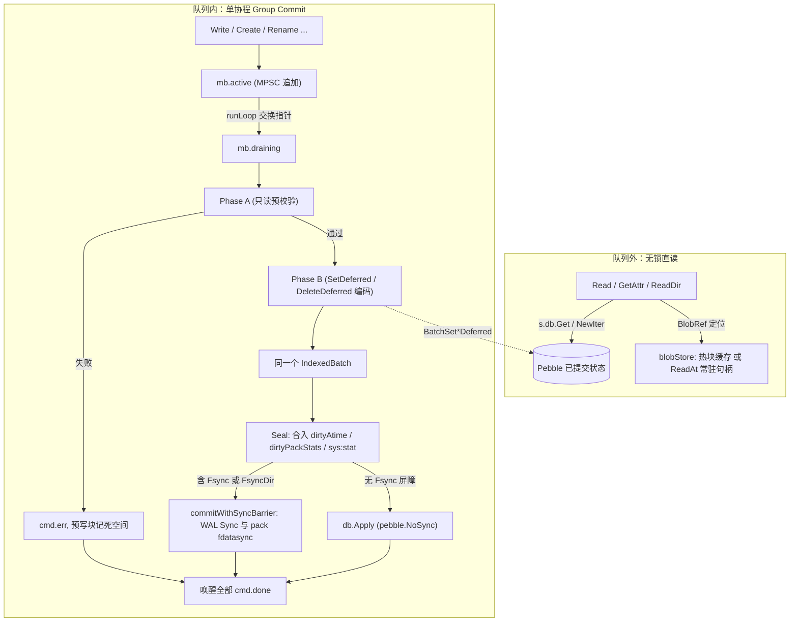
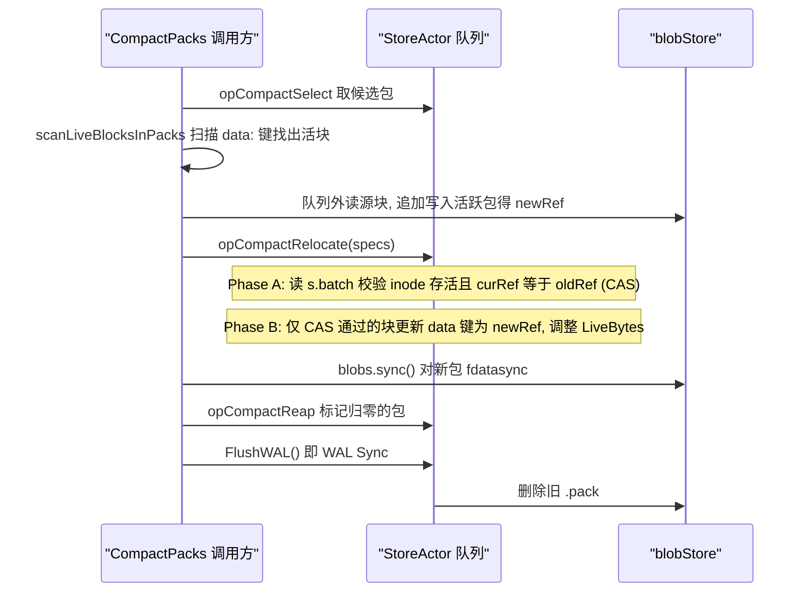

# Store 存储引擎

`services/storage/internal/store` 是单盘存储引擎。一块磁盘对应一个 `StoreActor`：Pebble 保存全部元数据与块索引，`packs/` 目录下的 `.pack` 文件保存文件数据。控制面如何打开与池化 Actor，见 [控制面与服务层](/04-internals/storage-control-plane)。

## 1. `StoreActor` 架构

### 1.1 读写分离模型

| 路径 | 入口 | 并发模型 |
| --- | --- | --- |
| 读（`GetAttr`、`Read`、`ReadDir` 等） | 直接调用 `s.db.Get` / `s.db.NewIter` | **队列外无锁直读**：不入队，只持 `lifecycleMu` 读锁（`enter()`）防止 Actor 被关闭 |
| 写（`Write`、`Create`、`Rename` 等） | `submit` → `enqueueAndWait`（`actor.go:979`、`actor.go:995`） | **双缓冲 MPSC 队列**，由单个 Actor 协程串行处理 |

写队列在 `StoreActor.mb`（`actor.go:225-231`）：`active` 供任意 RPC 协程追加，`draining` 供 Actor 协程处理。`runLoop`（`actor.go:1102`）收到 `notify` 信号后，在持锁状态下交换两个切片（指针交换，不拷贝命令），随后无锁处理 `draining`。命令载体 `writeCmd` 由 `sync.Pool` 复用，每个命令带一个容量为 1 的 `done` 通道，调用方阻塞在 `<-cmd.done`。

### 1.2 一次 Tick 的四步（`processTick`，`actor.go:1129`）

| 步骤 | 动作 |
| --- | --- |
| Step 1 Drain | 交换 `active` 与 `draining`，记录队列等待时间 |
| Step 2 逐条两阶段 | 对 `draining` 中每条命令依次执行 `validateCmd`（Phase A）与 `mutateCmd`（Phase B） |
| Step 3 Seal & Commit | 合入内存 `dirtyAtime`、`dirtyPackStats`，批次末尾只写 1 次 `sys:stat`；无屏障用 `db.Apply(batch, pebble.NoSync)`，有屏障走 `commitWithSyncBarrier` |
| Step 4 Reset & Wake | 批次超过 `1 MiB`（`BatchResetMaxReprBytes`）或 `8192` 条（`BatchResetMaxCount`）则重建 `IndexedBatch`，否则 `Reset()`；执行同批次的 Checkpoint；最后向所有命令的 `done` 发信号 |

### 1.3 Phase A：只读预校验

`validateCmd`（`actor.go:1425`）的约束：

- 只读取，不写入 `s.batch`。校验读取的是 `s.batch`（`IndexedBatch`），因此**同一 Tick 内前序命令的未提交写入对后序命令可见**，不会出现读到旧状态的竞态。
- 所有外部写操作先比较 `cmd.epoch` 与 `s.stat.WriterEpoch`，不一致返回 `ErrStaleEpoch` 并计入世代栅栏指标。
- 每类操作有独立校验函数，例如 `validateWriteCmd`（`data_rw.go:346`）检查 `NextWriteSeq` 未溢出、目标是可写常规文件、配额（`checkQuota`）、并调用 `resolveWriteBlockSpecs` 从 `s.batch` 重读每个目标块的现有 `BlobRef`。
- 失败命令只写入 `cmd.err`，其预写入 `.pack` 的块通过 `recordDeadBlobWrite` 记为死空间，不影响同批次其他命令。

### 1.4 Phase B：`SetDeferred` / `DeleteDeferred` 编码

`mutateCmd`（`actor.go:1475`）在 Phase A 通过后"必定成功"：

- 修改内存中的 `s.stat`（`LogicalBytes`、`Inodes`、`NextWriteSeq`）与 `s.packStats`。
- 通过 `values.go` 中的 `Batch*Deferred` 函数把键值编码写入 `s.batch`：`BatchSetInodeDeferred`、`BatchSetEntryDeferred`、`BatchSetDataDeferred`、`BatchDeleteEntryDeferred` 等。"Deferred"指 `pebble.Batch.SetDeferred` / `DeleteDeferred`：先预留键值空间，再原地填充字节，免去中间缓冲拷贝。
- 同一条 `mutateWriteCmd` 在一个批次内原子更新 `inode:` 键与全部涉及的 `data:` 键，因此对读者而言，一次写的元数据与块索引同时可见。

### 1.5 Group Commit 持久化语义

| 场景 | 提交方式 | 含义 |
| --- | --- | --- |
| 普通写批次 | `db.Apply(batch, NoSync)`，并置 `walDirty=true` | 写进 WAL 缓冲，不等落盘；崩溃可能丢失最近写入 |
| 批次含 `Fsync` / `FsyncDir`（`syncBarrier`） | `commitWithSyncBarrier`（`actor.go:1518`） | `ApplyNoSyncWait(batch, Sync)` 后，并行执行脏 `.pack` 的 `fdatasync`，再 `batch.SyncWait()`；两者都成功才算持久 |
| 仅有屏障、无批次 | `syncBarrierWithoutBatch`（`actor.go:1559`） | `db.LogData(nil, Sync)` 加 `.pack` 同步并行 |

屏障保证"索引不先于数据落盘"：`BlobRef` 指向的 `.pack` 字节在 WAL 同步返回前已 `fdatasync`。

### 1.6 `opCreateTmpfile` and `Link` orphan promotion

`StoreActor.CreateTmpfile`, defined at `namespace.go:265`, submits `opCreateTmpfile` from `actor.go:54`, whose `String` method returns `"create_tmpfile"` at `actor.go:87`. `isExternalWriteOp` at `actor.go:1395`, `validateCmd` at `actor.go:1437`, and `mutateCmd` at `actor.go:1484` process `opCreateTmpfile` under `WriterEpoch` fencing.

- **Pre-queue validation.** `StoreActor.CreateTmpfile` rejects read-only actors with `ErrReadOnly`, rejects stale epochs early through `isDefinitelyStaleEpoch` and `submitStaleEpoch`, validates `ParentIno` with `validateNodeIno`, and resolves `Mode` and `Umask` with `resolveRegCreateMode` at `namespace.go:222`. Only type bits `0` or `S_IFREG` with mode `<= 0o177777` pass.
- **Phase A validation.** `validateCreateTmpfileCmd` at `namespace.go:497` checks that `s.stat.NextWriteSeq` and `s.stat.Inodes` have not reached `math.MaxUint64`, reads `parent_ino` as a live directory via `readLiveDir` at `unlink_rename.go:43`, checks inode quota via `checkQuota(0, 1)`, and reserves an inode ID with `prepareIno`.
- **Phase B mutation.** `mutateCreateTmpfileCmd` at `namespace.go:516` consumes the reserved inode ID, advances `s.stat.NextWriteSeq`, increments `s.stat.Inodes`, inherits `op.parent.GID` when `op.parent.Mode & S_ISGID != 0`, and writes an anonymous `S_IFREG` `Inode` with `ParentIno: 0`, `Nlink: 0`, `Size: 0`, `Flags: 0`, and `Generation: 1` via `BatchSetInodeDeferred`. It writes the 1-byte `orphan:<ino>` marker via `BatchSetOrphanKindDeferred` at `values.go:387`, storing `0x02` for `OrphanKindTmpfileExclusive` when `op.exclusive` is true or `0x03` for `OrphanKindTmpfileLinkable` when `op.exclusive` is false. No `entry:` key is written and the parent inode stays unchanged.
- **Atomic promotion in `Link`.** In Phase A, `validateLinkCmd` at `namespace.go:556` inspects `target.Nlink == 0`. When `Nlink == 0`, it requires `target.Mode & S_IFMT == S_IFREG` and reads the marker via `readOrphanKind` at `unlink_rename.go:139` on `s.batch`. Any missing marker, `0x01` unlinked open handle, or `0x02` exclusive tmpfile fails with `ErrNotFound`. When `0x03` passes validation, `mutateLinkCmd` at `namespace.go:595` executes inside the same `IndexedBatch`, sets `op.target.Nlink` from `0` to `1`, updates `op.target` and `op.parent` metadata, writes the `Entry`, and deletes `orphan:<ino>` via `BatchDeleteOrphanDeferred` at `values.go:436`. Because `mutateCreateTmpfileCmd` already counted the inode, `mutateLinkCmd` does not increment `s.stat.Inodes`. Calling `s.overlayAtime(&op.target)` before building `op.attr` keeps pending `dirtyAtime` intact across promotion.

## 2. Pebble 键空间与值编码

`NewPebbleOptions`（`actor.go:178`）自定义 `Comparer.Split = SplitKey`，使 `entry:`、`xattr:`、`data:` 的 8 字节父标识成为 Prefix Bloom 前缀，全部 7 层启用 `bloom.FilterPolicy(10)`。所有整数一律**大端序**，使字节序等于数值序，支持按前缀范围扫描。

### 2.1 七类键

| 类别 | 键格式 | 键长 | 值 | 值长 | 源码 |
| --- | --- | --- | --- | --- | --- |
| `sys:stat` | `sys:stat` | 8 B | `BranchStat` | 41 B | `keys.go:10`、`values.go:12` |
| `sys:pack` | `sys:pack:` + 8B `packID` | 17 B | `PackMeta` | 17 B | `keys.go:12`、`values.go:13` |
| `inode` | `inode:` + 8B `ino` | 14 B | `Inode` | 93 B 头 + 变长 `SymlinkTarget` | `keys.go:13`、`values.go:15` |
| `entry` | `entry:` + 8B `parent` + `:` + `name` | 15 B + 名称 | `Entry` | 13 B | `keys.go:14`、`values.go:14` |
| `xattr` | `xattr:` + 8B `ino` + `:` + `name` | 15 B + 名称 | 原始字节 | 变长 | `keys.go:15` |
| `orphan` | `orphan:` + 8B `ino` | 15 B | 1-byte `OrphanKind`: `0x01` unlinked open handle, `0x02` exclusive tmpfile, `0x03` linkable tmpfile | 1 B | `keys.go:16`, `values.go:22-39`, `values.go:387-397` |
| `data` | `data:` + 8B `ino` + `:` + 8B `blockIdx` | 22 B | `BlobRef` | 16 B | `keys.go:18`、`values.go:16` |

扫描前缀：`EntryPrefix(parent)` 与 `XattrPrefix(ino)` 为 15 B，`DataPrefix(ino)` 为 14 B。

The `orphan:<ino>` key stores a 1-byte `OrphanKind` discriminant defined at `values.go:22-26`. `OrphanKindUnlinked`, value `0x01`, marks an open-handle orphan from `Unlink` or overwrite `Rename`. `OrphanKindTmpfileExclusive`, value `0x02`, marks a non-linkable `CreateTmpfile` inode with `exclusive = true`, and `OrphanKindTmpfileLinkable`, value `0x03`, marks a linkable `CreateTmpfile` inode with `exclusive = false`. `DecodeOrphanKind` at `values.go:29` accepts only those three 1-byte payloads and returns `ErrInvalidValue` for any other length or byte value. `BatchSetOrphanKindDeferred` at `values.go:387` writes a given kind byte in place, and `BatchSetOrphanDeferred` at `values.go:395` defaults to `OrphanKindUnlinked`. `hasOrphanMarker` at `unlink_rename.go:126` checks key existence across all three kinds so `PurgeOrphanInode`, `CleanOrphans`, `AdvanceEpoch`, `SanitizeCheckpoint`, and `tree_merge.go` reclaim every orphan uniformly, while `readOrphanKind` at `unlink_rename.go:139` decodes the kind byte for `validateLinkCmd`.

### 2.2 值的二进制布局

所有定长值以 1 字节版本号 `codecVersion = 1` 开头，解码时校验长度与版本，不符返回 `ErrInvalidValue`。

| 值 | 布局（字节偏移） |
| --- | --- |
| `BranchStat`（41 B） | `ver(0)`、`LogicalBytes(1-8)`、`Inodes(9-16)`、`NextWriteSeq(17-24)`、`WriterEpoch(25-32)`、`MaxBytes(33-40)` |
| `PackMeta`（17 B） | `ver(0)`、`LiveBytes(1-8)`、`TotalBytes(9-16)`；解码要求 `LiveBytes` 不大于 `TotalBytes` 且 `TotalBytes` 不大于 64 MiB |
| `Entry`（13 B） | `ver(0)`、`Ino(1-8)`、`Mode(9-12)` |
| `Inode`（93 B + n） | `ver`、`Ino`、`ParentIno`、`Mode`、`Nlink`、`UID`、`GID`、`Rdev`、`Size`、`Atime`、`Mtime`、`Ctime`（纳秒）、`Flags`、`Generation`、`WriteSeq`，末 4 字节 `len(SymlinkTarget)`（偏移 89-92），其后接目标路径 |
| `BlobRef`（16 B） | `PackID(0-7)`、`Offset(8-11)`、`Length(12-15)`；解码要求 `PackID` 非 0、`Length` 在 1 到 256 KiB、`Offset+Length` 不超过 64 MiB |

`BranchStat.WriterEpoch` 是持久化的写世代，`NextWriteSeq` 是单盘写序列号；合并时控制面用二者做水位 CAS（见 [控制面 §3.4](/04-internals/storage-control-plane)）。

## 3. 数据层：块网格与 `.pack` 容器

### 3.1 规格常量

| 常量 | 值 | 位置 |
| --- | --- | --- |
| `BlobSize` | `256 KiB`（`256 << 10`）：逻辑分块网格 | `errors.go:59` |
| `PackMaxSize` | `64 MiB`：单个 `.pack` 封口上限 | `errors.go:60` |
| `InodeSegment` / `PackSegment` | `4096` / `64`：向血缘预留号段的步长 | `errors.go:58`、`blob.go:23` |
| 热块缓存 | 16 分片 x 64 槽位，总预算 `64 MiB`，每分片 `4 MiB` | `blob.go:31-35` |
| 异步回写窗口 | `8 MiB`（`packWritebackWindow`） | `blob.go:38` |

文件数据的映射关系：文件内偏移 `off` 落在逻辑块 `off / 256 KiB`；每个逻辑块在 Pebble 中恰好对应 1 条 `data:<ino>:<blockIdx>` 键，值指向 `.pack` 内一段 `1..256 KiB` 的紧凑字节。稀疏空洞没有键，读取时填零；全零块在写入时被省略（`writeModeZeroElide`）。

物理文件为 `<disk_dir>/packs/<packID 的 16 位十六进制>.pack`（`packFileName`，`blob.go:330`）。`PackID` 由控制面按血缘预留号段，保证同一血缘的所有分叉盘不会生成同名 `.pack`。

### 3.2 写路径：块在队列外落盘，索引在队列内提交

`StoreActor.Write`（`data_rw.go:46`）按写的形态分三条路径，**数据字节总是先于索引写入 `.pack`**：

| 形态 | 判定 | 处理 |
| --- | --- | --- |
| 整块对齐写 | `offset` 与长度都是 256 KiB 倍数（`isFullBlockAlignedWrite`） | `writeFullBlocks`：不持 inode 锁，`appendBlocks` 单次 `WriteAt` 批量追加；再取 `inodeLocks[ino & 0xfff]` 后入队 |
| 局部或非对齐写 | 其余情况 | `writePartialData`：全程持 `inodeLocks[ino & 0xfff]`（4096 个条带互斥锁），逐块 `preparePartialWriteBlock` |
| 零字节写 | `len(data) == 0` | 仅入队做校验与属性返回 |

`preparePartialWriteBlock`（`data_rw.go:223`）的决策顺序：

1. 中间整块且全零：直接省略。
2. 整块且非零：`stageAppend` 追加，无需读旧块。
3. 旧块存在且写入起点不小于旧块长度：尝试 **`ExtendTail`**（`blob.go:489`）。条件是旧块恰好位于当前活跃 `.pack` 的最末尾（`oldRef.PackID == curActivePackID` 且 `oldRef.Offset + oldRef.Length == activeOffset`）且扩展后不超 64 MiB。命中则原地顺延写指针，不产生新块、写放大为 0；不满足返回 `(BlobRef{}, false, nil)` 回退。
4. 其余：**RMW 局部写合并**：读旧块（`readAtContext`）→ 在 `merged` 缓冲覆盖新数据 → 若合并结果全零则省略 → 否则 `stageAppend` 追加新块。旧块变成死空间。

追加写由 `blobStore.append` / `appendBlocks`（`blob.go:356`、`blob.go:406`）完成：当前活跃 `.pack` 剩余不足时 `openNextActivePackLocked` 封口并创建新包；写入后 `markPackDirtyLocked` 登记 inode 的脏包，并把数据写入热块缓存（整块批量写跳过用户态缓存拷贝）。

预写成功后，命令携带 `stagedBlobs` 入队。预写块在 Phase B 入账前被 `pinPackID` 钉住，防止被并发回收。Phase A 失败时，预写块被 `recordDeadBlobWrite` 记为死空间，不会让 `LiveBytes` 虚增。

### 3.3 常驻句柄池与热块缓存

- **`packFiles`**（`blob.go:133-134`）：`map[packID]*os.File`，涵盖活跃包与已封口只读包，受 `filesMu` 读写锁保护。读路径对句柄做 `ReadAt`，不执行 `open` / `close`，不存在 `ENOENT` 重试。
- **`hotShard`**（`blob.go:67-73`）：16 个分片，每片 64 个槽位的环形队列加 `4 MiB` 字节预算，分片键为 `(packID + offset/256KiB) % 16`。`tryReadHot` 命中直接拷贝，未命中走 `readRangeAtContext`；物理相邻的冷块合并为单次 `pread`。写入与 `ExtendTail` 会同步更新热缓存；包被删除时 `evictHotPack` 清理。
- **渐进回写**：活跃包每写满 8 MiB 对齐窗口，向 `wbLoop` 投递 `writebackHint`，由 Linux `sync_file_range`（`fdatasync_linux.go`）异步提交脏页，削平封口与 Fsync 时的尾延迟。

### 3.4 Fsync 屏障与 `.pack` 同步

`Fsync` 把被访问 inode 的脏包集合（`inoPacks`）传给 `commitWithSyncBarrier`，由 `syncFileInodes` → `blobStore.syncBatch` 并发 `fdatasync`（并发上限 `maxSyncBatchConcurrency = 8`）。新建 `.pack` 首次落盘后还要对 `packs/` 目录做一次目录 `fsync`（`syncPacksDir`），保证文件项持久。

## 4. 垃圾回收：`CompactPacks`

### 4.1 存活记账

每个 `.pack` 在 Pebble 中有一条 `sys:pack:<packID>` 记录 `PackMeta{LiveBytes, TotalBytes}`，由 Actor 协程在 Phase B 通过 `addBlobRef` / `removeBlobRef`（`pack_lifecycle.go:145`、`pack_lifecycle.go:162`）实时维护，并在 Seal 阶段由 `flushDirtyPackStatsToBatch` 写入批次。

### 4.2 `LiveBytes == 0`：WAL 同步后秒删

`flushDirtyPackStatsToBatch`（`pack_lifecycle.go:309`）对满足以下条件的包删除其 `sys:pack` 键并收集为 `deadPacks`：`LiveBytes == 0`、不是当前活跃包、没有被 `pinPackID` 钉住。随后：

- 批次走 `commitWithSyncBarrier` 时，WAL 同步成功后调用 `enqueueRemovePacks`，由后台 `reclaimLoop` 执行 `removePack`（关闭句柄、`evictHotPack`、`os.Remove`）。
- 批次走普通 `NoSync` 提交时，死包进入 `pendingDeadPacks`，等下一次屏障（`takePendingDeadPacks`）再删除；WAL 同步失败则 `restorePendingDeadPacks` 放回。

规则：**先让"索引不再引用该包"的批次落入 WAL，再删文件**，崩溃后不会出现索引指向已删文件。

### 4.3 低水位搬迁（`CompactPacks`，`compact.go`）

候选条件（`validateCompactSelectCmd`、`isLowWatermarkMeta`）：已封口（非活跃包）、`LiveBytes > 0` 且 `LiveBytes * 2 ≤ TotalBytes`，即存活率不超过 50%。

关键点：

- **CAS 搬迁**：`validateCompactRelocateCmd`（`compact.go`）在 Phase A 用 `s.batch.Get(DataKey)` 检查该块仍属于存活的常规文件，且 `curRef == oldRef`。扫描到搬迁之间若被前台覆写、截断或删除，CAS 不通过，该块不更新指针，预写的新块记为死空间（`recordDeadBlobWrite`），避免"旧值回写覆盖新数据"。
- **双重持久化屏障**：先 `blobs.sync()`（新包 `fdatasync`），再 `FlushWAL()`（`db.LogData(nil, pebble.Sync)`，`actor.go:902`）。只有两者都完成，旧 `.pack` 才会被物理删除；若顺序颠倒，崩溃后索引可能指向未落盘的新包或已删的旧包。
- 搬迁期间源包被 `pinPackIDs` 钉住，屏障完成后 `unpinPackIDs`。

::: tip 排错入口
Actor 内部的 `atomicLowWatermarkPacks` 与 `atomicPendingDeadPacks` 计数反映回收积压（由控制面的 `storageEngineCollector` 导出为指标）；`slow actor tick` 日志包含 `pack_sync_ms`、`wal_apply_ms`、`dead_pack_remove_ms` 各阶段耗时（`actor.go:1368-1386`）。指标全集见 [可观测性](/03-interfaces/observability)。
:::

## 5. 相关测试入口

| 目标 | 命令 |
| --- | --- |
| 引擎全部单测 | `cd services/storage && go test ./internal/store/...` |
| 回收与 CAS 搬迁 | `go test ./internal/store -run CompactPacks`（文件 `pack_compact_test.go`，例如 `TestGivenLowAndHighWatermarkPacksWhenCompactPacksThenLowWatermarkRelocatedAndHighKept`） |
| 数据读写与部分写 | 文件 `data_io_test.go`、`internal_race_test.go` |

测试钩子（`beforeTickHook`、`beforeCompactRelocateHook`、`syncFileHook`、`removePackHook`）仅在包内测试中注入，生产路径保持零值。
