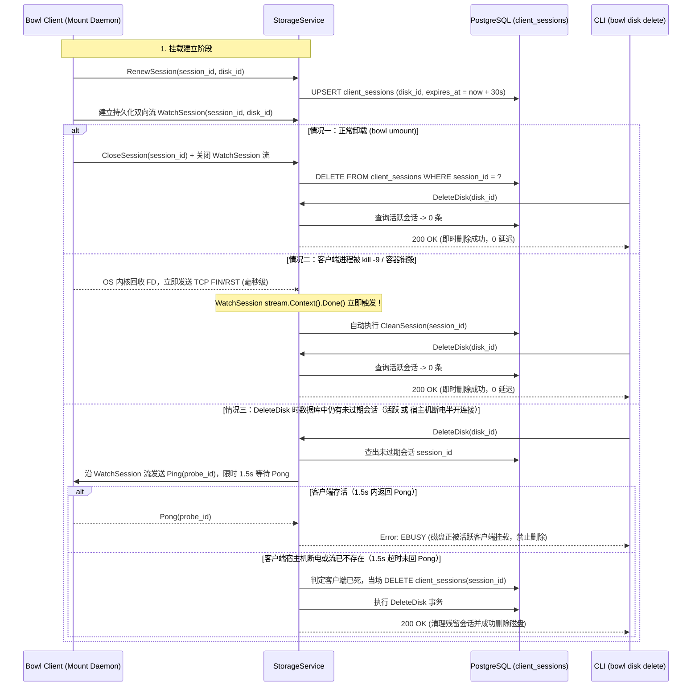

# 分布式存储挂载会话验活（Ping-Pong vs 租约/流式探测）与磁盘删除安全保护机制调研报告

## 1. 背景与 Bowl 现状诊断

在 Bowl 分布式存储系统（`/Users/fanxing/code/starsrc/bowl`）中，客户端通过 `bowl mount <disk-id> <mountpoint>` 挂载虚拟磁盘（`Disk`），建立 `ClientSession` 并通过 ConnectRPC over HTTP/2 定期调用 `StorageService.RenewSession` 续期。当用户执行 `bowl disk delete <disk-id>`（调用 `StorageService.DeleteDisk`）时，若仍有活跃客户端挂载该磁盘，直接删除会导致客户端后续元数据/数据块 I/O 出现悬空引用、状态撕裂甚至数据损坏。

通过对 Bowl 现有客户端与服务端源码的逐行核查，当前实现存在以下 **4 个关键断层**：

1. **`client_sessions` 表缺失 `disk_id` 维度绑定（空闲挂载无法被识别）**：
   - 在数据库迁移文件 [`20261018000000_create_file_locks_tables.sql`](file:///Users/fanxing/code/starsrc/bowl/services/storage/db/migrations/20261018000000_create_file_locks_tables.sql#L3-L8) 中，`client_sessions` 表仅定义了 `(session_id, expires_at, updated_at, created_at)` 四个字段，未关联 `disk_id`。
   - 服务端在 [`manager_handle_session.go`](file:///Users/fanxing/code/starsrc/bowl/services/storage/internal/meta/manager_handle_session.go#L41-L65) 的 `RenewSession` 与 [`metadata.sql`](file:///Users/fanxing/code/starsrc/bowl/services/storage/db/queries/metadata.sql#L361-L366) 的 `UpsertClientSession` 中，仅按 `session_id` 维护全局租约。
   - 虽然 `file_handles` 和 `file_locks` 表通过 `ino` 关联到了具体磁盘，但如果客户端刚刚完成 `bowl mount` 且处于**空闲挂载状态**（当前没有任何打开的文件句柄 `fh` 或文件锁），则 `file_handles` 中没有任何记录。此时服务端根本无法通过 SQL 查询出“有哪些 `client_sessions` 正在挂载目标 `disk_id`”。
2. **正常 `bowl umount` 缺失主动注销会话（`CloseSession`）RPC**：
   - 在客户端守护进程 [`daemon.go`](file:///Users/fanxing/code/starsrc/bowl/client/internal/cli/daemon.go#L101-L143) 与 [`session/manager.go`](file:///Users/fanxing/code/starsrc/bowl/client/internal/session/manager.go#L309-L319) 中，当 FUSE 收到卸载信号退出并调用 `sessMgr.Close()` 时，客户端仅仅执行了 `close(m.stopCh)` 停止本地后台续期协程（`renewLoop`），**并未向服务端发送任何注销会话的 RPC 请求**。
   - 这导致即便用户正常执行了 `bowl umount`，服务端 `client_sessions` 表中的记录依然要傻等默认租约 TTL（[`lock.go`](file:///Users/fanxing/code/starsrc/bowl/services/storage/internal/meta/lock.go#L56) 中 `defaultSessionLeaseDuration = 60 * time.Second`）自然过期后才会被视为失效。
3. **异常崩溃（`kill -9` / 容器销毁 / 断电）下的 60s 僵尸租约窗口**：
   - 客户端在 [`session/manager.go`](file:///Users/fanxing/code/starsrc/bowl/client/internal/session/manager.go#L350-L357) 的 `renewInterval` 中按 `remaining / 3`（夹逼在 `[200ms, 20s]` 之间，60s 租约下每 20s 续期一次）发送 `RenewSession`。
   - 一旦客户端进程被 `kill -9` 或所在容器被强制销毁，进程无法发出告别包，服务端 `client_sessions.expires_at` 在最长 60 秒内仍大于 `NOW()`。若在此期间执行 `bowl disk delete`，纯租约方案无法区分“客户端还活着”与“客户端刚被 `kill -9`”。
4. **`DeleteDisk` 缺乏活跃挂载检查与 `EBUSY` 状态码映射**：
   - 在 [`manager_disk.go`](file:///Users/fanxing/code/starsrc/bowl/services/storage/internal/meta/manager_disk.go#L211-L273) 的 `DeleteDisk` 中，事务仅通过 `GetDiskForUpdate` 锁住 `disks` 行并直接删除 `inodes` 和 `disks` 记录，未检查是否存在活跃挂载会话。
   - 在 [`status.go`](file:///Users/fanxing/code/starsrc/bowl/services/storage/internal/meta/status.go#L22-L47) 中，尚未定义用于表达资源忙（`EBUSY` / `connect.CodeFailedPrecondition`）的领域错误。

---

## 2. 权威开源项目一手源码深度剖析

### 2.1 JuiceFS：纯数据库/Redis 租约模型与被动过期清理

JuiceFS 采用**客户端直连被动元数据引擎（SQL / Redis / TiKV）**的无状态架构，元数据引擎本身不运行自定义 RPC 服务端代码，因此**不支持服务端反向 Ping 客户端**，完全依赖“心跳续期 + 正常卸载主动清理 + 异常崩溃等待 TTL 超时 + 强制删除开关”。

1. **会话注册与心跳续期周期（12s 心跳 / 60s 过期）**：
   - 在 [`pkg/meta/base.go`](file:///Users/fanxing/code/other/filesystem/juicefs/pkg/meta/base.go#L898-L904) 的 `NewSession` 中，客户端默认设置心跳周期 `Heartbeat = 12s`。
   - 每次续期时，客户端通过 [`pkg/meta/base.go`](file:///Users/fanxing/code/other/filesystem/juicefs/pkg/meta/base.go#L1000-L1002) 的 `refreshSession` 计算新的过期时间：`expire = now + Heartbeat * 5`（即默认 **60 秒 TTL**）。
   - 在 SQL 引擎实现 [`pkg/meta/sql.go`](file:///Users/fanxing/code/other/filesystem/juicefs/pkg/meta/sql.go#L793-L802) 中，`jfs_session2` 表持久化了 `Sid`、`Expire` 以及包含挂载主机名、进程 PID、挂载点等详细信息的 JSON `Info`（见 [`pkg/meta/sql.go`](file:///Users/fanxing/code/other/filesystem/juicefs/pkg/meta/sql.go#L3347-L3356) 的 `doRefreshSession`）。
   - 在 Redis 引擎实现 [`pkg/meta/redis.go`](file:///Users/fanxing/code/other/filesystem/juicefs/pkg/meta/redis.go#L2962-L2965) 中，使用 Sorted Set (`allSessions`) 以 `Expire` 时间戳作为 Score 存储所有活跃会话。
2. **正常卸载（`umount`）：主动调用 `CloseSession` 即时释放**：
   - 在 [`cmd/mount.go`](file:///Users/fanxing/code/other/filesystem/juicefs/cmd/mount.go#L698) 中，FUSE 循环退出后立即执行 `metaCli.CloseSession()`。
   - 在 [`pkg/meta/base.go`](file:///Users/fanxing/code/other/filesystem/juicefs/pkg/meta/base.go#L1023-L1039) 中，`CloseSession` 先停止心跳协程，随后**直接调用 `m.en.doCleanStaleSession(m.sid)`**。
   - 在 [`pkg/meta/sql.go`](file:///Users/fanxing/code/other/filesystem/juicefs/pkg/meta/sql.go#L3377-L3406) 中，`doCleanStaleSession` 立即在事务中清除该 `sid` 关联的 `flock`、`plock`、删除 `sustained` 孤儿 inode，并执行 `DELETE FROM jfs_session2 WHERE sid = ?`。因此，**正常卸载后会话在毫秒级内被彻底抹除**。
3. **异常断电与删除卷保护（`juicefs destroy`）**：
   - 当客户端被 `kill -9` 时，后台巡检协程每 `Heartbeat * 1`（并加随机抖动）执行一次 `CleanStaleSessions`（见 [`pkg/meta/base.go`](file:///Users/fanxing/code/other/filesystem/juicefs/pkg/meta/base.go#L971-L982)），通过 [`pkg/meta/sql.go`](file:///Users/fanxing/code/other/filesystem/juicefs/pkg/meta/sql.go#L3359-L3375) 的 `doFindStaleSessions` 查找 `Expire < now` 的会话并清理。
   - 在执行销毁卷命令 [`cmd/destroy.go`](file:///Users/fanxing/code/other/filesystem/juicefs/cmd/destroy.go#L132-L144) 时，JuiceFS 的处理逻辑极具代表性：
     ```go
     // cmd/destroy.go#L132-L144
     if !c.Bool("force") {
         m.CleanStaleSessions()
         sessions, err := m.ListSessions()
         if err != nil {
             logger.Fatalf("list sessions: %s", err)
         }
         if num := len(sessions); num > 0 {
             logger.Fatalf("%d sessions are active, please disconnect them first", num)
         }
     }
     ```
   - **核心局限**：因为 SQL/Redis 是被动存储，如果客户端刚刚被 `kill -9`（尚未超过 60s TTL），`m.CleanStaleSessions()` 不会清理它，`m.ListSessions()` 依然会查出该僵尸会话，导致 `juicefs destroy` 报错拒绝删除，用户必须等待 60s 或显式传入 `--force`。

---

### 2.2 Ceph (RBD 与 CephFS)：OSD Watch/Notify 双向通道、TCP 断连感知与 Ping-Pong 探活

Ceph 在块存储（RBD）和文件系统（CephFS）中维护了**客户端到 OSD/MDS 的有状态长连接（Messenger Session）**，并在此之上构建了 `Watch/Notify` 机制。

1. **`rbd rm` 删除镜像时的前置检查链路（`RemoveRequest` -> `PreRemoveRequest`）**：
   - 在命令行入口 [`src/tools/rbd/action/Remove.cc`](file:///Users/fanxing/code/other/filesystem/ceph/src/tools/rbd/action/Remove.cc#L112-L118) 中，调用 `rbd.remove_with_progress`；若返回 `-EBUSY`，直接向用户输出提示：
     > `"rbd: error: image still has watchers\nThis means the image is still open or the client using it crashed. Try again after closing/unmapping it or waiting 30s for the crashed client to timeout."`
   - 在 [`src/librbd/image/RemoveRequest.cc`](file:///Users/fanxing/code/other/filesystem/ceph/src/librbd/image/RemoveRequest.cc#L121-L130) 中，删除流程首先执行 `PreRemoveRequest`。
   - 在 [`src/librbd/image/PreRemoveRequest.cc`](file:///Users/fanxing/code/other/filesystem/ceph/src/librbd/image/PreRemoveRequest.cc#L68-L163) 中，分为两步严格校验：
     1. **抢占或验证独占锁（`check_exclusive_lock`）**：如果镜像开启了 `ExclusiveLock`，尝试通过 `acquire_lock` 获取锁。
     2. **枚举所有活跃 Watcher（`list_image_watchers` -> `check_image_watchers`）**：通过 [`src/librbd/image/ListWatchersRequest.cc`](file:///Users/fanxing/code/other/filesystem/ceph/src/librbd/image/ListWatchersRequest.cc#L101-L120) 向镜像的 `header_oid` 发送 `op.list_watchers(&m_watchers)`。在 [`PreRemoveRequest.cc`](file:///Users/fanxing/code/other/filesystem/ceph/src/librbd/image/PreRemoveRequest.cc#L152-L163) 中，只要过滤掉自身后 `!m_watchers.empty()`，立即返回 **`-EBUSY`** 中止删除！
2. **OSD Watch/Notify 的底层保活与反向 Ping-Pong 机制**：
   - **客户端注册 Watch 与定期 Ping**：客户端挂载/打开 RBD 镜像时，通过 [`src/librbd/Watcher.cc`](file:///Users/fanxing/code/other/filesystem/ceph/src/librbd/Watcher.cc#L109-L119) 的 `register_watch` 在 `Objecter` 中注册一个持久化 `LingerOp`（`is_watch = true`）。客户端在 [`src/osdc/Objecter.cc`](file:///Users/fanxing/code/other/filesystem/ceph/src/osdc/Objecter.cc#L636-L654) 与 [`src/osdc/Objecter.cc`](file:///Users/fanxing/code/other/filesystem/ceph/src/osdc/Objecter.cc#L789-L809) 的 `_send_linger_ping` 中，周期性向 Primary OSD 发送 `CEPH_OSD_WATCH_OP_PING` 续期。
   - **服务端反向推送 Notify（Server-to-Client Ping-Pong）**：当另一个客户端（如 `rbd rm` 尝试获取独占锁或发送通知）触发 `notify` 时，Primary OSD 在 [`src/osd/Watch.cc`](file:///Users/fanxing/code/other/filesystem/ceph/src/osd/Watch.cc#L467-L516) 的 `Watch::start_notify` 中，**直接复用客户端预先建立的 TCP 长连接句柄 `conn`**，调用 `conn->send_message(notify_msg)` 向客户端反向推送 `MWatchNotify` 消息，并注册 `NotifyTimeoutCB` 等待客户端回复 `notify_ack`（即 `Pong`）。
   - **死锁客户端判定（`BreakRequest`）**：当持锁客户端疑似死机、未响应 `notify_request_lock` 时，[`src/librbd/managed_lock/BreakRequest.cc`](file:///Users/fanxing/code/other/filesystem/ceph/src/librbd/managed_lock/BreakRequest.cc#L65-L96) 会调用 `list_watchers` 检查持锁者的 `watcher.cookie` 是否还在活跃列表里；若已掉线（或强制破锁），则将死机客户端加入黑名单并破除旧锁。
   - **TCP 断连感知（`WatchConState::reset`）与超时窗口**：在 [`src/osd/Watch.cc`](file:///Users/fanxing/code/other/filesystem/ceph/src/osd/Watch.cc#L539-L560) 中，OSD 的 `WatchConState::reset(Connection *con)` 监听了底层 TCP 连接断开事件（当客户端 `kill -9` 时，OS 内核立即发送 `FIN/RST`，OSD 立刻触发 `w->disconnect()` 将 `conn` 置空）。不过，由于 Ceph OSD 需要容忍 PG Peering 和网络闪断重连，[`src/osd/Watch.cc`](file:///Users/fanxing/code/other/filesystem/ceph/src/osd/Watch.cc#L408-L414) 的 `Watch::disconnect()` 依然会等待 `osd_client_watch_timeout`（默认 30s）定时器触发 [`src/osd/PrimaryLogPG.cc`](file:///Users/fanxing/code/other/filesystem/ceph/src/osd/PrimaryLogPG.cc#L12087-L12138) 的 `handle_watch_timeout`，才会从对象元数据 `oi.watchers` 中彻底抹除该 Watcher。
3. **CephFS MDS `SessionMap` 生命周期**：
   - 在 [`src/mds/Server.cc`](file:///Users/fanxing/code/other/filesystem/ceph/src/mds/Server.cc#L1211-L1330) 中，正常 `umount` 会向 MDS 发送 `CEPH_SESSION_REQUEST_CLOSE` 即时回收 Session 与 Caps；异常断电则由 MDS 根据 `mds_session_timeout`（默认 60s）与 `mds_session_autoclose`（默认 300s）驱逐超时会话。

---

### 2.3 Drive9 / Cloudflare Computer / LayerFS 的会话与删除保护设计

1. **Drive9（基于 JuiceFS 引擎演进的云原生存储）**：
   - **卸载时的 In-Flight RPC 排空门控（Drain Gate）**：在 [`pkg/fuse/extent_runtime.go`](file:///Users/fanxing/code/other/filesystem/drive9/pkg/fuse/extent_runtime.go#L63-L167) 中，Drive9 引入了 `extentMetaHold` 引用计数屏障。当 FUSE 卸载触发 `teardownExtentRuntime()`（[`pkg/fuse/extent_runtime.go`](file:///Users/fanxing/code/other/filesystem/drive9/pkg/fuse/extent_runtime.go#L88-L115)）时，先将状态置为 `closing` 拒绝新请求，等待所有在途 RPC 完成后，在 [`pkg/extent/runtime.go`](file:///Users/fanxing/code/other/filesystem/drive9/pkg/extent/runtime.go#L283-L304) 的 `Close()` 中调用 `r.meta.CloseSession()`。
   - **服务端会话清理与本地 Control Socket 探活**：`CloseSession` 在服务端 [`pkg/datastore/jfs_gc.go`](file:///Users/fanxing/code/other/filesystem/drive9/pkg/datastore/jfs_gc.go#L390-L444) 的 `jfsCleanStaleSession` 中立即删除 `jfs_session2` 记录及关联锁。此外，在宿主机本地层面，Drive9 在 [`pkg/mountcontrol/control.go`](file:///Users/fanxing/code/other/filesystem/drive9/pkg/mountcontrol/control.go#L125-L163) 中通过 Unix Domain Socket 发送 `Request{Op: "ping"}` 同步探测挂载守护进程是否存活。
2. **Cloudflare Computer（NAT/容器环境下的“连接反转 + 服务端双向 Ping”典范）**：
   - **连接反转（Connection Inversion）突破容器/NAT 隔离**：在 [`docs/11_lifecycle.md`](file:///Users/fanxing/code/other/filesystem/computer/docs/11_lifecycle.md#L52-L61) 与 [`container-backend.ts`](file:///Users/fanxing/code/other/filesystem/computer/packages/computer/src/backends/container/container-backend.ts#L172-L234) 中，Cloudflare 明确指出控制面（Durable Object）无法主动向隔离容器发起入站连接。因此，容器启动后主动向 DO 发起出站 `POST /connect` 并升级为 **WebSocket 双向长连接**（`/api`）。
   - **基于客户端出站长连接的服务端反向 RPC 与心跳**：连接建立后，DO 在该 WebSocket 上运行双向 Cap'n Proto RPC（`capnweb`），并通过 [`packages/computer/src/heartbeat.ts`](file:///Users/fanxing/code/other/filesystem/computer/packages/computer/src/heartbeat.ts#L25-L42) 的 `startHeartbeat` 每 20s 反向调用客户端的 `ping()` 方法；一旦容器进程崩溃关闭 WebSocket 或 `ping()` 失败，DO 立即感知连接断开。
3. **LayerFS（删除前按需探活与死沙箱自动回收 `reclaim`）**：
   - 在 [`api/runtime/src/project/remove.js`](file:///Users/fanxing/code/other/filesystem/layerfs/api/runtime/src/project/remove.js#L24-L28) 中，删除 Project 时若发现 `hasMounts()` 为真且未传 `force`，则抛出 `Busy` 错误拒绝删除。
   - 更关键的是，在 [`api/binding/src/sandbox.rs`](file:///Users/fanxing/code/other/filesystem/layerfs/api/binding/src/sandbox.rs#L364-L412) 与 [`sandbox.rs`](file:///Users/fanxing/code/other/filesystem/layerfs/api/binding/src/sandbox.rs#L470-L502) 中，LayerFS 并不会盲目相信残留的挂载元数据，而是**在操作前主动探活**：通过检查挂载容器的实际运行状态，区分出仍在运行的活跃挂载与已经死掉的容器（`STOPPED: ["created", "exited", "dead"]`）。对于已经死掉的残留沙箱，自动执行 `reclaim` 清理残留挂载并放行后续操作；只有确认容器确实还活着时，才返回 `Error::MountsActive`。

---

### 2.4 开源参考项目会话验活与删除保护横向对比

| 维度 | JuiceFS | Ceph (RBD / CephFS) | Drive9 | Cloudflare Computer | LayerFS | Bowl 现状 |
| :--- | :--- | :--- | :--- | :--- | :--- | :--- |
| **源码位置** | [`pkg/meta/base.go`](file:///Users/fanxing/code/other/filesystem/juicefs/pkg/meta/base.go#L898-L1039), [`cmd/destroy.go`](file:///Users/fanxing/code/other/filesystem/juicefs/cmd/destroy.go#L132-L144) | [`PreRemoveRequest.cc`](file:///Users/fanxing/code/other/filesystem/ceph/src/librbd/image/PreRemoveRequest.cc#L68-L163), [`Watch.cc`](file:///Users/fanxing/code/other/filesystem/ceph/src/osd/Watch.cc#L467-L560) | [`extent_runtime.go`](file:///Users/fanxing/code/other/filesystem/drive9/pkg/fuse/extent_runtime.go#L88-L115), [`jfs_gc.go`](file:///Users/fanxing/code/other/filesystem/drive9/pkg/datastore/jfs_gc.go#L390-L444) | [`11_lifecycle.md`](file:///Users/fanxing/code/other/filesystem/computer/docs/11_lifecycle.md#L52-L61), [`heartbeat.ts`](file:///Users/fanxing/code/other/filesystem/computer/packages/computer/src/heartbeat.ts#L25-L42) | [`remove.js`](file:///Users/fanxing/code/other/filesystem/layerfs/api/runtime/src/project/remove.js#L24-L28), [`sandbox.rs`](file:///Users/fanxing/code/other/filesystem/layerfs/api/binding/src/sandbox.rs#L364-L502) | [`manager.go`](file:///Users/fanxing/code/starsrc/bowl/client/internal/session/manager.go#L120-L357), [`manager_disk.go`](file:///Users/fanxing/code/starsrc/bowl/services/storage/internal/meta/manager_disk.go#L211-L273) |
| **正常 `umount` 清理延迟** | **即时（毫秒级）**：调用 `CloseSession` 删除 `jfs_session2` 行 | **即时（毫秒级）**：发送 `unwatch` / `REQUEST_CLOSE` | **即时（毫秒级）**：排空在途 RPC 后调用 `CloseSession` | **即时（毫秒级）**：主动关闭 WebSocket 会话 | **即时（毫秒级）**：卸载并清理沙箱容器 | **60s 延迟（缺陷）**：仅停本地协程，未发 `CloseSession` RPC |
| **异常 `kill -9` 感知机制** | 纯租约超时（默认 12s 心跳，**60s TTL**） | TCP `FIN/RST` 触发 `WatchConState::reset` + **30s Watch TTL** | 云端同 JuiceFS（60s TTL）；本地通过 Unix Socket `ping` 即时感知 | WebSocket `close` 事件（`kill -9` **毫秒级感知**）+ 20s 反向 `ping()` | 删除前主动向容器运行时探活，区分 `exited/dead` 与活跃态 | 纯租约超时（默认 20s 续期，**60s TTL**） |
| **服务端能否反向 Ping 客户端** | **不能**（SQL/Redis 为被动存储） | **能**（复用客户端 Messenger 长连接推送 `MWatchNotify`） | 云端不能；宿主机本地 Control Socket 可以 | **能**（客户端主动发起出站 WebSocket，服务端反向 RPC `ping`） | 在单机/宿主机层通过运行时探活 | 当前仅单向 Unary RPC，未维护反向流通道 |
| **删除卷/盘时的保护行为** | 清理已过期会话后若仍有未过期会话，拒绝删除（除非 `--force`） | `ListWatchersRequest` 发现非空 Watcher 立即返回 **`-EBUSY`** | 依赖 `jfs_session2` 计数与 GC | 销毁沙箱时断开连接并回收 | 先自动 `reclaim` 已死容器，若仍有活挂载则返回 **`Busy`** | **无保护（缺陷）**：直接强删 `disks` 与 `inodes` |

---

## 3. 第一性原理方案推演（结合 Bowl ConnectRPC / HTTP/2 架构）

### 3.1 核心网络边界约束

Bowl 客户端通过 ConnectRPC over HTTP/2（`h2c` 或 TLS）连接云端 `StorageService`。在真实部署环境中：
- 客户端可能运行在 **Docker 容器（Bridge 网络）、Kubernetes Pod、家庭/办公局域网 NAT 之后，或开启了入站防火墙的宿主机**上。
- 因此，**只有客户端能主动向 `StorageService` 发起 TCP/HTTP2 连接，`StorageService` 绝无可能根据客户端上报的 IP:Port 反向发起 TCP 拨号**。
- 但只要客户端主动建立了一条 HTTP/2 流（Server-Streaming 或 Bidi-Streaming），服务端就可以**沿着这条已建立的流反向推送消息**，并且能够**借由操作系统内核的 TCP 协议栈即时感知客户端进程的生死**。

### 3.2 四种候选方案深度推演

#### 方案 A：正常 `umount` 主动 `CloseSession` + 纯租约 TTL 过期（缩短租约）

- **核心机制**：
  1. 在 `client_sessions` 表中增加 `disk_id` 字段（或挂载绑定表），使服务端能够精确查询某块 `Disk` 下的活跃挂载会话。
  2. 新增 `StorageService.CloseSession` RPC：当用户正常执行 `bowl umount` 时，客户端在退出前同步调用 `CloseSession`，服务端立即在事务中删除 `client_sessions`、`file_handles`、`file_locks` 记录。
  3. 将默认租约 TTL 从 `60s` 缩短至 `15s`（客户端每 `5s` 调用一次 `RenewSession`）。
  4. `DeleteDisk` 时，查询该 `disk_id` 下 `expires_at > NOW()` 的会话；若存在，直接返回 `FailedPrecondition` / `EBUSY`。
- **优缺点分析**：
  - **优点**：完全无状态，天然适配 `StorageService` 多副本水平扩展（所有状态均在 PostgreSQL 中），实现极其简单。
  - **缺点**：**无法彻底消灭 `kill -9` 后的等待窗口**。如果用户在脚本中 `kill -9` 挂载进程后立即执行 `bowl disk delete`（常见于 CI/CD、自动化测试或容器编排快速重建场景），在 `15s` TTL 窗口内仍会误报 `EBUSY`。若将 TTL 压得过低（如 `2s`），又会导致高并发 I/O 或网络抖动时误杀正常会话并成倍放大数据库写入压力。

#### 方案 B：基于 ConnectRPC / HTTP/2 挂起流（Watch Stream）的内核级断连感知与反向 Ping-Pong 验活

- **第一性原理洞察（为什么它能做到毫秒级探活？）**：
  需要区分客户端死机的两种物理场景：
  1. **场景 1（占比 >99%）：客户端进程被 `kill -9`、Panic 崩溃或容器被销毁（宿主机 OS 内核未断电）**。
     当客户端持有与 `StorageService` 的 HTTP/2 流时，一旦进程被 `kill -9`，**客户端宿主机 Linux/macOS 内核在回收进程文件描述符（FD）的同一毫秒内，会自动向服务端发送 TCP `FIN` 或 `RST` 包**！服务端 HTTP/2 流上下文 `stream.Context().Done()` 会**在几毫秒内立即触发**，根本不需要等待超时！
  2. **场景 2（占比 <1%）：宿主机直接拔电源、内核 Panic 或中间路由黑洞（无 TCP `FIN/RST`）**。
     此时 TCP 连接处于半开（Half-Open）状态。当服务端收到 `DeleteDisk` 请求并发现数据库里该 `session_id` 尚未过期时，服务端通过内存注册表找到该 `session_id` 对应的双向流（或挂起流），**立即向客户端下发一个 `Ping` 帧并等待 `Pong`（设置极短超时，如 `1.5s`）**。如果客户端真活着，几毫秒内就会回 `Pong`，服务端立刻拒绝 `DeleteDisk`（返回 `EBUSY`）；如果 `1.5s` 内未收到 `Pong`，则确认为死机半开连接，当场清理该僵尸会话并放行 `DeleteDisk`！



- **多副本（Multi-Replica）扩展性考量**：
  - 在单实例 `StorageService` 部署下，内存 `WatchRegistry`（`map[int64]SessionStream`）可直接命中。
  - 若未来 `StorageService` 水平扩展为多副本（客户端 A 的 `WatchSession` 流连在节点 1，而 `DeleteDisk` 请求落到了节点 2）：可利用 **PostgreSQL `LISTEN / NOTIFY`**（或 Redis Pub/Sub）广播一条轻量级探活事件 `pg_notify('session_probe', session_id)`，持有该流的节点 1 收到后执行 1.5s `Ping-Pong` 并将结果写回，若没有任何节点持有该 `session_id` 的活跃流（且缓冲宽限期已过），说明客户端连接早已断开，可直接判定为死会话。

#### 方案 C：服务端根据客户端上报的 IP:Port 反向发起 RPC Ping-Pong

- **核心机制**：客户端在 `RenewSession` 时上报自身监听的 `ip:port`，服务端在 `DeleteDisk` 时主动作为 RPC Client 向 `ip:port` 发起 TCP 连接并调用 `Ping`。
- **第一性原理否决结论（不可行）**：
  1. **NAT 与容器网络隔离不可穿透**：当 Bowl 客户端运行在 Docker Bridge 容器、Kubernetes Pod、macOS 虚拟机或办公室 NAT 路由器后方时，客户端看到的本地网卡 IP（如 `172.17.0.2` 或 `192.168.1.x`）对云端 `StorageService` 完全不可路由。
  2. **客户端防火墙与安全合规风险**：要求每个挂载客户端暴露一个公网/内网可访问的入站监听端口，违反最小权限原则，且会被宿主机防火墙（`ufw`/`iptables`/安全组）拦截，导致服务端永远 Ping 不通，把**活着的客户端误判为死机**并误删正在读写的磁盘！这是灾难性的安全隐患。

---

### 3.3 候选方案横向对比矩阵

| 评估维度 | 方案 A：`CloseSession` + 纯租约 TTL | 方案 B：`CloseSession` + 租约 + ConnectRPC 流式 Watch 反向 Ping-Pong | 方案 C：服务端反向拨号客户端 `IP:Port` |
| :--- | :--- | :--- | :--- |
| **正常 `umount` 后删除延迟** | **0 ms**（主动调用 `CloseSession` 即时删表） | **0 ms**（主动调用 `CloseSession` + 流关闭即时删表） | **0 ms** |
| **`kill -9` / 容器销毁后删除延迟** | **15s ~ 60s**（必须等数据库 TTL 自然过期） | **< 10 ms**（OS 内核立即发 TCP `FIN/RST`，服务端流即时感知并清理） | 取决于 NAT（若通则毫秒级，不通则误判） |
| **宿主机拔电源断电后删除延迟** | **15s ~ 60s**（必须等数据库 TTL 自然过期） | **1.5 s**（`DeleteDisk` 按需触发流式 `Ping`，1.5s 无 `Pong` 当场清理） | TCP `SYN` 重传超时（1~3s） |
| **NAT / Docker / K8s 网络兼容性** | **100% 兼容**（纯客户端出站请求） | **100% 兼容**（复用客户端主动发起的 HTTP/2 出站流） | **不兼容**（无法穿透 NAT/容器网桥/防火墙） |
| **活客户端被误判为死机的风险** | **极低**（由续期保证） | **极低**（连接存活且 `Pong` 响应即拒绝删除） | **极高（致命）**（防火墙拦截入站连接会导致把活客户端当死机并删盘！） |
| **实现复杂度** | 低（改表 + 1 个 Unary RPC） | 中低（在方案 A 基础上增加 1 个 Bidi-Stream RPC 与内存探活表） | 高且脆弱（需客户端起 Server、处理证书与路由） |

---

## 4. 针对 Bowl 的混合最优解建议

➡️ **推荐方案：采用「方案 A + 方案 B」分层演进架构——以 `disk_id` 会话绑定 + 显式 `CloseSession` RPC + 租约兜底为底座，叠加基于 ConnectRPC 双向流（`WatchSession`）的内核级断连感知与 `DeleteDisk` 按需 `Ping-Pong` 验活。**

该混合方案吸取了 **JuiceFS** 的 `CloseSession` 即时清理、**Ceph OSD** 的 `Watch/Notify` 连接复位感知（`WatchConState::reset`）、**Cloudflare Computer** 的出站长连接反向 `ping()` 以及 **LayerFS** 的删除前按需探活并自动回收（`reclaim`）死会话的优点。

### 4.1 数据库 Schema 改造（绑定 `disk_id`）

在 PostgreSQL 的 `client_sessions` 表（见 [`20261018000000_create_file_locks_tables.sql`](file:///Users/fanxing/code/starsrc/bowl/services/storage/db/migrations/20261018000000_create_file_locks_tables.sql#L3-L8)）中新增 `disk_id` 外键列与索引，使空闲挂载（0 个打开文件句柄）也能被 `DeleteDisk` 精准检索：

```sql
ALTER TABLE client_sessions
    ADD COLUMN disk_id UUID REFERENCES disks(disk_id) ON DELETE CASCADE;

CREATE INDEX idx_client_sessions_disk_expires
    ON client_sessions (disk_id, expires_at);
```

### 4.2 Protobuf 与 ConnectRPC 接口设计

在 `StorageService` 中补齐以下接口语义：

1. **扩展 `RenewSessionRequest`**：增加 `string disk_id = 3;`，客户端在 [`session/manager.go`](file:///Users/fanxing/code/starsrc/bowl/client/internal/session/manager.go#L140-L152) 发起 `RenewSession` 时携带当前挂载的 `disk_id`。
2. **新增 `CloseSession` (Unary RPC)**：
   - 客户端在 [`daemon.go`](file:///Users/fanxing/code/starsrc/bowl/client/internal/cli/daemon.go#L139) 退出 FUSE 循环调用 `sessMgr.Close()` 时，使用带 2s 超时的独立 Context 调用 `StorageService.CloseSession(session_id)`。
   - 服务端立即在事务中调用 `cleanExpiredSessionTx(ctx, qtx, sessionID)`（复用 [`manager_handle_session.go`](file:///Users/fanxing/code/starsrc/bowl/services/storage/internal/meta/manager_handle_session.go#L430-L439) 现有的清理逻辑，直接删除该 `session_id` 的 `file_locks`、`file_handles` 和 `client_sessions` 行）。
3. **新增 `WatchSession` (Bidi-Streaming RPC，用于即時断连感知与按需 Ping-Pong)**：
   ```protobuf
   message WatchSessionRequest {
     int64 session_id = 1;
     string disk_id = 2;
     uint64 pong_seq = 3; // 客户端对服务端 Ping 的应答序号
   }
   message WatchSessionResponse {
     uint64 ping_seq = 1; // 服务端按需下发的探活序号
   }
   ```
   - **平时 0 额外流量**：连接建立后挂起，平时不发送高频轮询包（依靠底层 HTTP/2 Keepalive 和 `RenewSession` 即可）。
   - **进程 `kill -9` 毫秒级自动清理**：当客户端被 `kill -9` 时，OS 内核立即关闭 TCP Socket，服务端 `WatchSession` 处理协程从 `stream.Receive()` 收到 `io.EOF` / `context.Canceled`，立即清理该 `session_id` 的数据库记录（或将其标记为待探活）。

### 4.3 `DeleteDisk` 服务端验活与安全保护完整流程

修改 [`services/storage/internal/meta/manager_disk.go`](file:///Users/fanxing/code/starsrc/bowl/services/storage/internal/meta/manager_disk.go#L211-L273) 的 `DeleteDisk` 与 [`services/storage/internal/meta/status.go`](file:///Users/fanxing/code/starsrc/bowl/services/storage/internal/meta/status.go#L22-L47)：

1. **定义领域错误**：在 [`status.go`](file:///Users/fanxing/code/starsrc/bowl/services/storage/internal/meta/status.go#L22-L47) 中新增 `ErrBusy = errors.New("resource busy")`，并在 `toConnectError` 中映射为 `connect.CodeFailedPrecondition`（对应 POSIX `EBUSY`）。
2. **`DeleteDisk` 执行步骤**：
   - **Step 1（清理已过期会话）**：先清理 `disk_id` 下 `expires_at <= NOW()` 的过期会话。
   - **Step 2（查询疑似活跃会话）**：查询 `SELECT session_id FROM client_sessions WHERE disk_id = $1 AND expires_at > NOW()`。若结果为空，直接进入删除磁盘事务。
   - **Step 3（按需 Ping-Pong 验活）**：若查出未过期的 `session_id` 列表，服务端遍历这些 `session_id` 向 `SessionWatchHub` 发起探活 `Probe(ctx, sessionID, 1500*time.Millisecond)`：
     - **Case 3a（客户端无活跃 `WatchSession` 流）**：说明客户端连接早已断开（例如刚被 `kill -9`），服务端直接调用 `cleanExpiredSessionTx` 清理该残留会话。
     - **Case 3b（客户端有活跃流，发送 `Ping` 后在 1.5s 内收到 `Pong`）**：确认客户端**真活着**！立即中止删除，返回 `fmt.Errorf("%w: disk %s is currently mounted by active session %d", ErrBusy, diskID, sessionID)`。
     - **Case 3c（发送 `Ping` 后 1.5s 超时未收到 `Pong` 或流报错）**：确认客户端已死（宿主机断电或半开连接），当场关闭流并调用 `cleanExpiredSessionTx` 清理该僵尸会话。
   - **Step 4（事务内复核与原子删除）**：开启数据库事务，`GetDiskForUpdate` 加行锁后再次确认 `COUNT(session_id) == 0`，随后执行原有的 `DeleteInodesByDiskID` 与 `DeleteDiskByID`。
   - **Step 5（可选 `--force` 逃生舱）**：参照 JuiceFS [`cmd/destroy.go`](file:///Users/fanxing/code/other/filesystem/juicefs/cmd/destroy.go#L132) 与 Ceph，在 `DeleteDiskRequest` 中预留 `bool force = 2;`（CLI 对应 `bowl disk delete --force`），当管理员明确知晓风险需强制销毁时，可跳过活跃会话拦截并强行驱逐所有关联会话。
